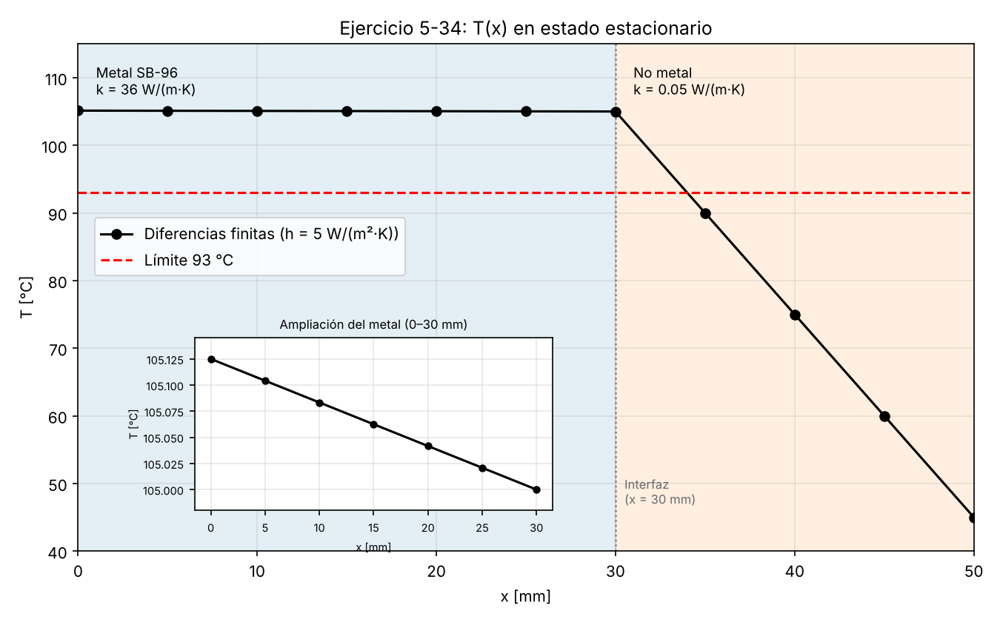

# Ejercicio original 5-34 — Versión 1

Esta sección reúne la conversación con Claude, el reporte original, el código, la gráfica de temperaturas y la auditoría de la primera versión.

## 1. Conversación con Claude

Registro del prompt inicial, las respuestas recibidas y las solicitudes de conversión de formato.

[Consultar la conversación con Claude](Conversacion_con_Claude.md)

## 2. Reporte original

Reporte generado por Claude antes de aplicar las observaciones de la auditoría.

- [Consultar el reporte en PDF](Reporte_original_v1.pdf)
- [Consultar el reporte en Markdown](reporte_original_v1.md)

## 3. Código y gráfica

Código de Python y gráfica correspondientes a la solución del ejercicio.

- [Consultar el código de Python](ej_5_34_v1.py)
- [Abrir la gráfica de temperaturas](T_vs_x_5_34_v1.png)

## 4. Auditoría del reporte

Documento con comentarios sobre errores, aspectos que requieren aclaración y comparación de los resultados con los cálculos manuales.

[Consultar la auditoría del reporte 1](Auditoria_del_reporte_1.pdf)
