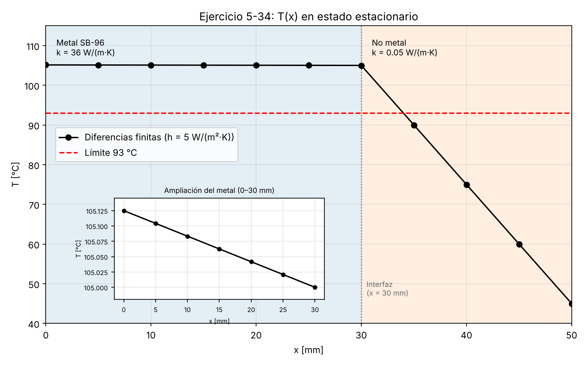

# Ejercicio 5-34: conducción unidimensional estacionaria en una pared compuesta (diferencias finitas)

**Versión:** v2 (informe original corregido)
**Archivos:** `reporte_original_v2.md`, `ej_5_34_v2.py`, `T_vs_x_5_34_v2.png`

## Material de referencia consultado

| Archivo | Páginas del PDF consultadas | Uso |
|---|---|---|
| `092126 2.pdf` | pág. 1 (instrucciones y rúbrica), pág. 2 (enunciado del 5-34, pág. 368 del libro), pág. 3 (Figura P5-34) | Datos, preguntas y numeración de nodos |
| `Libreta.pdf` | págs. 11–12 (sección 5-3, diapositivas 13–20) | Balance de energía en un elemento de volumen, nodo interior, fronteras con flujo especificado y convección, interfaz con contacto perfecto |
| `Libreta Examen 2.pdf` | págs. 2–3 (sección 3-1, diapositivas 5–11) | Resistencia térmica, resistencia de convección, red de resistencias, caída de temperatura ΔT = QR y paredes multicapa |

Las referencias a diapositivas indican el número impreso en cada archivo (cuatro por página del PDF). No se consultó la plantilla de prompts del GitHub de la clase, porque no estaba adjunta.

---

## A. Objetivo y descripción del sistema

**Objetivo.** Determinar la temperatura en los 11 nodos de una pared compuesta mediante diferencias finitas, graficar T(x), evaluar si el metal cumple el límite de 93 °C del enunciado y hallar el coeficiente de convección $h$ umbral.

**Sistema.** Una placa de cobre-silicio ASME SB-96 (metal, 30 mm) soporta sobre su superficie superior una placa no metálica (20 mm). Por la superficie 1 (inferior del metal) entra un flujo de calor uniforme. En este problema, el calor fluye en la dirección $+x$, desde la base caliente hacia la superficie expuesta al aire, y sale por convección desde la superficie 2 (superior del no metal).

**Incógnitas.** Las temperaturas nodales $T_0, T_1, \dots, T_{10}$.

**Flujo y tasa.** El flujo de calor $q''$ se mide en W/m². La tasa de transferencia de calor es $\dot Q = q'' A$, en W. La energía $E$ se mide en J. Como $A$ es la misma en toda la pared, se cancela en cada balance.

### Datos (verificados contra el enunciado y la Figura P5-34)

| Dato | Símbolo | Valor | Unidad |
|---|---|---|---|
| Conductividad del metal (SB-96) | $k_m$ | 36 | W/(m·K) |
| Espesor del metal | $L_m$ | 0.030 | m |
| Conductividad del no metal | $k_n$ | 0.05 | W/(m·K) |
| Espesor del no metal | $L_n$ | 0.020 | m |
| Flujo de calor entrante en la superficie 1 | $q''$ | 150 | W/m² |
| Coeficiente de convección en la superficie 2 | $h$ | 5 | W/(m²·K) |
| Temperatura del aire | $T_\infty$ | 15 | °C |
| Espaciamiento nodal | $\Delta x$ | 0.005 | m |
| Límite de temperatura de la placa SB-96 | $T_{lim}$ | 93 | °C |

Todos los valores coinciden con el enunciado (págs. 2–3 del PDF). Con $\Delta x = 5$ mm hay 6 intervalos en el metal y 4 en el no metal, es decir 11 nodos, consistente con la Figura P5-34 (nodos 0 a 10, interfaz en el nodo 6).

El enunciado pide: la temperatura en cada nodo, la gráfica de T(x), si el uso de la placa SB-96 cumple el límite de 93 °C y el menor valor de $h$ para que la placa quede por debajo de 93 °C.

---

## B. Suposiciones

**Condiciones dadas por el enunciado:** flujo uniforme de 150 W/m² en la superficie 1, convección en la superficie 2 con $T_\infty = 15$ °C y $h = 5$ W/(m²·K), espesores, conductividades, $\Delta x$ y límite de 93 °C.

**Suposiciones adoptadas:**

| Suposición | Justificación y efecto en los balances |
|---|---|
| Estado estacionario | El enunciado no lo dice de forma explícita. Es una interpretación consistente con los datos: da un flujo y una convección constantes y compara con un límite de temperatura, pero no da densidad, calor específico, condición inicial ni tiempos. La energía almacenada no cambia, así que la acumulación es cero. Las diferencias finitas aquí discretizan solo el espacio, por lo que usarlas no vuelve el problema transitorio. |
| Conducción unidimensional | Los efectos laterales se suponen despreciables, por lo que $T = T(x)$. La temperatura es uniforme en cada plano perpendicular a $x$, pero no es uniforme a través del espesor: varía con $x$. |
| Conductividad constante en cada material | Se usan los valores dados, $k_m$ y $k_n$. No se presentan datos que validen esta aproximación en el intervalo de temperaturas del problema. |
| Sin generación interna | Se adopta la ausencia de fuentes volumétricas dentro de los materiales: $\dot e_{gen} = 0$. Que el calor entre por una superficie no demuestra, por sí solo, que no pueda existir generación interna. El flujo impuesto es una condición de frontera (calor que cruza la superficie 1), mientras que la generación sería energía producida dentro del material. Aquí se supone que solo existe el primero. |
| Contacto térmico perfecto | No hay resistencia de contacto en la interfaz: se supone una sola temperatura $T_6$ en la unión. |
| Radiación despreciable | El enunciado solo da un coeficiente de convección $h$, que en este modelo es exclusivamente convectivo. No se añade ningún término radiativo. |

---

## C. Distribución de los nodos

La coordenada $x$ parte de la superficie 1 (inferior del metal) hacia la superficie 2 (superior del no metal), con $\Delta x = 0.005$ m.

| Nodo | $x$ (mm) | Ubicación | Condición |
|---|---|---|---|
| 0 | 0 | Superficie 1 (frontera, metal) | Flujo de calor impuesto |
| 1–5 | 5–25 | Interior del metal | Balance de energía interior |
| 6 | 30 | Interfaz metal/no metal | Contacto perfecto |
| 7–9 | 35–45 | Interior del no metal | Balance de energía interior |
| 10 | 50 | Superficie 2 (frontera, no metal) | Convección |

---

## D. Formulación por diferencias finitas

### Balance general de energía

Para el elemento de volumen alrededor de un nodo (Libreta.pdf, pág. 11, diapositiva 13):

$$\text{Entrada} - \text{salida} + \text{generación} = \text{acumulación}$$

La diapositiva lo escribe como una suma algebraica de las tasas de transferencia de calor que llegan al elemento por ambos lados más la generación:

$$\dot Q_{izq} + \dot Q_{der} + \dot E_{gen,elem} = \frac{\Delta E_{elem}}{\Delta t}$$

En esta forma, cada $\dot Q$ se cuenta como entrada positiva al elemento. Un valor negativo representa calor que sale.

**Simplificación.** En estado estacionario, la acumulación $\Delta E_{elem}/\Delta t$ es cero. Sin generación, $\dot E_{gen,elem} = \dot e_{gen} V_{elem} = 0$. Queda

$$\sum \dot Q_{entra} = 0$$

que es una **suma algebraica**: los términos negativos son calor que sale del elemento. Con $\dot Q = q'' A$, el área $A$ es común a todos los términos y se cancela, de modo que cada ecuación es un balance de flujos de calor en W/m².

### Convención de signos del balance de energía y distancias

Cada término de conducción se escribe como entrada positiva al nodo:

$$q''_{vecino \to nodo} = k\,\frac{T_{vecino} - T_{nodo}}{\Delta x}$$

Esta es la convención de signos del balance de energía. Si el valor resulta negativo, el calor sale del nodo hacia ese vecino. En este problema, el calor fluye en la dirección $+x$ porque $T$ disminuye al aumentar $x$.

**Ancho del volumen frente a distancia entre nodos.** El volumen de control de un nodo interior tiene ancho $\Delta x$. El de un nodo de frontera tiene ancho $\Delta x/2$, porque se extiende solo hacia el interior del material (Libreta.pdf, págs. 11–12, diapositivas 13, 16 y 17). Aun así, la conducción entre un nodo de frontera y su vecino se calcula con la distancia $\Delta x$ entre nodos. Como $\dot e_{gen} = 0$ y el régimen es estacionario, el ancho del volumen no aparece en las ecuaciones finales.

### Nodo 0: frontera con flujo impuesto (diapositiva 17)

El volumen de control tiene ancho $\Delta x/2$ y área $A$. Balance en tasas de transferencia de calor (W):

$$\underbrace{q''\,A}_{\text{flujo impuesto}} + \underbrace{k_m A\,\frac{T_1 - T_0}{\Delta x}}_{\text{conducción desde el nodo 1}} + \underbrace{\dot e_{gen}\,A\,\frac{\Delta x}{2}}_{=\,0} = 0$$

Al dividir entre $A$, queda el balance en W/m²:

$$q'' + k_m\,\frac{T_1 - T_0}{\Delta x} = 0$$

### Nodo interior del metal, $i = 1, \dots, 5$ (diapositiva 14)

Volumen de control de ancho $\Delta x$:

$$k_m A\,\frac{T_{i-1} - T_i}{\Delta x} + k_m A\,\frac{T_{i+1} - T_i}{\Delta x} = 0 \;\;\Longrightarrow\;\; T_{i-1} - 2T_i + T_{i+1} = 0$$

### Nodo interior del no metal, $i = 7, 8, 9$ (diapositiva 14)

$$k_n A\,\frac{T_{i-1} - T_i}{\Delta x} + k_n A\,\frac{T_{i+1} - T_i}{\Delta x} = 0 \;\;\Longrightarrow\;\; T_{i-1} - 2T_i + T_{i+1} = 0$$

### Nodo 6: interfaz (diapositiva 20, ecuación 5-29)

El volumen de control es medio metal y medio no metal. Balance en W:

$$k_m A\,\frac{T_5 - T_6}{\Delta x} + k_n A\,\frac{T_7 - T_6}{\Delta x} = 0 \;\;\Longrightarrow\;\; k_m\,\frac{T_5 - T_6}{\Delta x} + k_n\,\frac{T_7 - T_6}{\Delta x} = 0$$

Ambos términos están escritos como entradas positivas al nodo. El calor llega desde el metal ($T_5 > T_6$) y sale hacia el no metal ($T_6 > T_7$), por lo que el segundo término es negativo y la suma da cero. Cada lado conserva su propia conductividad.

Dos ideas distintas, con causas distintas:

- **La temperatura es continua** por la suposición de contacto térmico perfecto: se adopta una sola temperatura $T_6$ para la unión.
- **El flujo se conserva** por el balance de energía en estado estacionario y sin generación: el elemento de la interfaz no acumula ni produce energía, así que el calor que llega desde el metal es igual al que sale hacia el no metal.

La conservación del flujo no depende del contacto perfecto. Si existiera una resistencia de contacto, el flujo seguiría conservándose en estado estacionario, pero habría un salto de temperatura en la unión. Ese caso no se incluye en este modelo.

**Promedio ponderado.** Despejando $T_6$ del balance:

$$T_6 = \frac{k_m T_5 + k_n T_7}{k_m + k_n}$$

Los pesos se reducen a las conductividades porque las distancias del nodo 6 a sus vecinos son iguales ($\Delta x$ a cada lado) y se cancelan en el balance. No es un promedio aritmético simple: los pesos son $36/36.05 \approx 99.86\,\%$ para $T_5$ y $0.05/36.05 \approx 0.14\,\%$ para $T_7$.

### Nodo 10: frontera con convección (diapositiva 18)

El volumen de control tiene ancho $\Delta x/2$ y área $A$. Balance en W:

$$\underbrace{k_n A\,\frac{T_9 - T_{10}}{\Delta x}}_{\text{conducción desde el nodo 9}} + \underbrace{h\,A\,(T_\infty - T_{10})}_{\text{convección con el aire}} + \underbrace{\dot e_{gen}\,A\,\frac{\Delta x}{2}}_{=\,0} = 0$$

Al dividir entre $A$:

$$k_n\,\frac{T_9 - T_{10}}{\Delta x} + h\,(T_\infty - T_{10}) = 0$$

---

## E. Solución

### Las 11 ecuaciones

Con $k_m/\Delta x = 36/0.005 = 7200$ W/(m²·K) y $k_n/\Delta x = 0.05/0.005 = 10$ W/(m²·K).

**Cómo recuperar los coeficientes dimensionales.** Las ecuaciones interiores en temperatura ($T_{i-1} - 2T_i + T_{i+1} = 0$) se multiplican por $k/\Delta x$ para convertirlas en balances de flujo en W/m². Los residuos de la sección H se evalúan con esta forma.

| # | Nodo | Balance de flujo (W/m²) |
|---|---|---|
| 1 | 0 | $-7200\,T_0 + 7200\,T_1 = -150$ |
| 2 | 1 | $7200\,T_0 - 14400\,T_1 + 7200\,T_2 = 0$ |
| 3 | 2 | $7200\,T_1 - 14400\,T_2 + 7200\,T_3 = 0$ |
| 4 | 3 | $7200\,T_2 - 14400\,T_3 + 7200\,T_4 = 0$ |
| 5 | 4 | $7200\,T_3 - 14400\,T_4 + 7200\,T_5 = 0$ |
| 6 | 5 | $7200\,T_4 - 14400\,T_5 + 7200\,T_6 = 0$ |
| 7 | 6 | $7200\,T_5 - 7210\,T_6 + 10\,T_7 = 0$ |
| 8 | 7 | $10\,T_6 - 20\,T_7 + 10\,T_8 = 0$ |
| 9 | 8 | $10\,T_7 - 20\,T_8 + 10\,T_9 = 0$ |
| 10 | 9 | $10\,T_8 - 20\,T_9 + 10\,T_{10} = 0$ |
| 11 | 10 | $10\,T_9 - 15\,T_{10} = -75$ |

La ecuación 11 sale de $10(T_9 - T_{10}) + 5(15 - T_{10}) = 0$.

### Notación matricial

Las 11 ecuaciones se escriben como

$$\mathbf M\,\mathbf T = \mathbf b$$

- $\mathbf M$ es la **matriz de coeficientes** (11 × 11, en W/(m²·K)). Cada fila contiene los coeficientes de las temperaturas en el balance de un nodo. Por ejemplo, la fila 7 es $[\,\dots, 7200, -7210, 10, \dots\,]$ en las columnas de $T_5$, $T_6$ y $T_7$.
- $\mathbf T$ es el **vector de temperaturas desconocidas** $[T_0, T_1, \dots, T_{10}]^T$, en °C.
- $\mathbf b$ es el **vector de términos independientes** (en W/m²): $-150$ en la fila 1 (el flujo impuesto pasa al lado derecho), $-75$ en la fila 11 (el término $-h\,T_\infty$) y cero en las demás.

Se usa $\mathbf M$ para evitar confusión con el área $A$. Esta misma notación se usa en los residuos y en el código.

### Procedimiento algebraico a mano

1. Ec. 1: $T_0 - T_1 = 150/7200 = 1/48$ K.
2. Ec. 2 (nodo 1): $T_0 - T_1 = T_1 - T_2$, así que $T_1 - T_2 = 1/48$ K. Lo mismo en los nodos 2, 3 y 4: $T_2 - T_3 = T_3 - T_4 = T_4 - T_5 = 1/48$ K.
3. Ec. 6 (nodo 5): $7200(T_4 - T_5) = 7200(T_5 - T_6)$. Como $T_4 - T_5 = 1/48$, resulta $T_5 - T_6 = 1/48$ K.
4. Entonces $T_0 - T_6 = 6 \times \tfrac{1}{48} = 0.125$ K, es decir $T_6 = T_0 - 0.125$.
5. Ec. 7 (interfaz): $7200(T_5 - T_6) = 10(T_6 - T_7)$. Con $T_5 - T_6 = 1/48$: $150 = 10(T_6 - T_7)$, así que $T_6 - T_7 = 15$ K.
6. Ecs. 8 a 10: $T_6 - T_7 = T_7 - T_8 = T_8 - T_9 = T_9 - T_{10} = 15$ K. Por tanto $T_{10} = T_6 - 60$.
7. Ec. 11 con $T_9 = T_{10} + 15$: $10(T_{10} + 15) - 15\,T_{10} = -75 \Rightarrow 150 - 5\,T_{10} = -75 \Rightarrow T_{10} = 45$ °C.
8. Hacia atrás: $T_6 = 45 + 60 = 105$ °C y $T_0 = 105 + 0.125 = 105.125$ °C. Los demás nodos salen de sumar $1/48$ K por nodo en el metal y 15 K por nodo en el no metal.

### Solución computacional

`ej_5_34_v2.py` construye $\mathbf M$ y $\mathbf b$ de la tabla anterior y las resuelve con `numpy.linalg.solve`.

- **Solucionador:** función que resuelve simultáneamente las 11 ecuaciones $\mathbf M\,\mathbf T = \mathbf b$.
- **Residuo:** desequilibrio que queda al sustituir las temperaturas calculadas en una ecuación.
- **Punto flotante:** representación numérica de precisión limitada, que puede producir pequeñas diferencias de cálculo del orden de $10^{-14}$ a $10^{-11}$.

**Ejecución:**

```bash
pip install numpy matplotlib
python3 ej_5_34_v2.py
```

Bibliotecas: `numpy`, `matplotlib` y `fractions` (incluida en Python). El script imprime temperaturas, flujos, residuos, la comparación con resistencias y el análisis de $h$, y guarda `T_vs_x_5_34_v2.png`. El valor umbral de $h$ se calcula en el código a partir de las variables de entrada.

---

## F. Resultados e interpretación

### Temperaturas (resultado real de la ejecución, redondeado a 4 decimales)

| Nodo | $x$ (mm) | Zona | $T$ (°C) |
|---|---|---|---|
| 0 | 0 | Frontera, flujo impuesto | 105.1250 |
| 1 | 5 | Metal | 105.1042 |
| 2 | 10 | Metal | 105.0833 |
| 3 | 15 | Metal | 105.0625 |
| 4 | 20 | Metal | 105.0417 |
| 5 | 25 | Metal | 105.0208 |
| 6 | 30 | Interfaz | 105.0000 |
| 7 | 35 | No metal | 90.0000 |
| 8 | 40 | No metal | 75.0000 |
| 9 | 45 | No metal | 60.0000 |
| 10 | 50 | Frontera, convección | 45.0000 |

### Gráfica



La gráfica muestra T (°C) frente a $x$ (mm), con el metal y el no metal sombreados, la interfaz en $x = 30$ mm, el límite de 93 °C y una ampliación del perfil dentro del metal.

### Pendientes (ley de Fourier)

Con $q'' = -k\,\dfrac{dT}{dx}$ y $q'' = +150$ W/m² en la dirección $+x$:

- Metal: $\dfrac{dT}{dx} = -\dfrac{150}{36} = -4.1667$ K/m.
- No metal: $\dfrac{dT}{dx} = -\dfrac{150}{0.05} = -3000$ K/m.

Ambas son negativas porque $T$ disminuye al aumentar $x$. La pendiente del metal es pequeña, pero no es cero: suma 0.125 °C a lo largo de 30 mm, y sin ese gradiente no habría flujo de calor. La magnitud de la pendiente del no metal es 720 veces mayor que la del metal, que es la razón $k_m/k_n$ (el script da $720.000000$). La ampliación del metal muestra esa caída lineal de 105.125 a 105.000 °C.

### Caídas de temperatura (resultado real de la ejecución)

Una diferencia de temperatura de 1 K equivale a una diferencia de 1 °C, por lo que las caídas se pueden expresar en cualquiera de las dos unidades. Esto no significa que las temperaturas absolutas en ambas escalas sean iguales.

| Tramo | $\Delta T$ (°C o K) | $R''$ (m²·K/W) |
|---|---|---|
| Dentro del metal ($T_0 - T_6$) | 0.125 | $\approx 8.333\times10^{-4}$ |
| Dentro del no metal ($T_6 - T_{10}$) | 60 | 0.4 |
| Superficie exterior − aire ($T_{10} - T_\infty$) | 30 | 0.2 |
| Total ($T_0 - T_\infty$) | 90.125 | $\approx 0.600833$ |

Con el mismo flujo, la caída es proporcional a $R''$ (Libreta Examen 2.pdf, pág. 3, diapositiva 9). En el no metal, $R'' = L/k$ es unas 480 veces la del metal, por eso ahí se concentra la caída de los dos sólidos. Los 30 °C de la tercera fila son la diferencia entre la superficie exterior y el aire, no una caída dentro de un material. En la interfaz no hay salto de temperatura: $T_6 = 105$ °C desde ambos lados.

### Temperatura máxima y cumplimiento del límite

La temperatura máxima del metal es $T_0 = 105.125$ °C, en $x = 0$ (superficie 1). Excede el límite de 93 °C en 12.125 °C. Con el límite del enunciado, **el uso de la placa SB-96 en estas condiciones no cumpliría**. Esta conclusión es solo respecto al límite que da el ejercicio, no una certificación normativa del equipo.

---

## G. Coeficiente de convección requerido

La temperatura máxima, en función de $h$, es

$$T_0 = T_\infty + q''\left(\frac{1}{h} + \frac{L_n}{k_n} + \frac{L_m}{k_m}\right)$$

Con $T_0 = 93$ °C y los demás datos constantes:

1. $\dfrac{93 - 15}{150} = 0.52$ m²·K/W.
2. $\dfrac{1}{h} = 0.52 - \dfrac{0.020}{0.05} - \dfrac{0.030}{36} = 0.52 - 0.4 - 0.000833\ldots = \dfrac{143}{1200}$ m²·K/W.
3. $h^* = \dfrac{1200}{143} = 8.391608\ldots$ W/(m²·K).

**Unidades:** todos los términos de $1/h$ están en m²·K/W, así que $h$ queda en W/(m²·K).

**Comprobación por sustitución** (resultado real de la ejecución, resolviendo el sistema completo):

| $h$ (W/(m²·K)) | $T_0$ (°C) | Respecto a 93 °C |
|---|---|---|
| $h^* = 1200/143$ | 93.000000 | $T_{máx} = 93$ °C |
| $h^* + 0.001$ | 92.997870 | Por debajo |
| 8.39 (redondeado por debajo del umbral) | 93.003427 | Por encima |
| 8.5 | 92.772059 | Por debajo, margen de 0.227941 °C |

**Dos condiciones distintas:**

- $h = 1200/143$ W/(m²·K) produce $T_{máx} = 93$ °C.
- Para $T_{máx} < 93$ °C se requiere $h > 1200/143$ W/(m²·K).

Si $h$ puede variar de forma continua, no existe un menor valor alcanzable para la condición estricta: cualquier valor superior al umbral cumple, y siempre hay otro más cercano al umbral que también cumple. Un valor redondeado hacia abajo, como 8.39, no cumple. $h = 8.5$ W/(m²·K) es un ejemplo que cumple, no el mínimo exacto.

---

## H. Comprobaciones

### Definición de residuo

El residuo de una ecuación es el desequilibrio que queda al sustituir las temperaturas calculadas en ella. Aquí se calcula como $\mathbf r = \mathbf M\,\mathbf T - \mathbf b$, con las ecuaciones expresadas como balances de flujo en W/m² (tabla de la sección E) y con las **temperaturas numéricas sin redondear** de `numpy.linalg.solve`.

### Residuos (resultado real de esta ejecución)

| Nodo | Residuo (W/m²) |
|---|---|
| 0 a 8 | 0 |
| 9 | $1.421\times10^{-14}$ |
| 10 | $-2.842\times10^{-14}$ |
| Máximo en valor absoluto | $2.842\times10^{-14}$ |

Los residuos distintos de cero son diferencias de punto flotante. Un residuo pequeño indica que el solucionador resolvió el sistema que se le dio, pero no es prueba suficiente de que el planteamiento físico sea correcto. Por eso se complementa con las comprobaciones siguientes.

### Solución independiente por resistencias térmicas (Libreta Examen 2.pdf, págs. 2–3, diapositivas 5–11)

Resistencias por unidad de área, $R''$ en m²·K/W, calculadas con precisión completa:

- $R''_m = L_m/k_m = 0.030/36 \approx 8.333\times10^{-4}$
- $R''_n = L_n/k_n = 0.020/0.05 = 0.4$
- $R''_{conv} = 1/h = 0.2$

Las resistencias en K/W son $R = R''/A$, es decir $L/(kA)$ y $1/(hA)$. Aquí se trabaja por unidad de área.

Con $q'' = 150$ W/m² constante en toda la cadena:

- $T_{10} = 15 + 150(0.2) = 45$ °C
- $T_6 = 45 + 150(0.020/0.05) = 105$ °C
- $T_0 = 105 + 150\,(0.030/36) = 105.125$ °C

Aquí $150 \times (0.030/36) = 0.125$ exactamente, porque se conserva la fracción en lugar de sustituir $8.333\times10^{-4}$.

Comparando los 11 nodos (perfil lineal dentro de cada material) con la solución numérica, la diferencia máxima fue $5.726\times10^{-11}$ °C (resultado real de esta ejecución), una diferencia de punto flotante, no un error de ecuaciones.

### Flujo en cada tramo (resultado real de esta ejecución)

$q'' = k\,(T_i - T_{i+1})/\Delta x$ dio **150.000000000 W/m²** en los diez tramos, y el flujo convectivo $h\,(T_{10} - T_\infty)$ dio 150.000000000 W/m².

### Tabla de comprobaciones

| Resultado o ecuación | Método de comprobación | Resultado |
|---|---|---|
| Temperaturas nodales | Solución independiente por resistencias | Coinciden; diferencia máxima $5.726\times10^{-11}$ °C |
| Balance global | $q''_{in}$ frente a $h\,(T_{10} - T_\infty)$ | $150 = 5 \times 30 = 150$ W/m² |
| Flujo en cada tramo | $k\,(T_i - T_{i+1})/\Delta x$, 10 tramos | 150.000000000 W/m² en todos |
| Continuidad del flujo en la interfaz | Tramos 5→6 y 6→7 | 150.000000000 W/m² en ambos |
| Condición de frontera, nodo 0 | Residuo de la ec. 1 | 0 |
| Condición de frontera, nodo 10 | Residuo de la ec. 11 | $-2.842\times10^{-14}$ W/m² |
| Residuos de las 11 ecuaciones | $\mathbf M\,\mathbf T - \mathbf b$ en W/m², $T$ sin redondear | Máximo $2.842\times10^{-14}$ W/m² |
| Coherencia física | Signo de las pendientes y unidades | $T$ baja con $x$; unidades consistentes |

### Efecto del redondeo

Si se verifica la ecuación de la interfaz con temperaturas redondeadas a 4 decimales, por ejemplo $T_5 \approx 105.0208$, resulta $7200\,(T_5 - 105) \approx 7200 \times 0.0208 = 149.76$ W/m² y no 150. Esa diferencia es de redondeo, no un error de las ecuaciones: con $T_5 - T_6 = 1/48$ exacto, $7200/48 = 150$ W/m².

---

## Información adicional para la etapa siguiente (sin desarrollar)

Para demostrar un calentamiento o enfriamiento más rápido se necesitará un análisis transitorio. Una temperatura estacionaria menor no implica un menor tiempo de enfriamiento. Faltarían: densidad $\rho$ y calor específico $c_p$ de cada capa (no están en el enunciado y no se inventan), la condición inicial, qué ocurre con el flujo de 150 W/m² durante el proceso y un criterio de tiempo. Una temperatura inicial uniforme sería una condición nueva, no el perfil estacionario calculado aquí.

---

## Cálculos que deben contrastar con su solución manual

1. Los coeficientes $7200$, $7210$, $10$ y $15$, y los términos independientes $-150$ y $-75$.
2. Los pasos 1 a 8 del procedimiento algebraico, en especial $T_5 - T_6 = 1/48$ K y $T_6 - T_7 = 15$ K.
3. Las 11 temperaturas, con $T_0 = 105.125$ °C, $T_6 = 105$ °C y $T_{10} = 45$ °C.
4. Las pendientes $-4.1667$ K/m y $-3000$ K/m, con su signo, y la razón de magnitudes 720.
5. Las tres caídas de temperatura: 0.125 °C, 60 °C y 30 °C.
6. El despeje de $h^* = 1200/143$, la condición $h > 1200/143$ y la sustitución de $h = 8.5$ W/(m²·K).
7. La comprobación por resistencias con $0.030/36$, $0.020/0.05$ y $1/h$.
8. El efecto del redondeo en la ecuación de la interfaz (149.76 frente a 150 W/m²).

## Comprobaciones pendientes

- Contraste con la solución manual de ustedes: **pendiente**. Este informe solo contiene verificaciones hechas con código y por resistencias.
- Las referencias a diapositivas deben confirmarse al abrir los archivos de clase.

---

## Registro de cambios respecto a la versión 1

Los resultados numéricos y las ecuaciones no cambiaron. Los cambios son los siguientes, y no corresponden a errores de cálculo.

**Aclaraciones de redacción**

| Tema | Cambio |
|---|---|
| Dirección del calor | "El calor físico va siempre en $+x$" pasó a "en este problema, el calor fluye en la dirección $+x$, desde la base caliente hacia la superficie expuesta al aire". |
| Convención de signos | "Convención de contabilidad" pasó a "convención de signos del balance de energía". |
| Comparación de pendientes | "720 veces mayor" pasó a "la magnitud de la pendiente del no metal es 720 veces mayor que la del metal", conservando los signos negativos. |
| Unidades de diferencias de temperatura | Se añadió que 1 K equivale a 1 °C en diferencias, sin que las temperaturas absolutas sean iguales. |
| Condición sobre $h$ | Se distingue $h = 1200/143$ ($T_{máx} = 93$ °C) de $h > 1200/143$ ($T_{máx} < 93$ °C), y se explica que no existe un menor valor para la condición estricta. |

**Mejoras del desarrollo**

| Tema | Cambio |
|---|---|
| Generación interna | Se aclara que su ausencia es una suposición y se distingue el flujo impuesto en la frontera de la generación dentro del material. |
| Balance general | Se presenta primero entrada − salida + generación = acumulación, y se explica la suma algebraica. |
| Nodos 0 y 10 | Se desarrolla el balance en W con el área $A$ y luego se divide entre $A$, identificando los términos de flujo impuesto, conducción y convección. |
| Interfaz | Se separan la continuidad de temperatura (contacto perfecto) y la conservación del flujo (balance estacionario sin generación), se comenta el caso con resistencia de contacto y se explica que los pesos del promedio ponderado se reducen a las conductividades por tener distancias iguales. |
| Notación matricial | Se explica qué son la matriz de coeficientes, el vector de temperaturas y el vector de términos independientes. |
| Términos de computación | Se definen residuo, solucionador y punto flotante. |

**Ajustes de notación o redondeo**

| Tema | Cambio |
|---|---|
| Matriz | Se usa $\mathbf M$ en lugar de $A$ en el informe, los residuos ($\mathbf r = \mathbf M\,\mathbf T - \mathbf b$) y el código. |
| Resistencias | La comprobación usa $0.030/36$ con precisión completa; los valores redondeados se muestran con $\approx$. |
| Código | $h^*$ se calcula a partir de las variables de entrada, sin repetir los datos como números independientes en la fórmula. La tabla de $h$ ya no incluye el caso $h = 8.3916$ de la v1. |
| Resultados | Todas las tablas numéricas, residuos y comparaciones provienen de la ejecución de `ej_5_34_v2.py`. |
