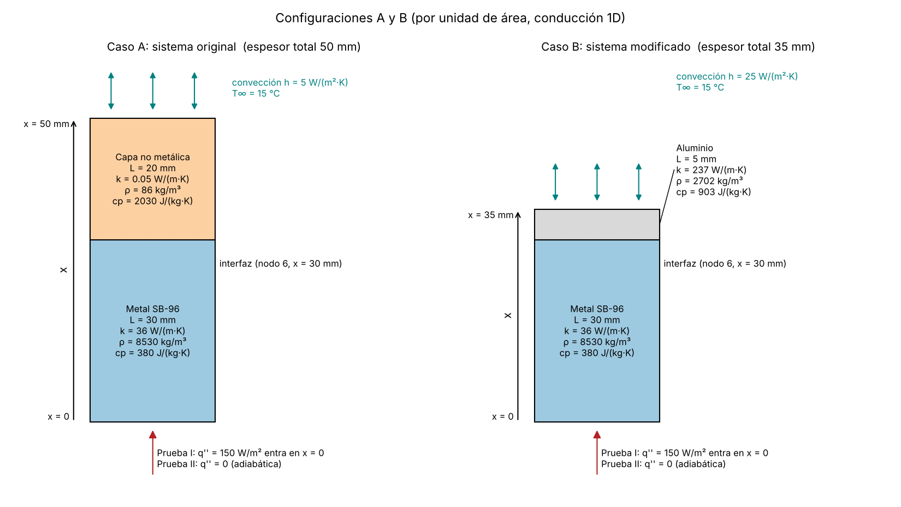
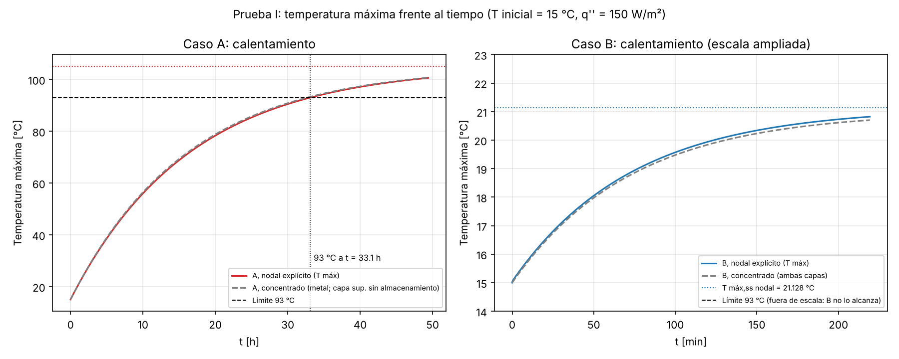
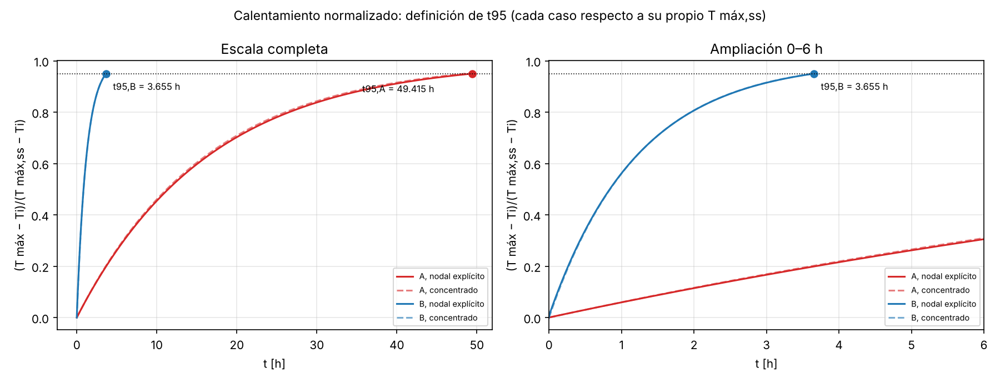
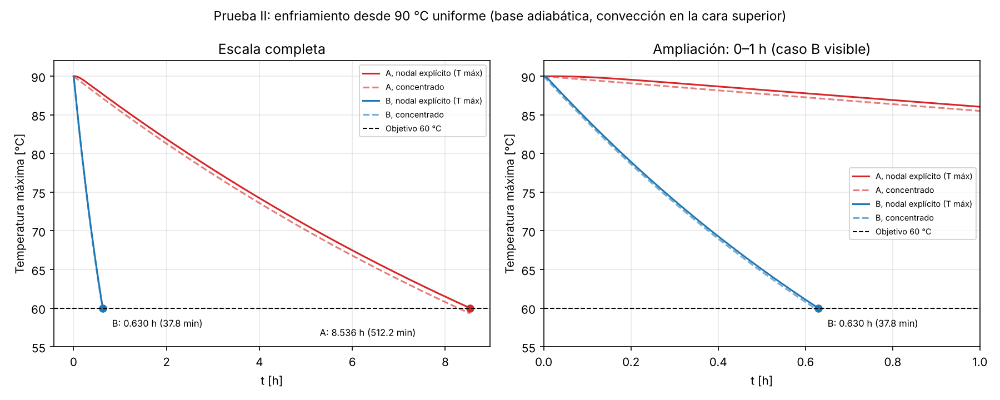

# Ejercicio modificado 5-34: análisis transitorio y mejora del enfriamiento

## 1. Portada

**Versión:** versión 1 del ejercicio modificado

**Estudiantes:**

1. Karina Hernández Cruz.
2. Claudia Román García.

**Curso:** Transferencia de Calor, proyecto de métodos numéricos.

**Fecha de generación del borrador:** 25 de octubre de 2026.

**Estado:** borrador generado con asistencia de IA, pendiente de auditoría manual y de firmas.

**Archivos de esta entrega:** reporte_modificado_v1.md, Reporte_modificado_v1.docx, Reporte_modificado_v1.pdf, ej_5_34_modificado_v1.py, esquema_casos_modificado_v1.png, calentamiento_modificado_v1.png, calentamiento_normalizado_modificado_v1.png, enfriamiento_modificado_v1.png, resultados_modificado_v1.csv, convergencia_modificado_v1.csv.

**Uso de IA y archivos para GitHub.** Este reporte y el código fueron producidos con asistencia de IA a partir del prompt de la fase 2. El prompt, esta respuesta y los archivos listados deben conservarse en el repositorio del grupo. Las comprobaciones de la sección 12 las ejecutó el código. Las verificaciones manuales de las estudiantes se harán después y se registrarán en la sección 16. Este documento no afirma que las estudiantes hayan verificado ninguno de los cálculos nuevos.

**Denominación.** Esta es la versión 1 del ejercicio modificado. No es una versión del ejercicio original y no modifica los reportes aprobados del ejercicio original.

**Documentos consultados y no consultados.** Se abrieron las instrucciones y la rúbrica del profesor (`092126 2.pdf`) y se buscó texto en los apuntes adjuntos (`Libreta.pdf`, `Libreta Examen 2.pdf`, `Libreta Heat Transfer examen .pdf`). No estaban disponibles en la sesión `Problem_5-34_Base_and_Adapted.pdf` ni `Revision_y_ajustes_Ejercicio_modificado_5_34.pdf`, ni el libro de texto, ni la plantilla de prompts de GitHub. Por eso no se afirma haberlos consultado ni se comparan resultados con esos documentos. Las condiciones del ejercicio modificado son las explícitas en el prompt. Los valores de contraste que el prompt atribuye a una revisión previa se usan solo como referencia en las secciones 10, 11 y 12.

## 2. Objetivo y relación con el ejercicio original

El ejercicio original 5-34 es una pared compuesta (placa metálica SB-96 y capa no metálica) en **estado estacionario** con flujo de calor impuesto en la cara inferior y convección en la superior. Su análisis, ya aprobado, se resolvió por diferencias finitas con $\Delta x = 5$ mm y 11 nodos. Aquí se conserva ese análisis: la solución estacionaria sigue siendo válida y el transitorio no la invalida. El estado estacionario da las temperaturas finales y permite verificar el límite térmico de 93 °C. El transitorio es necesario para obtener tiempos.

**Objetivo.** Adaptar el ejercicio cambiando el material, la geometría y la convección, y demostrar cuantitativamente un **enfriamiento significativamente más rápido** entre las mismas temperaturas inicial (90 °C) y objetivo (60 °C). También se conserva el análisis de calentamiento para estudiar la evolución hacia el estado estacionario y verificar el límite térmico.

Estabilizarse antes hacia una temperatura final distinta **no demuestra por sí solo** un enfriamiento más rápido entre temperaturas comunes. Por eso la demostración principal es la prueba II (sección 11), con temperaturas inicial y objetivo comunes.

Este reporte no repite el desarrollo completo del ejercicio original. Solo se incluye lo necesario para entender y comparar la adaptación.

**Discrepancias respecto del documento base.** No se pudo abrir el documento base (sección 1), así que no se puede afirmar si existen discrepancias con él ni se copió nada de él. Se usaron las condiciones explícitas del prompt. Dentro del prompt no se encontró ninguna contradicción interna en los datos.

## 3. Enunciado del ejercicio modificado

Se tiene una placa inferior de cobre-silicio SB-96 de 30 mm sobre la que se apoya una capa superior. Se estudian por unidad de área transversal dos configuraciones:

- **Caso A (sistema original):** capa superior no metálica de 20 mm, $h = 5$ W/(m²·K).
- **Caso B (sistema modificado):** capa superior de aluminio de 5 mm, $h = 25$ W/(m²·K).

Para cada configuración se pide:

1. **Prueba I, calentamiento:** con $T(x,0) = 15$ °C y un flujo constante de 150 W/m² en $x = 0$ desde $t = 0$, hallar la temperatura máxima estacionaria, si se alcanza 93 °C y cuándo, y el tiempo $t_{95}$.
2. **Prueba II, enfriamiento:** con $T(x,0) = 90$ °C uniforme, flujo impuesto igual a cero en $x = 0$ (cara adiabática) y convección hacia aire a 15 °C en la cara superior, hallar el tiempo hasta que la temperatura máxima de todo el sistema baja a 60 °C.
3. Comparar los tiempos de enfriamiento de A y B y sustentar cuantitativamente la reducción.

Las temperaturas de 90 °C y 60 °C son condiciones elegidas para una comparación común. No son datos del ejercicio original.

## 4. Configuraciones A y B

Son **dos configuraciones físicas** sometidas a **dos condiciones de operación** (prueba I y prueba II). No son cuatro diseños distintos.

{width=6.5in}

Se define $x = 0$ en la superficie inferior de la placa SB-96 y $+x$ hacia la superficie superior expuesta al aire. La interfaz está en $x = 30$ mm en ambos casos.

**Los tres cambios combinados del caso B respecto de A:**

1. La capa no metálica se sustituye por aluminio.
2. El espesor de esa capa baja de 20 a 5 mm.
3. El coeficiente $h$ sube de 5 a 25 W/(m²·K).

La tabla siguiente separa el efecto de cada cambio sobre las magnitudes que importan. Es un análisis de las magnitudes del modelo, no un aislamiento numérico: solo se compararon A y B, y no se ejecutaron casos que cambien un solo parámetro.

| Magnitud | Cambio que la afecta | Caso A | Caso B | Efecto |
|--------------|----------------|--------|--------|--------------------------|
| $R''$ de la capa superior | Material y espesor | 0.400 m²·K/W | $2.110\times10^{-5}$ m²·K/W | Cae casi a cero: el aluminio casi no añade resistencia |
| $R''_{conv} = 1/h$ | $h$ | 0.200 m²·K/W | 0.040 m²·K/W | Baja 5 veces |
| $R''_{tot}$ | Los tres | 0.600833 m²·K/W | 0.040854 m²·K/W | Baja 14.7 veces |
| $C''$ de la capa superior | Material y espesor | 3491.6 J/(m²·K) | 12199.5 J/(m²·K) | **Aumenta** 3.49 veces |
| $C''$ total | Material y espesor | 100733.6 J/(m²·K) | 109441.5 J/(m²·K) | Aumenta 8.6 % |
| $T_{m\acute{a}x,ss}$ | Resistencia total | 105.125 °C | 21.128 °C | Baja porque $T_{m\acute{a}x,ss} - T_\infty = q''R''_{tot}$ |
| Respuesta y enfriamiento | Resistencia externa y capacidad | $\tau_{conc}$ = 16.207 h | $\tau_{conc}$ = 1.216 h | Domina la caída de la resistencia externa, no la capacidad |

La capacidad térmica por unidad de área **no baja**: sube un poco, porque el aluminio almacena más energía por metro cuadrado que la capa no metálica. Por tanto, la mejora no viene de almacenar menos energía. Viene de que la resistencia entre el sistema y el aire baja mucho. No se atribuye toda la mejora al aluminio: el cambio de capa y el aumento de $h$ actúan juntos. Con aritmética de resistencias (no es una simulación ni un aislamiento numérico del enfriamiento): si solo se cambiara la capa por aluminio de 5 mm, $R''_{tot}$ sería 0.201 m²·K/W; si solo se subiera $h$ a 25 W/(m²·K), sería 0.441 m²·K/W; con ambos cambios es 0.040854 m²·K/W. Los efectos no se suman, porque con la capa de aluminio ya casi no hay resistencia en la capa y la resistencia restante pasa a ser la convectiva, que a su vez depende de $h$.

$h_B = 25$ W/(m²·K) se presenta como **condición de diseño**. No se afirma que cualquier ventilador garantice ese valor ni se supone una velocidad de aire.

## 5. Datos, fuentes y supuestos

### 5.1 Tabla de datos

Se trabaja por unidad de área transversal. No se inventan dimensiones laterales.

| Símbolo | Descripción | Valor | Unidad | Clase |
|-------|------------------------|---------|---------|----------------|
| $L_m$ | Espesor del SB-96 | 0.030 | m | Original |
| $k_m$ | Conductividad del SB-96 | 36 | W/(m·K) | Original |
| $L_n$ | Espesor de la capa no metálica (A) | 0.020 | m | Original |
| $k_n$ | Conductividad de la capa no metálica (A) | 0.050 | W/(m·K) | Original |
| $h_A$ | Coeficiente de convección (A) | 5 | W/(m²·K) | Original |
| $T_\infty$ | Temperatura del aire | 15 | °C | Original |
| $q''$ | Flujo impuesto en $x = 0$ (prueba I) | 150 | W/m² | Original |
| — | Límite térmico del ejercicio | 93 | °C | Original |
| $\rho_m$ | Densidad del SB-96 | 8530 | kg/m³ | Adoptada para el transitorio |
| $c_{p,m}$ | Calor específico del SB-96 | 380 | J/(kg·K) | Adoptada para el transitorio |
| $\rho_n$ | Densidad de la capa no metálica (A) | 86 | kg/m³ | Adoptada para el transitorio |
| $c_{p,n}$ | Calor específico de la capa no metálica (A) | 2030 | J/(kg·K) | Adoptada para el transitorio |
| $L_a$ | Espesor del aluminio (B) | 0.005 | m | Modificada por diseño |
| $k_a$ | Conductividad del aluminio (B) | 237 | W/(m·K) | Modificada por diseño |
| $\rho_a$ | Densidad del aluminio (B) | 2702 | kg/m³ | Modificada por diseño |
| $c_{p,a}$ | Calor específico del aluminio (B) | 903 | J/(kg·K) | Modificada por diseño |
| $h_B$ | Coeficiente de convección (B) | 25 | W/(m²·K) | Modificada por diseño |
| $T_i$ (I) | Temperatura inicial, calentamiento | 15 | °C | Elegida para la comparación |
| $T_i$ (II) | Temperatura inicial, enfriamiento | 90 | °C | Elegida para la comparación |
| $T_{obj}$ | Temperatura máxima objetivo, enfriamiento | 60 | °C | Elegida para la comparación |
| $\Delta x$ | Espaciamiento de la malla base | 0.005 | m | Numérica |

Espesor total: 0.050 m (A) y 0.035 m (B).

### 5.2 Fuentes y estado de las propiedades

- **Datos originales:** vienen del ejercicio y del prompt.
- **Propiedades adicionales y del aluminio:** son los valores indicados en el prompt de esta entrega. En el texto extraíble de los apuntes disponibles no se localizaron estos valores ($\rho$ y $c_p$ de los tres materiales), así que **no se pudo confirmar su fuente** y no se citan tablas ni páginas. Permanecen identificadas como supuestos o valores adoptados. No se sustituyó ninguna propiedad por otro valor.
- **SB-96:** el ejercicio lo identifica como cobre-silicio. Los valores de $\rho_m$ y $c_{p,m}$ se adoptan sin demostrar un grado exacto de aleación.
- **Capa no metálica:** sus propiedades de almacenamiento se adoptaron usando el corcho como representación. No se afirma que el material original sea corcho por tener una conductividad similar.
- **Aluminio:** se usa como aluminio puro con los valores del prompt. No se pudo abrir la tabla del documento base a la que se refiere.

**Efecto de las propiedades no confirmadas sobre los tiempos.** Con el modelo concentrado (sección 8), $\tau = C''R''_{ext}$. El metal aporta 96.5 % de $C''$ en A y 88.9 % en B. Un error de ±10 % en $\rho_m c_{p,m}$ cambia los tiempos aproximadamente ±9.7 % (A) y ±8.9 % (B). Un error de ±10 % en $k_n$ cambia $R''_{ext,A}$ aproximadamente ∓6.7 %. Son estimaciones de primer orden con el modelo concentrado, no resultados del modelo nodal.

## 6. Modelo físico y condiciones de frontera

### 6.1 Supuestos

1. Conducción unidimensional en $x$.
2. Propiedades constantes dentro de cada material.
3. Sección transversal constante.
4. Contacto térmico perfecto entre capas.
5. Sin generación volumétrica de calor. El flujo aplicado en la frontera $x = 0$ **no** es generación volumétrica: es una condición de frontera.
6. Sin pérdidas laterales.
7. Radiación omitida en este modelo. $h$ representa solo convección.
8. Ambiente a temperatura constante.
9. Convección prescrita en la superficie superior.

### 6.2 Ecuaciones

En cada material ($i$ = metal, capa superior):

$$
\rho_i c_{p,i}\,\frac{\partial T}{\partial t} = k_i\,\frac{\partial^2 T}{\partial x^2}
\quad\Longleftrightarrow\quad
\frac{\partial T}{\partial t} = \alpha_i\,\frac{\partial^2 T}{\partial x^2},\qquad \alpha_i = \frac{k_i}{\rho_i c_{p,i}}
$$

Símbolos: $T$ es la temperatura [°C], $t$ el tiempo [s], $x$ la coordenada [m], $k$ la conductividad [W/(m·K)], $\rho$ la densidad [kg/m³], $c_p$ el calor específico [J/(kg·K)] y $\alpha$ la difusividad térmica [m²/s].

**Condiciones de frontera.**

- En $x = 0$: $-k_m\,\partial T/\partial x\big|_{x=0} = q''_{ap}(t)$, con $q''_{ap} = 150$ W/m² en la prueba I y $q''_{ap} = 0$ en la prueba II (cara adiabática, sin convección inferior).
- En $x = L_{tot}$: $-k_s\,\partial T/\partial x\big|_{x=L_{tot}} = h\,[T(L_{tot},t) - T_\infty]$, donde $k_s$ es la conductividad de la capa superior.
- En la interfaz ($x = L_m$), con contacto perfecto: $T_m = T_s$ (continuidad de temperatura) y $k_m\,\partial T_m/\partial x = k_s\,\partial T_s/\partial x$ (continuidad de flujo).

**Condiciones iniciales.**

- Prueba I: $T(x,0) = 15$ °C en ambas capas.
- Prueba II: $T(x,0) = 90$ °C uniformemente en ambas capas. Es una prueba independiente del arranque de calentamiento. **No** es el perfil estacionario previo del calentamiento: son condiciones iniciales distintas.

En la prueba II el sistema se encuentra con el calentamiento apagado, con la cara inferior adiabática y con la cara superior expuesta a aire a 15 °C. Cada configuración conserva sus materiales, espesores y $h$.

## 7. Selección de métodos

| Método | Para qué se usa aquí | Condiciones de validez y límites |
|--------------|---------------------|------------------------------|
| Resistencias térmicas (estacionario) | $T_{m\acute{a}x,ss}$ y verificación del límite de 93 °C | Solo estado estacionario con flujo unidimensional |
| Capacidad concentrada | Aproximación analítica de $\tau$, $t_{95}$ y tiempos de enfriamiento | Requiere un Biot efectivo pequeño; no representa el gradiente interno |
| Diferencias finitas, esquema explícito | **Resultado base** de tiempos (A: $\Delta t$ = 1 s, B: $\Delta t$ = 0.1 s) | Estabilidad condicionada (sección 9.4); error temporal de primer orden |
| Mismo sistema nodal, integración temporal exacta | Aislar el error espacial en el estudio de malla (sección 12) | Resuelve el sistema discretizado, no el problema continuo; no es una solución exacta |
| Heisler y soluciones de un término | **No se aplican** | Ver sección 8.4 |

Todos los métodos se contrastan entre sí. Ningún modelo se ajustó artificialmente para coincidir con otro.

## 8. Desarrollo analítico aproximado

### 8.1 Propiedades y resistencias por unidad de área

Difusividad $\alpha = k/(\rho c_p)$, resistencia de cada capa $R'' = L/k$ y de convección $R''_{conv} = 1/h$, y capacidad $C'' = \sum \rho c_p L$:

| Magnitud | Cálculo | Resultado |
|-------------|-----------------------------|------------------|
| $\rho_m c_{p,m}$ | $8530 \times 380$ | 3241400 J/(m³·K) |
| $\rho_n c_{p,n}$ | $86 \times 2030$ | 174580 J/(m³·K) |
| $\rho_a c_{p,a}$ | $2702 \times 903$ | 2439906 J/(m³·K) |
| $\alpha_m$ | $36 / 3241400$ | $1.111\times10^{-5}$ m²/s |
| $\alpha_n$ | $0.050 / 174580$ | $2.864\times10^{-7}$ m²/s |
| $\alpha_a$ | $237 / 2439906$ | $9.713\times10^{-5}$ m²/s |
| $R''_m$ | $0.030/36$ | $8.333\times10^{-4}$ m²·K/W |
| $R''_n$ | $0.020/0.050$ | 0.400 m²·K/W |
| $R''_a$ | $0.005/237$ | $2.110\times10^{-5}$ m²·K/W |
| $R''_{conv,A}$ | $1/5$ | 0.200 m²·K/W |
| $R''_{conv,B}$ | $1/25$ | 0.040 m²·K/W |
| $C''_m$ | $8530 \times 380 \times 0.030$ | 97242.0 J/(m²·K) |
| $C''_n$ | $86 \times 2030 \times 0.020$ | 3491.6 J/(m²·K) |
| $C''_a$ | $2702 \times 903 \times 0.005$ | 12199.5 J/(m²·K) |
| $C''_{tot,A}$ | $C''_m + C''_n$ | 100733.6 J/(m²·K) |
| $C''_{tot,B}$ | $C''_m + C''_a$ | 109441.5 J/(m²·K) |

### 8.2 Estado estacionario (resistencias) y distinción de resistencias

La **resistencia total** usada para la temperatura máxima estacionaria es la suma en serie hasta la cara inferior, donde está el máximo:

$$
R''_{tot} = R''_m + R''_{s} + R''_{conv},\qquad T_{m\acute{a}x,ss} = T_\infty + q''\,R''_{tot}
$$

- Caso A: $R''_{tot} = 8.333\times10^{-4} + 0.400 + 0.200 = 0.600833$ m²·K/W, y $T_{m\acute{a}x,ss,A} = 15 + 150 \times 0.600833 = 105.125$ °C.
- Caso B: $R''_{tot} = 8.333\times10^{-4} + 2.110\times10^{-5} + 0.040 = 0.040854$ m²·K/W, y $T_{m\acute{a}x,ss,B} = 15 + 150 \times 0.040854 = 21.128$ °C.
- Temperatura en la interfaz y en la superficie superior en el estacionario: A, 105.000 °C y 45.000 °C; B, 21.003 °C y 21.000 °C.

En cambio, la **resistencia externa equivalente** $R''_{ext}$ que se usa en la aproximación concentrada es la resistencia entre el cuerpo que se supone isotérmico y el aire. No incluye la resistencia interna del cuerpo:

- Caso A: el cuerpo es el metal, $R''_{ext,A} = L_n/k_n + 1/h_A = 0.600$ m²·K/W.
- Caso B: el cuerpo es el metal más el aluminio, $R''_{ext,B} = 1/h_B = 0.040$ m²·K/W.

Por eso la temperatura estacionaria concentrada (105.000 °C en A, 21.000 °C en B) difiere de $T_{m\acute{a}x,ss}$ (105.125 °C y 21.128 °C): la diferencia es la caída interna que la aproximación desprecia.

### 8.3 Biot y Fourier

**Longitud característica.** Las capas no están expuestas por ambas caras a un fluido, así que no se usa $L/2$. La capa superior tiene una cara convectiva y la otra en contacto con el metal. Se usa su espesor completo como longitud característica.

**Biot convencional** (se identifica como tal): $Bi = hL_c/k$ con $L_c$ el espesor de la capa expuesta.

- Capa no metálica del caso A: $Bi = 5 \times 0.020/0.050 = 2.0$. Es mayor que 0.1: **la capa no metálica no es isotérmica** y no debe declararse así.
- Aluminio del caso B: $Bi = 25 \times 0.005/237 = 5.27\times10^{-4}$, menor que 0.1.

**Biot efectivo** (estimación basada en una conductancia equivalente; **no** es una identidad universal para paredes compuestas): relación entre la resistencia interna del cuerpo supuesto isotérmico y la resistencia externa,

$$
Bi_{ef} = \frac{R''_{int}}{R''_{ext}}
$$

- Caso A (cuerpo = metal, $R''_{int} = R''_m$): $Bi_{ef} = 8.333\times10^{-4}/0.600 = 1.39\times10^{-3}$.
- Caso B (cuerpo = metal + aluminio, $R''_{int} = R''_m + R''_a$): $Bi_{ef} = (8.333\times10^{-4} + 2.110\times10^{-5})/0.040 = 0.0214$.

Ambos son menores que 0.1, así que la aproximación concentrada es razonable para el metal en A y para el conjunto en B, **no** para la capa no metálica de A. Un Biot pequeño no garantiza por sí solo que la respuesta concentrada coincida con la nodal en todo instante; eso se contrasta numéricamente (secciones 10 y 11).

**Número de Fourier.** $Fo = \alpha t/L_c^2$ mide cuánto ha avanzado la difusión en una capa. Para el tiempo de enfriamiento de cada caso (resultado base, sección 11):

| Caso | $Fo$ del metal ($L_c$ = 0.030 m) | $Fo$ de la capa superior ($L_c$ = espesor) |
|------|-------------------|--------------------|
| A, $t$ = 30729.3 s | 379.210 | 22.0 |
| B, $t$ = 2266.2 s | 27.966 | 8805.15 |

No se usa $Fo$ como criterio de validez de ninguna solución de un término. **No** debe confundirse con el parámetro de malla $Fo_\Delta = \alpha\,\Delta t/\Delta x^2$ (sección 9), que gobierna la estabilidad del esquema explícito. La constante de tiempo de la aproximación concentrada se denota $\tau$ para no repetir el símbolo de Fourier.

### 8.4 Heisler y soluciones de un término

Las gráficas de Heisler y las soluciones de un término corresponden a un sólido **homogéneo** con condición inicial uniforme y convección a temperatura constante. Aquí hay una pared **compuesta** de dos materiales, un flujo impuesto en una cara (prueba I) o una cara adiabática (prueba II) y convección solo en la cara opuesta. No se aplican sin una justificación que no se ha construido, y no se usaron. Tampoco se afirma que $Fo > 0.2$ valide una solución de un término: ese criterio exige condiciones que este problema no cumple.

### 8.5 Capacidad concentrada: derivación

Se supone un cuerpo de capacidad $C''$ a temperatura uniforme $T(t)$, que recibe $q''_{ap}$ y cede calor al aire a través de $R''_{ext}$. El balance de energía por unidad de área es:

$$
C''\,\frac{dT}{dt} = q''_{ap} - \frac{T - T_\infty}{R''_{ext}}
$$

Se define la temperatura estacionaria $T_{ss,conc} = T_\infty + q''_{ap}R''_{ext}$, que anula el miembro derecho, y $\theta = T - T_{ss,conc}$. Como $T_{ss,conc}$ es constante, $d\theta/dt = -\theta/\tau$ con $\tau = C''R''_{ext}$. Separando variables e integrando desde $\theta_i$:

$$
T(t) = T_{ss,conc} + \left(T_i - T_{ss,conc}\right)e^{-t/\tau}
$$

De aquí salen los tiempos:

- Prueba I, tiempo hasta $T_{lim}$: $t = -\tau\,\ln\!\left[1 - \dfrac{T_{lim}-T_i}{T_{ss,conc}-T_i}\right]$.
- Prueba I, $t_{95}$: $t_{95} = -\tau\ln(0.05)$.
- Prueba II ($q''_{ap} = 0$, $T_{ss,conc} = T_\infty$): $t = \tau\,\ln\!\left[\dfrac{T_i - T_\infty}{T_{obj} - T_\infty}\right] = \tau\ln(75/45)$.

**Caso A.** La capa no metálica se representa como resistencia con almacenamiento despreciado, $C'' = C''_m$ y $R''_{ext,A} = 0.6$ m²·K/W. Se justifica con $Bi > 0.1$ (no es isotérmica) y porque su capacidad (3491.6 J/(m²·K)) es 3.5 % de la total. Esa pequeña capacidad relativa **no basta** para demostrar la validez en todo instante: por eso se contrasta con el modelo nodal. Como variante informativa se incluye también $C'' = C''_{tot,A}$ con la misma $R''_{ext}$.

**Caso B.** $C'' = C''_{tot,B}$ (ambas capas) y $R''_{ext,B} = 1/h_B$.

| Caso y variante | $C''$ [J/(m²·K)] | $R''_{ext}$ [m²·K/W] | $\tau$ [s] | $\tau$ [h] |
|---------|-------------|-------------|--------|-------|
| A, capa superior sin almacenamiento | 97242.0 | 0.600 | 58345.2 | 16.207 |
| A, con la capacidad de la capa superior | 100733.6 | 0.600 | 60440.2 | 16.789 |
| B, ambas capas | 109441.5 | 0.040 | 4377.7 | 1.216 |

**Resultados concentrados.**

| Magnitud | A (sin almacenamiento) | A (con almacenamiento) | B |
|--------------|----------|----------|----------|
| $T_{ss,conc}$ [°C] | 105.000 | 105.000 | 21.000 |
| Tiempo para 93 °C [h] | 32.656 | 33.828 | No alcanza |
| $t_{95}$ [h] | 48.552 | 50.295 | 3.643 |
| Enfriamiento 90→60 °C [h] | 8.279 | 8.576 | 0.621 |

Estos valores son del modelo concentrado y se distinguen de los del modelo nodal. No se ajustó uno para que coincida con el otro. Las diferencias persisten porque la aproximación desprecia el gradiente interno: en el caso B, la temperatura máxima local (en $x = 0$, extremo adiabático en la prueba II) queda por encima de la temperatura concentrada, y en el calentamiento el máximo local supera a la temperatura concentrada en 0.128 K en el estacionario (A: 0.125 K).

## 9. Desarrollo numérico

### 9.1 Malla y volúmenes de control

Malla base $\Delta x = 0.005$ m. Caso A: 11 nodos (0 a 10), interfaz en el nodo 6. Caso B: 8 nodos (0 a 7), interfaz en el nodo 6. Los nodos de superficie usan **medios volúmenes** de control. En la interfaz, el volumen de control es la mitad del metal y la mitad del material superior, así que su capacidad suma la de ambos materiales. No se asigna al nodo de interfaz las propiedades de un solo material.

Capacidades nodales $C_i$ [J/(m²·K)] (por unidad de área):

| Nodo | Descripción | A | B |
|-----|--------------|-------|-------|
| 0 | Superficie inferior (medio volumen de metal) | 8103.5 | 8103.5 |
| 1 a 5 | Interiores del metal | 16207 | 16207 |
| 6 | Interfaz (medio metal más medio material superior) | 8539.95 | 14203.265 |
| 7 a 9 | Interiores de la capa superior (solo A) | 872.9 | — |
| 10 (A) / 7 (B) | Superficie superior (medio volumen) | 436.45 | 6099.765 |

### 9.2 Ecuaciones nodales

Cada ecuación es un balance de energía de un volumen de control por unidad de área. Con $G_j = k_j/\Delta x$ la conductancia del intervalo entre los nodos $j$ y $j+1$ ($k_j$ la del material de ese intervalo) y $p$ el índice de tiempo:

**Superficie inferior (nodo 0).** Entra el flujo aplicado y el calor desde el nodo 1:

$$
C_0\,\frac{T_0^{p+1} - T_0^{p}}{\Delta t} = q''_{ap} + G_0\left(T_1^{p} - T_0^{p}\right)
$$

**Nodos interiores de cada material.**

$$
C_i\,\frac{T_i^{p+1} - T_i^{p}}{\Delta t} = G_{i-1}\left(T_{i-1}^{p} - T_i^{p}\right) + G_i\left(T_{i+1}^{p} - T_i^{p}\right)
$$

con $C_i = \rho c_p\,\Delta x$ del material correspondiente.

**Interfaz (nodo 6)**, con $G_5 = k_m/\Delta x$ y $G_6 = k_s/\Delta x$ y $C_6 = \tfrac12\left[(\rho c_p)_m + (\rho c_p)_s\right]\Delta x$:

$$
C_6\,\frac{T_6^{p+1} - T_6^{p}}{\Delta t} = G_5\left(T_5^{p} - T_6^{p}\right) + G_6\left(T_7^{p} - T_6^{p}\right)
$$

**Superficie superior (nodo $N$)**, con $C_N = \tfrac12 (\rho c_p)_s\,\Delta x$:

$$
C_N\,\frac{T_N^{p+1} - T_N^{p}}{\Delta t} = G_{N-1}\left(T_{N-1}^{p} - T_N^{p}\right) + h\left(T_\infty - T_N^{p}\right)
$$

Estas ecuaciones son la versión transitoria de las del ejercicio original (donde el miembro izquierdo es cero en el estacionario). En la **prueba II** el cambio es solo en el nodo 0: $q''_{ap} = 0$, y el balance inferior queda $C_0\,(T_0^{p+1}-T_0^p)/\Delta t = G_0(T_1^p - T_0^p)$, que representa una cara adiabática.

### 9.3 Esquema explícito y no negatividad de coeficientes

Despejando $T_i^{p+1}$, el coeficiente de $T_i^p$ es $1 - \Delta t\,\sum G/C_i$ y los de los vecinos son positivos. En los nodos sin fuente los coeficientes suman 1. Si todos son no negativos, $T_i^{p+1}$ es un promedio ponderado de valores del paso anterior (más términos fuente acotados) y los errores no crecen: es un criterio **suficiente** de estabilidad y de no negatividad de coeficientes.

### 9.4 Criterio de estabilidad por tipo de nodo

Con $Fo_\Delta = \alpha\,\Delta t/\Delta x^2$ y $Bi_\Delta = h\Delta x/k$:

| Tipo de nodo | Condición $1 - \Delta t\,\sum G/C_i \ge 0$ | $\Delta t$ máximo |
|--------------|-------------------------|-----------------|
| Superficie inferior (metal) | $Fo_\Delta \le 1/2$ | $\Delta x^2/(2\alpha_m)$ |
| Interior | $Fo_\Delta \le 1/2$ | $\Delta x^2/(2\alpha)$ |
| Interfaz | $\Delta t \le \dfrac{\Delta x^2\,[(\rho c_p)_m + (\rho c_p)_s]}{2\,(k_m + k_s)}$ | según la fórmula |
| Superficie superior | $Fo_\Delta\,(1 + Bi_\Delta) \le 1/2$ | $\Delta x^2(\rho c_p)_s/[2k_s(1 + Bi_\Delta)]$ |

Evaluado en la malla base (código, sección 2 de la salida):

| Nodo | A: $\Delta t_{máx}$ [s] | B: $\Delta t_{máx}$ [s] |
|-----|---------|---------|
| 0 a 5 (metal) | 1.1255 | 1.1255 |
| 6 (interfaz) | 1.1845 | 0.2601 |
| Interiores de la capa superior | 43.645 | — |
| Superficie superior | 29.097 | 0.1286 |
| **Límite del sistema** | **1.1255** (nodo 0) | **0.1286** (nodo 7) |
| $\Delta t$ base | 1 | 0.1 |
| $Fo_\Delta$ base en el metal | 0.4443 | 0.0444 |

En el caso A el nodo limitante es el metal (el nodo 0 empata con los interiores del metal); en el caso B lo limita la **superficie superior**, por el aluminio, de difusividad alta ($Fo_\Delta$ del aluminio con $\Delta t$ = 0.1 s es 0.3885). No se supone que un paso válido para A lo sea para B: con $\Delta t$ = 1 s el caso B sería inestable.

**Demostración numérica (código).** Con $\Delta t$ por encima del límite el esquema diverge: A con $\Delta t$ = 1.25 s da $\max|T|$ = $4.41\times10^{5}$ °C tras 200 pasos, y B con $\Delta t$ = 0.2 s da $9.92\times10^{17}$ °C. Esto muestra que el criterio no es una formalidad. La estabilidad no implica precisión: la sensibilidad al paso se estudia en la sección 12.

**Paso admisible al refinar la malla.** Al reducir $\Delta x$ el límite baja con $\Delta x^2$ y debe recalcularse:

| $\Delta x$ [mm] | A: nodos | A: $\Delta t_{máx}$ [s] | B: nodos | B: $\Delta t_{máx}$ [s] |
|--------|-----|----------|-----|----------|
| 5 | 11 | 1.12549 | 8 | 0.12862 |
| 2.5 | 21 | 0.28137 | 15 | 0.03216 |
| 1.25 | 41 | 0.07034 | 29 | 0.00804 |
| 0.625 | 81 | 0.01759 | 57 | 0.00201 |

### 9.5 Ejemplo verificable a mano: primeros dos pasos del caso A (calentamiento)

Datos: $\Delta t$ = 1 s, $T_i = 15$ °C en los 11 nodos, $q'' = 150$ W/m², $k_m/\Delta x = 7200$ W/(m²·K), $C_0 = 8103.5$ J/(m²·K) y $C_1 = 16207$ J/(m²·K).

**Paso 1** ($p = 0 \to 1$). Con todas las temperaturas iguales, solo el nodo 0 cambia, por el flujo aplicado:

$$
T_0^{1} = 15 + \frac{1}{8103.5}\left[150 + 7200\,(15 - 15)\right] = 15 + \frac{150}{8103.5} = 15.0185105\ \text{°C}
$$

Los nodos 1 a 10 siguen en 15 °C, porque sus vecinos están a 15 °C.

**Paso 2** ($p = 1 \to 2$). Ahora el nodo 0 y su vecino ya no están a la misma temperatura:

$$
T_0^{2} = 15.0185105 + \frac{1}{8103.5}\left[150 + 7200\,(15 - 15.0185105)\right] = 15.0205744\ \text{°C}
$$

$$
T_1^{2} = 15 + \frac{1}{16207}\left[7200\,(15.0185105 - 15) + 7200\,(15 - 15)\right] = 15.0082233\ \text{°C}
$$

Los nodos 2 a 10 siguen en 15 °C. Los valores coinciden con la ejecución del código (sección 3 de la salida), que reporta 15.0205744 °C y 15.0082233 °C.

**Cómo cambia el balance inferior al apagar el calentamiento (prueba II).** Se elimina el término $q''$ del nodo 0. Con la temperatura inicial uniforme de 90 °C, en el primer paso el nodo 0 no cambia (no hay flujo ni diferencia con su vecino) y el único nodo que cambia es el de la superficie superior, que pierde calor por convección:

$$
T_{10}^{1} = 90 + \frac{1}{436.45}\left[\frac{0.05}{0.005}(90 - 90) + 5\,(15 - 90)\right] = 90 - \frac{375}{436.45} = 89.140795\ \text{°C}
$$

### 9.6 Métodos usados y pasos ejecutados

- **Resultado base:** esquema explícito, malla de 5 mm, $\Delta t$ = 1 s (A) y 0.1 s (B), con cruce detectado por **interpolación lineal** entre dos pasos consecutivos de la temperatura máxima del sistema. Se ejecutaron pasos explícitos reales: por ejemplo, 177894 pasos para el calentamiento de A hasta $t_{95}$, 131584 para el de B y 30730 y 22663 para el enfriamiento de A y B. Estos números salen de dividir el tiempo simulado entre $\Delta t$.
- **Estudio de malla:** se resolvió el **mismo sistema nodal con integración temporal exacta** (diagonalización de la matriz del sistema), **no** con millones de pasos explícitos. Así el error temporal queda fuera y se aísla el espacial. No es una solución exacta del problema continuo.
- Los tiempos se buscan con raíz numérica (método de Brent) sobre la temperatura máxima del sistema, que es monótona en estas pruebas.

## 10. Resultados de calentamiento (prueba I)

### 10.1 Temperatura frente al tiempo

{width=6.5in}

Temperaturas en la superficie inferior ($x = 0$), la interfaz y la superficie superior, y ubicación del máximo, del esquema explícito en la malla base:

**Caso A**

| $t$ [h] | $T$ inferior [°C] | $T$ interfaz [°C] | $T$ superior [°C] | Nodo del máximo |
|-----|----------|----------|----------|------|
| 0.5 | 17.736 | 17.670 | 15.704 | 0 |
| 1 | 20.344 | 20.277 | 16.578 | 0 |
| 2 | 25.331 | 25.260 | 18.250 | 0 |
| 4 | 34.441 | 34.364 | 21.304 | 0 |
| 8 | 49.659 | 49.572 | 26.406 | 0 |
| 16 | 70.972 | 70.870 | 33.551 | 0 |
| 24 | 84.095 | 83.984 | 37.950 | 0 |
| 33 | 92.937 | 92.821 | 40.914 | 0 |
| 48 | 100.215 | 100.094 | 43.354 | 0 |

**Caso B**

| $t$ [min] | $T$ inferior [°C] | $T$ interfaz [°C] | $T$ superior [°C] | Nodo del máximo |
|-----|----------|----------|----------|------|
| 0.5 | 15.086 | 15.020 | 15.020 | 0 |
| 1 | 15.129 | 15.059 | 15.059 | 0 |
| 2 | 15.210 | 15.139 | 15.139 | 0 |
| 5 | 15.447 | 15.374 | 15.374 | 0 |
| 10 | 15.821 | 15.745 | 15.744 | 0 |
| 20 | 16.497 | 16.415 | 16.414 | 0 |
| 40 | 17.602 | 17.509 | 17.508 | 0 |
| 60 | 18.443 | 18.343 | 18.341 | 0 |

El máximo ocurre en el nodo 0, la superficie inferior, en todos los instantes registrados de ambos casos: el calor entra por ahí y la temperatura decrece con $x$.

### 10.2 Temperatura máxima estacionaria y recuperación del estacionario

Por resistencias (sección 8.2): A, 105.125 °C; B, 21.128 °C. El sistema nodal estacionario da los mismos valores (diferencia máxima entre ambos métodos en las tres temperaturas comparadas: A 0.0e+00, B 0.0e+00 °C). El transitorio tiende a ellos: la corrida explícita larga (A hasta 700000 s, B hasta 60000 s) termina a 6.86e-04 °C (A) y 7.36e-06 °C (B) del estacionario.

### 10.3 Límite de 93 °C

- **Caso A:** $T_{m\acute{a}x,ss} = 105.125$ °C > 93 °C. **Alcanza 93 °C** a $t$ = 119106.2 s = 33.085 h (esquema explícito, malla 5 mm).
- **Caso B:** $T_{m\acute{a}x,ss} = 21.128$ °C < 93 °C. **No alcanza 93 °C** bajo estas condiciones.

Sobre el umbral de convección del ejercicio original (geometría del caso A), $h^* = 1200/143 \approx 8.391608$ W/(m²·K): con $h = h^*$ resulta $T_{m\acute{a}x} = 93$ °C; con $h > h^*$, $T_{m\acute{a}x} < 93$ °C. No se usa $h = 8.39$ como garantía del límite estricto, porque es menor que $h^*$.

### 10.4 Tiempo $t_{95}$

Se define explícitamente

$$
\frac{T_{m\acute{a}x}(t_{95}) - T_i}{T_{m\acute{a}x,ss} - T_i} = 0.95
$$

con $T_i = 15$ °C y $T_{m\acute{a}x,ss}$ propio de cada caso. $t_{95}$ **no** es el tiempo para alcanzar exactamente el estado estacionario.

{width=6.5in}

### 10.5 Tabla de resultados de calentamiento

| Magnitud | Caso A | Caso B |
|--------------------|-------------|-------------|
| $T_{m\acute{a}x,ss}$ nodal [°C] | 105.125 | 21.128 |
| Tiempo para 93 °C, explícito, 5 mm [h] | 33.085 | No alcanza |
| Tiempo para 93 °C, nodal exacto en el tiempo, 0.625 mm [h] | 33.080 | No alcanza |
| $t_{95}$, explícito, 5 mm [h] | 49.415 | 3.655 |
| $t_{95}$, nodal exacto en el tiempo, 0.625 mm [h] | 49.407 | 3.655 |
| $t_{95}$ concentrado [h] | 48.552 (sin almac.) | 3.643 |
| Razón $t_{95,A}/t_{95,B}$ (explícito, 5 mm) | 13.52 | |

**Contraste con los valores de la revisión previa citados en el prompt.** $T_{m\acute{a}x,ss,A} \approx 105.125$ °C, $T_{m\acute{a}x,ss,B} \approx 21.128$ °C, tiempo de A hasta 93 °C $\approx 33.1$ h y B sin alcanzar 93 °C. Los valores recalculados aquí (105.125 °C, 21.128 °C, 33.085 h y la no llegada de B) son coherentes con esos valores de referencia. Se obtuvieron con el código de esta entrega, no se copiaron.

**Qué mide $t_{95}$ y qué no.** A y B tienen temperaturas finales distintas (105.125 y 21.128 °C). Comparar $t_{95}$ entre ambos demuestra una diferencia en la estabilización **normalizada**, no necesariamente un calentamiento más rápido hacia una misma temperatura absoluta. Por eso la demostración principal no es esta, sino la prueba II.

## 11. Comparación de enfriamiento (prueba II): demostración principal

Ambos casos se resuelven desde 90 °C uniforme hasta que la temperatura máxima de todo el sistema llega a 60 °C, con las condiciones de la sección 6 (base adiabática, convección en la cara superior a 15 °C).

**Detección del cruce.** En cada paso se calcula la temperatura máxima del sistema (en la prueba II está en el nodo 0, en todos los instantes registrados). El cruce de 60 °C se detecta cuando esa temperatura pasa de arriba hacia abajo de 60 °C y el tiempo se **interpola linealmente** entre los dos pasos consecutivos.

{width=6.5in}

Temperaturas en la prueba II (esquema explícito, malla base):

**Caso A**

| $t$ [h] | $T$ inferior [°C] | $T$ interfaz [°C] | $T$ superior [°C] | Nodo del máximo |
|-----|----------|----------|----------|------|
| 0.5 | 88.240 | 88.190 | 39.583 | 0 |
| 1 | 86.054 | 86.006 | 38.820 | 0 |
| 2 | 81.875 | 81.830 | 37.419 | 0 |
| 4 | 74.240 | 74.200 | 34.860 | 0 |
| 6 | 67.477 | 67.441 | 32.592 | 0 |
| 8 | 61.486 | 61.454 | 30.584 | 0 |

**Caso B**

| $t$ [min] | $T$ inferior [°C] | $T$ interfaz [°C] | $T$ superior [°C] | Nodo del máximo |
|-----|----------|----------|----------|------|
| 1 | 89.266 | 88.586 | 88.549 | 0 |
| 2 | 88.262 | 87.589 | 87.553 | 0 |
| 5 | 85.328 | 84.682 | 84.647 | 0 |
| 10 | 80.696 | 80.093 | 80.060 | 0 |
| 20 | 72.328 | 71.801 | 71.773 | 0 |
| 30 | 65.026 | 64.566 | 64.541 | 0 |

### 11.1 Resultados

| Magnitud | Resultado base (explícito, 5 mm) | Nodal, 0.625 mm (exacto en el tiempo) |
|------------------|---------------|---------------|
| Tiempo de enfriamiento de A | 30729.3 s = 8.536 h = 512.2 min | 8.5372 h |
| Tiempo de enfriamiento de B | 2266.2 s = 0.6295 h = 37.8 min | 0.6295 h = 37.8 min |
| Diferencia $t_A - t_B$ | 28463.0 s = 7.906 h | 7.9077 h |
| Factor $t_A/t_B$ | 13.56 | 13.56 |
| Reducción $100\,(t_A - t_B)/t_A$ | 92.63 % | 92.63 % |

Resultado concentrado de contraste: A, 8.279 h (sin almacenamiento de la capa superior) o 8.576 h (con él); B, 0.621 h.

**Contraste con la revisión previa citada en el prompt** (malla de 0.625 mm): A $\approx 8.537$ h, B $\approx 0.629$ h ($\approx 37.8$ min) y reducción $\approx 92.6$ %. Los valores obtenidos aquí en la malla de 0.625 mm (8.5372 h, 0.6295 h y 92.63 %) son coherentes dentro de la precisión citada. Los valores se calcularon con el código propio y no se forzó ninguna coincidencia. La reducción con la malla base (5 mm) es 92.625 % y con la de 0.625 mm es 92.627 %; la diferencia es de 0.001 puntos porcentuales.

### 11.2 Qué se compara y qué se concluye

Se comparan sistemas con **capacidades térmicas distintas** bajo las **mismas temperaturas inicial y objetivo**. La métrica es el tiempo de enfriamiento, no la extracción de una cantidad idéntica de energía. En el código, la energía extraída por convección hasta el cruce de 60 °C fue 3075158 J/m² en A y 3302112 J/m² en B (potencias medias de 100 W/m² y 1457 W/m²). B extrae **más** energía y en mucho menos tiempo, porque cede calor al aire con una potencia mucho mayor.

**Conclusión de esta prueba.** Con las mismas temperaturas inicial y objetivo, el sistema modificado B tarda 37.8 min y el original A tarda 512.2 min (8.536 h): una reducción del 92.63 % en el modelo, con una razón $t_A/t_B$ de 13.56. Esta conclusión sale del tiempo de enfriamiento calculado con el modelo nodal, no solo del cambio de constante de tiempo ni de la temperatura estacionaria.

## 12. Comprobaciones y convergencia

Todas las comprobaciones de esta sección las ejecutó el código (`ej_5_34_modificado_v1.py`); ninguna es una verificación manual de las estudiantes.

### 12.1 Lista de comprobaciones

| Comprobación | Método | Resultado |
|--------------|--------------|----------------------|
| Consistencia de unidades | Todo el código usa SI (m, s, W, J, K o °C) sin conversiones; las ecuaciones nodales son balances en W/m², $C''$ está en J/(m²·K), $\tau = C''R''$ en s y $\alpha$ en m²/s | Revisión de dimensiones; los tiempos concentrados (en s) y los nodales son del mismo orden (secciones 8 y 11) |
| Condiciones iniciales | El código las construye directamente: 15 °C (I) o 90 °C (II) en todos los nodos | Definidas en el código; no hay una comprobación separada |
| Condición de frontera inferior | Prueba nula: $T = T_\infty$ sin calentamiento no cambia en 2000 pasos | Cambio máximo 0.0e+00 °C (A) y 1.8e-15 °C (B) |
| Permanencia del estacionario | El perfil estacionario de la prueba I, usado como inicial, no cambia en 2000 pasos | Cambio máximo 1.4e-14 °C (A) y 1.4e-14 °C (B) |
| Continuidad en la interfaz | Flujos a ambos lados del nodo 6 en el estacionario | Izquierda 150.000000, derecha 150.000000 W/m² (A); 150.000000 y 150.000000 W/m² (B) |
| Salida convectiva en el estacionario | $h\,(T_{sup} - T_\infty)$ | 150.000000 W/m² en A y 150.000000 W/m² en B |
| Recuperación del estacionario | El transitorio nodal contra resistencias | Ver sección 10.2 |
| Balance global de energía, calentamiento | $\Delta E_{almac} = Q_{in} - Q_{out}$ con $\Delta E = \sum C_i\,\Delta T_i$ | Residuo A: -6.24e-06 J/m²; B: -1.16e-05 J/m² |
| Balance global de energía, enfriamiento | $\Delta E_{almac} = -Q_{out}$ | Residuo A: -2.27e-07 J/m²; B: -8.68e-06 J/m² |
| Estabilidad temporal | Criterio por nodo (sección 9.4) y divergencia con $\Delta t$ excesivo | Pasos base estables; divergencia comprobada por encima del límite |

**Balance de energía: cómo se evalúa.** En cada paso se acumula el calor saliente con las temperaturas $T_N^p$ del paso (el mismo esquema), el calor entrante $q'' t$ y el cambio de energía almacenada $\sum C_i\,(T_i^{fin} - T_i^{0})$ con las capacidades de los volúmenes de control. Las cantidades de energía son del orden de $10^6$ J/m²; el residuo, de $10^{-5}$ a $10^{-7}$ J/m², es redondeo de punto flotante, no una discrepancia del modelo. El residuo pequeño no prueba por sí solo que el modelo físico sea correcto: es una identidad del esquema. Se complementa con la comparación contra resistencias y contra el modelo concentrado.

**Flujo en la interfaz durante el transitorio.** El nodo de interfaz tiene capacidad propia, así que fuera del estacionario el flujo que entra por el lado metálico no tiene que ser igual al que sale por el lado superior: la diferencia es $C_6\,dT_6/dt$. La igualdad de flujos solo se espera en el estacionario, donde sí se verificó.

### 12.2 Estudio de malla (separado del estudio temporal)

Se resolvió el sistema nodal con integración temporal exacta, para aislar el error espacial. Cada $\Delta x$ cambia el número de nodos (A: 11, 21, 41, 81; B: 8, 15, 29, 57).

| $\Delta x$ [mm] | A: 93 °C [h] | A: $t_{95}$ [h] | A: enfriamiento [h] | B: $t_{95}$ [h] | B: enfriamiento [h] |
|-----|--------|--------|--------|--------|--------|
| 5 | 33.08533 | 49.41514 | 8.53598 | 3.65515 | 0.62951 |
| 2.5 | 33.08135 | 49.40925 | 8.53692 | 3.65522 | 0.62949 |
| 1.25 | 33.08036 | 49.40777 | 8.53716 | 3.65524 | 0.62949 |
| 0.625 | 33.08011 | 49.40740 | 8.53722 | 3.65524 | 0.62949 |

Cambios relativos respecto de la malla anterior [%] (valor absoluto, nuevo menos anterior entre anterior):

| $\Delta x$ [mm] | A: 93 °C | A: $t_{95}$ | A: enfriamiento | B: $t_{95}$ | B: enfriamiento |
|-----|--------|--------|--------|--------|--------|
| 5 | — | — | — | — | — |
| 2.5 | 0.0120 | 0.0119 | 0.0111 | 0.0019 | 0.0027 |
| 1.25 | 0.0030 | 0.0030 | 0.0028 | 0.0005 | 0.0007 |
| 0.625 | 0.0008 | 0.0007 | 0.0007 | 0.0001 | 0.0002 |

Los cambios relativos son pequeños y **decrecen** al refinar. Eso respalda que el resultado con 5 mm está cerca de la tendencia, pero no se afirma independencia de malla ni se presenta la malla más fina (0.625 mm) como una solución exacta: solo se muestra evidencia de que la variación disminuye. $T_{m\acute{a}x,ss}$ no cambia con la malla (105.125 °C y 21.128 °C) porque, con propiedades constantes y flujo lineal por tramos, la solución estacionaria nodal ya es exacta.

### 12.3 Sensibilidad al paso temporal (malla base)

Se comparó el explícito con $\Delta t$ decreciente contra el sistema nodal con integración temporal exacta **en la misma malla de 5 mm**, para aislar el error temporal. Diferencia relativa respecto de esa referencia:

| Caso | $\Delta t$ [s] | 93 °C [s] | Dif. [%] | $t_{95}$ [s] | Dif. [%] | Enfriamiento [s] | Dif. [%] |
|----|-------|---------|--------|---------|--------|---------|--------|
| A | 1 | 119106.170 | -0.00084 | 177893.010 | -0.00084 | 30729.255 | -0.00084 |
| A | 0.5 | 119106.671 | -0.00042 | 177893.759 | -0.00042 | 30729.384 | -0.00042 |
| A | 0.25 | 119106.922 | -0.00021 | 177894.133 | -0.00021 | 30729.449 | -0.00021 |
| B | 0.1 | — | — | 13158.400 | -0.00114 | 2266.217 | -0.00114 |
| B | 0.05 | — | — | 13158.474 | -0.00057 | 2266.230 | -0.00057 |
| B | 0.025 | — | — | 13158.512 | -0.00028 | 2266.236 | -0.00028 |

Referencias de la misma malla (exacta en el tiempo): A, 93 °C a 119107.172 s, $t_{95}$ = 177894.507 s y enfriamiento 30729.513 s; B, $t_{95}$ = 13158.549 s y enfriamiento 2266.243 s. La diferencia máxima es de 0.0011 % y **disminuye** de forma aproximadamente proporcional a $\Delta t$, como corresponde a un esquema explícito de primer orden. Esto es sensibilidad al paso, distinta de la estabilidad.

### 12.4 Efecto sobre la reducción del enfriamiento

El factor $t_A/t_B$ y la reducción son prácticamente iguales en todas las variantes de malla y paso consideradas: 92.63 % (explícito, 5 mm) y 92.63 % (0.625 mm). Es evidencia de que la conclusión de la prueba II no depende de la malla ni del paso dentro de este estudio, sin afirmar independencia total.

## 13. Interpretación física y viabilidad

**Por qué disminuye la resistencia térmica.** La capa no metálica de 20 mm tenía $R'' = 0.400$ m²·K/W y la de aluminio de 5 mm tiene $R'' = 2.110\times10^{-5}$ m²·K/W. Además, $R''_{conv}$ baja de 0.200 a 0.040 m²·K/W. La resistencia total pasa de 0.600833 a 0.040854 m²·K/W.

**Cómo cambia la capacidad térmica.** Sube ligeramente (de 100733.6 a 109441.5 J/(m²·K)), porque el aluminio almacena más energía por metro cuadrado que la capa no metálica. La capacidad **no** es la causa de la mejora.

**Por qué esos cambios afectan el tiempo.** La constante de tiempo concentrada es $\tau = C''R''_{ext}$. Con $C''$ casi igual, el tiempo lo gobierna $R''_{ext}$, que pasa de 0.600 a 0.040 m²·K/W (menor en un factor de 15.0). El tiempo de enfriamiento baja en una proporción semejante: el factor $t_A/t_B$ es 13.56 en el modelo nodal, algo menor que 15.0 porque la capacidad total aumenta 8.6 % y porque el modelo nodal incluye la caída interna que el concentrado desprecia.

**Por qué B alcanza una temperatura estacionaria menor.** Porque $T_{m\acute{a}x,ss} - T_\infty = q''R''_{tot}$ y $R''_{tot}$ es mucho menor en B.

**Por qué ambos casos expulsan 150 W/m² en el estacionario.** Sin generación y con almacenamiento nulo en el estacionario, todo el calor que entra sale por convección: $h\,(T_{sup} - T_\infty) = 150$ W/m². En A: $5 \times (45 - 15) = 150$; en B: $25 \times (21 - 15) = 150$. Las temperaturas difieren porque $h$ difiere.

**Por qué en el transitorio entrante y saliente no tienen que ser iguales.** Porque $q''_{in} - q''_{out} = dE/dt$: la diferencia se acumula como energía almacenada. Solo cuando $dE/dt = 0$ coinciden.

**Límites de las conclusiones.**

- Son resultados de un modelo, no mediciones experimentales.
- La convección adoptada ($h_B = 25$ W/(m²·K)) tendría que conseguirse en una implementación real.
- El contacto térmico real puede añadir resistencia.
- La sustitución de la capa no metálica por aluminio debe preservar cualquier función eléctrica, mecánica o de protección que esa capa tuviera.
- La mejora térmica no demuestra por sí sola la viabilidad integral de fabricación.
- Las propiedades $\rho$ y $c_p$ no se pudieron confirmar con una fuente (sección 5.2).

**Límite térmico.** El caso B **cumple el límite térmico de 93 °C indicado en el ejercicio** (su temperatura máxima estacionaria es 21.128 °C). No se declara cumplimiento completo con ASME ni certificación de materiales.

## 14. Conclusiones

1. **Qué se modificó.** Se sustituyó la capa no metálica de 20 mm por aluminio de 5 mm y se aumentó $h$ de 5 a 25 W/(m²·K), conservando la placa SB-96.
2. **Cuánto se redujo el tiempo de enfriamiento.** De 512.2 min (8.536 h) en A a 37.8 min en B, bajando la temperatura máxima de 90 a 60 °C: reducción de 92.63 % y factor 13.56 (esquema explícito, 5 mm). Con la malla de 0.625 mm: 92.63 %.
3. **Qué evidencia respalda esa reducción.** El tiempo de enfriamiento de la prueba II con el modelo nodal explícito; el contraste con el estudio de malla y de paso temporal (secciones 12.2 y 12.3); el balance global de energía; la solución concentrada independiente, que da tiempos del mismo orden (8.576 h y 0.621 h); y la coherencia con los valores de referencia del prompt.
4. **Qué supuestos limitan la conclusión.** Propiedades $\rho$ y $c_p$ adoptadas sin fuente confirmada; contacto perfecto; $h_B$ como condición de diseño; conducción 1D sin pérdidas laterales ni radiación; base adiabática en la prueba II; y que es un modelo, no una medición.

Además, en el calentamiento el caso A supera 93 °C tras 33.085 h y el caso B no lo alcanza (21.128 °C). La mejora proviene sobre todo de la reducción de la resistencia externa, no de almacenar menos energía.

## 15. Referencias

1. Instrucciones y rúbrica del profesor, `092126 2.pdf` (abierto y leído para esta entrega).
2. Apuntes del curso: `Libreta.pdf`, `Libreta Examen 2.pdf` y `Libreta Heat Transfer examen .pdf`. Se buscó en su texto extraíble; no se localizaron los valores de $\rho$ y $c_p$ usados, y no se citan páginas.
3. Prompt de esta entrega (fase 2, versión 1 del ejercicio modificado): fuente de los datos, de las propiedades adoptadas y de los valores de contraste de una revisión previa.
4. No se consultaron, por no estar disponibles en la sesión: `Problem_5-34_Base_and_Adapted.pdf`, `Revision_y_ajustes_Ejercicio_modificado_5_34.pdf`, el libro de texto y la plantilla de prompts de GitHub.
5. Código de esta entrega: `ej_5_34_modificado_v1.py`, con salidas en `resultados_modificado_v1.csv` y `convergencia_modificado_v1.csv`.

<!-- pagebreak -->

## 16. Tabla de auditoría manual pendiente

Esta tabla es para la verificación manual posterior de las estudiantes. Los resultados computacionales son los de esta ejecución. La columna del resultado manual se deja vacía y el estado inicial de todas las filas es "Pendiente de verificación por las estudiantes". Facilita la verificación; no sustituye el desarrollo matemático de las secciones anteriores.

**Nota sobre lo que se puede verificar a mano.** Los tiempos del esquema explícito (decenas de miles de pasos) no se reproducen a mano. Para esas filas se sugiere verificar a mano los primeros pasos (grupo 6), los tiempos concentrados con las fórmulas cerradas de la sección 8.5 (grupos 7 y 8) y comprobar que el orden de magnitud y la tendencia coinciden con la tabla nodal.

### Grupo 1: propiedades

| # | Cálculo o afirmación | Sección | Resultado computacional | Resultado manual | Estado |
|--|------------------|----|--------------------|----------|-----------|
| 1 | $\alpha_m = k_m/(\rho_m c_{p,m})$ | 8.1 | $1.111\times10^{-5}$ m²/s | | Pendiente de verificación por las estudiantes |
| 2 | $\alpha_n = k_n/(\rho_n c_{p,n})$ | 8.1 | $2.864\times10^{-7}$ m²/s | | Pendiente de verificación por las estudiantes |
| 3 | $\alpha_a = k_a/(\rho_a c_{p,a})$ | 8.1 | $9.713\times10^{-5}$ m²/s | | Pendiente de verificación por las estudiantes |
| 4 | Productos $\rho c_p$ de los tres materiales | 8.1 | 3241400; 174580; 2439906 J/(m³·K) | | Pendiente de verificación por las estudiantes |

### Grupo 2: resistencias

| # | Cálculo o afirmación | Sección | Resultado computacional | Resultado manual | Estado |
|--|------------------|----|--------------------|----------|-----------|
| 5 | $R''_m$, $R''_n$, $R''_a$ | 8.1 | $8.333\times10^{-4}$; 0.400; $2.110\times10^{-5}$ m²·K/W | | Pendiente de verificación por las estudiantes |
| 6 | $R''_{conv}$ de A y de B | 8.1 | 0.200; 0.040 m²·K/W | | Pendiente de verificación por las estudiantes |
| 7 | $R''_{tot}$ de A y de B | 8.2 | 0.600833; 0.040854 m²·K/W | | Pendiente de verificación por las estudiantes |
| 8 | $R''_{ext}$ concentrada de A y de B | 8.2 | 0.600; 0.040 m²·K/W | | Pendiente de verificación por las estudiantes |
| 9 | $T_{máx,ss}$ de A y de B por resistencias | 8.2 | 105.125; 21.128 °C | | Pendiente de verificación por las estudiantes |

### Grupo 3: capacidades

| # | Cálculo o afirmación | Sección | Resultado computacional | Resultado manual | Estado |
|--|------------------|----|--------------------|----------|-----------|
| 10 | $C''_m$, $C''_n$, $C''_a$ | 8.1 | 97242.0; 3491.6; 12199.5 J/(m²·K) | | Pendiente de verificación por las estudiantes |
| 11 | $C''_{tot}$ de A y de B | 8.1 | 100733.6; 109441.5 J/(m²·K) | | Pendiente de verificación por las estudiantes |
| 12 | Capacidades nodales (medios volúmenes e interfaz) | 9.1 | A: 8103.5; 16207; 8539.95; 872.9; 436.45. B: 14203.265; 6099.765 | | Pendiente de verificación por las estudiantes |

### Grupo 4: Biot y Fourier

| # | Cálculo o afirmación | Sección | Resultado computacional | Resultado manual | Estado |
|--|------------------|----|--------------------|----------|-----------|
| 13 | $Bi = hL_n/k_n$ de la capa no metálica (A) | 8.3 | 2.0 | | Pendiente de verificación por las estudiantes |
| 14 | $Bi$ del aluminio (B) | 8.3 | $5.27\times10^{-4}$ | | Pendiente de verificación por las estudiantes |
| 15 | $Bi_{ef}$ de A y de B | 8.3 | $1.39\times10^{-3}$; 0.0214 | | Pendiente de verificación por las estudiantes |
| 16 | $Fo = \alpha t/L_c^2$ al tiempo de enfriamiento | 8.3 | A: 379.210 (metal), 22.0 (capa); B: 27.966 (metal), 8805.15 (aluminio) | | Pendiente de verificación por las estudiantes |
| 17 | $Fo_\Delta = \alpha\Delta t/\Delta x^2$ en el metal de A y en el aluminio de B | 9.4 | 0.4443; 0.3885 | | Pendiente de verificación por las estudiantes |

### Grupo 5: balances y estabilidad

| # | Cálculo o afirmación | Sección | Resultado computacional | Resultado manual | Estado |
|--|------------------|----|--------------------|----------|-----------|
| 18 | Paso máximo por tipo de nodo, caso A | 9.4 | 1.1255 (metal); 1.1845 (interfaz); 29.097 (superior) s | | Pendiente de verificación por las estudiantes |
| 19 | Paso máximo por tipo de nodo, caso B | 9.4 | 1.1255 (metal); 0.2601 (interfaz); 0.1286 (superior) s | | Pendiente de verificación por las estudiantes |
| 20 | Nodo limitante y comprobación de los pasos base | 9.4 | A: nodo 0, 1 s < 1.1255 s; B: nodo 7, 0.1 s < 0.1286 s | | Pendiente de verificación por las estudiantes |
| 21 | Pasos admisibles al refinar la malla | 9.4 | Ver tabla de la sección 9.4 | | Pendiente de verificación por las estudiantes |
| 22 | Balance de energía global, calentamiento y enfriamiento | 12.1 | Residuos -6.24e-06, -1.16e-05, -2.27e-07, -8.68e-06 J/m² | | Pendiente de verificación por las estudiantes |

### Grupo 6: primeros pasos

| # | Cálculo o afirmación | Sección | Resultado computacional | Resultado manual | Estado |
|--|------------------|----|--------------------|----------|-----------|
| 23 | Paso 1 del caso A: $T_0^1$ | 9.5 | 15.0185105 °C | | Pendiente de verificación por las estudiantes |
| 24 | Paso 2 del caso A: $T_0^2$ y $T_1^2$ | 9.5 | 15.0205744; 15.0082233 °C | | Pendiente de verificación por las estudiantes |
| 25 | Primer paso del enfriamiento de A: $T_{10}^1$ | 9.5 | 89.140795 °C | | Pendiente de verificación por las estudiantes |

### Grupo 7: resultados de calentamiento

| # | Cálculo o afirmación | Sección | Resultado computacional | Resultado manual | Estado |
|--|------------------|----|--------------------|----------|-----------|
| 26 | Tiempo para 93 °C, caso A | 10.3 | 119106.2 s = 33.085 h (explícito, 5 mm) | | Pendiente de verificación por las estudiantes |
| 27 | $t_{95}$ de A y de B | 10.4 | 49.415 h; 3.655 h (explícito, 5 mm) | | Pendiente de verificación por las estudiantes |
| 28 | Constante de tiempo concentrada de A y de B | 8.5 | 16.207 h; 1.216 h | | Pendiente de verificación por las estudiantes |
| 29 | Tiempos concentrados de calentamiento | 8.5 | A: 32.656 h (93 °C), 48.552 h ($t_{95}$); B: 3.643 h ($t_{95}$) | | Pendiente de verificación por las estudiantes |
| 30 | Caso B no alcanza 93 °C | 10.3 | $T_{máx,ss}$ = 21.128 °C < 93 °C | | Pendiente de verificación por las estudiantes |
| 31 | Umbral $h^* = 1200/143$ | 10.3 | 8.391608 W/(m²·K) | | Pendiente de verificación por las estudiantes |

### Grupo 8: enfriamiento

| # | Cálculo o afirmación | Sección | Resultado computacional | Resultado manual | Estado |
|--|------------------|----|--------------------|----------|-----------|
| 32 | Tiempo de enfriamiento de A | 11.1 | 30729.3 s = 8.536 h = 512.2 min | | Pendiente de verificación por las estudiantes |
| 33 | Tiempo de enfriamiento de B | 11.1 | 2266.2 s = 0.6295 h = 37.8 min | | Pendiente de verificación por las estudiantes |
| 34 | Tiempos concentrados de enfriamiento | 8.5 | A: 8.279 h / 8.576 h; B: 0.621 h | | Pendiente de verificación por las estudiantes |
| 35 | Energía extraída hasta 60 °C | 11.2 | A: 3075158 J/m²; B: 3302112 J/m² | | Pendiente de verificación por las estudiantes |

### Grupo 9: porcentajes y comparaciones

| # | Cálculo o afirmación | Sección | Resultado computacional | Resultado manual | Estado |
|--|------------------|----|--------------------|----------|-----------|
| 36 | Diferencia $t_A - t_B$ | 11.1 | 28463.0 s = 7.906 h | | Pendiente de verificación por las estudiantes |
| 37 | Factor $t_A/t_B$ | 11.1 | 13.56 | | Pendiente de verificación por las estudiantes |
| 38 | Reducción $100\,(t_A-t_B)/t_A$ | 11.1 | 92.63 % | | Pendiente de verificación por las estudiantes |
| 39 | Razón $R''_{tot,A}/R''_{tot,B}$ y $R''_{ext,A}/R''_{ext,B}$ | 4 y 13 | 14.7; 15.0 | | Pendiente de verificación por las estudiantes |
| 40 | Razón $C''_{s,B}/C''_{s,A}$ y aumento de $C''_{tot}$ | 4 | 3.49; 8.6 % | | Pendiente de verificación por las estudiantes |
| 41 | Razón $t_{95,A}/t_{95,B}$ | 10.5 | 13.52 | | Pendiente de verificación por las estudiantes |
| 42 | Tiempos en la malla de 0.625 mm (exacta en el tiempo) | 12.2 | A: 33.080 h (93 °C), 49.407 h ($t_{95}$), 8.5372 h (enfriamiento); B: 3.655 h ($t_{95}$), 0.6295 h (enfriamiento) | | Pendiente de verificación por las estudiantes |
| 43 | Reducción con la malla de 0.625 mm | 12.2 | 92.627 % (base: 92.625 %) | | Pendiente de verificación por las estudiantes |
| 44 | Diferencia máxima por paso temporal respecto de la referencia | 12.3 | 0.0011 % | | Pendiente de verificación por las estudiantes |

<!-- pagebreak -->

## 17. Página reservada para aprobación y firmas

Esta página queda reservada para las firmas manuscritas de ambas estudiantes y la fecha. **Se completará después de la revisión manual.** No contiene firmas, fechas de aprobación ni certificaciones de revisión ya realizada.

| Estudiante | Firma manuscrita | Fecha |
|--------------------|------------------------|--------------|
| Karina Hernández Cruz | | |
| Claudia Román García | | |
