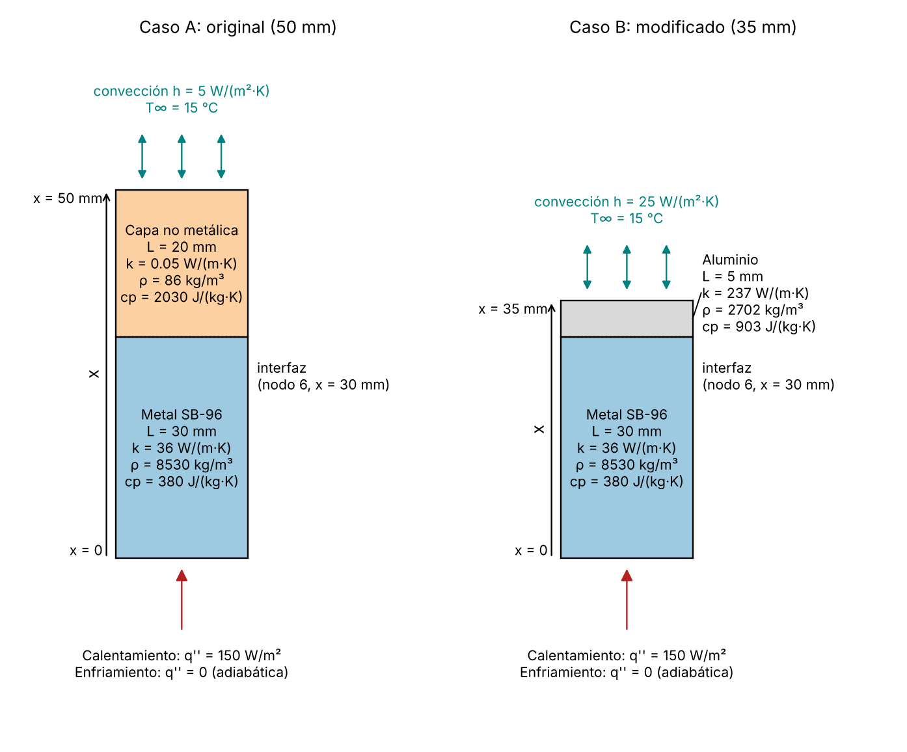
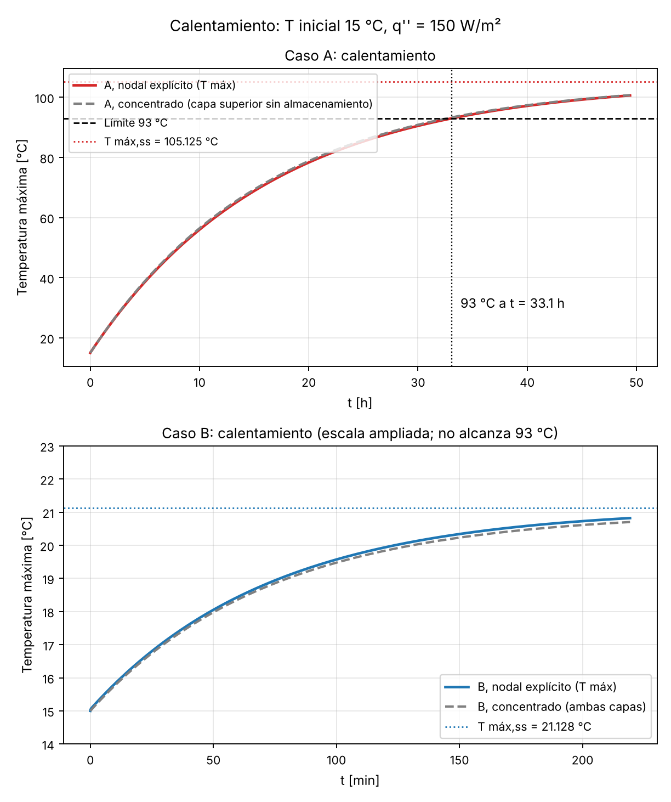
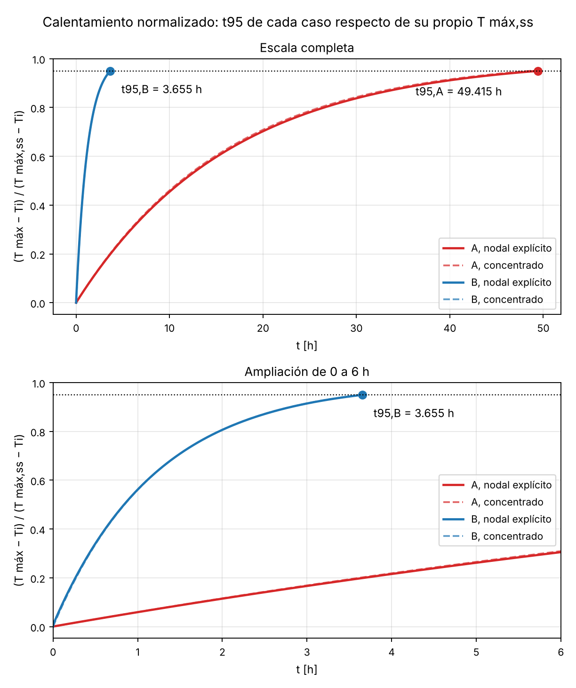
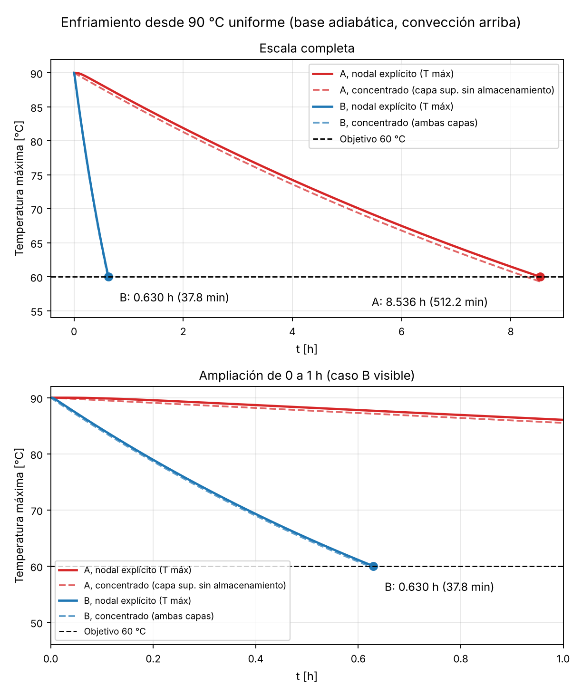

# Ejercicio modificado 5-34: análisis transitorio y mejora del enfriamiento

## 1. Portada

**Versión:** Versión 2 del ejercicio modificado

**Estudiantes:**

1. Karina Hernández Cruz.
2. Claudia Román García.

**Curso:** Transferencia de Calor, proyecto de métodos numéricos.

**Fecha de generación del borrador:** 25 de octubre de 2026.

**Estado:** borrador de la versión 2, generado con asistencia de IA a partir de la versión 1 y de las observaciones de auditoría. **No está aprobado.** La revisión y las firmas corresponden a las estudiantes (sección 18).

**Archivos de esta entrega:** reporte_modificado_v2.md, Reporte_modificado_v2.docx, Reporte_modificado_v2.pdf, ej_5_34_modificado_v2.py, esquema_casos_modificado_v2.png, calentamiento_modificado_v2.png, calentamiento_normalizado_modificado_v2.png, enfriamiento_modificado_v2.png, resultados_modificado_v2.csv, convergencia_modificado_v2.csv.

**Uso de IA y archivos para GitHub.** Este reporte y el código se produjeron con asistencia de IA a partir de la versión 1 y del prompt de la versión 2. El prompt, la respuesta y los archivos listados deben conservarse en el repositorio del grupo. El alcance de cada tipo de comprobación (computacional, conceptual y manual confirmada por las estudiantes) se separa en las secciones 12 y 16.

**Denominación.** Esta es la versión 2 del ejercicio modificado. No es una versión nueva del ejercicio original y no modifica los reportes aprobados del ejercicio original.

**Documentos consultados y no consultados.**

| Documento | Estado en esta sesión |
|--------------------------|--------------------------------------------|
| Instrucciones y rúbrica del profesor (`092126 2.pdf`) | Abiertas y leídas. |
| Reporte, código, figuras y CSV de la versión 1 | Abiertos. El código de la versión 2 se derivó de ellos y se comprobó qué resultados se conservan (sección 17). |
| Apuntes del curso (`Libreta.pdf`, `Libreta Examen 2.pdf`, `Libreta Heat Transfer examen .pdf`) | Se buscó en su texto extraíble; no se localizaron los valores de $\rho$ y $c_p$ usados. No se citan páginas. |
| Documento de cálculos manuales del ejercicio modificado 5-34 (archivo `Problem_5-34_Base_and_Adapted.pdf`) | **No se pudo abrir.** Se registra la confirmación de las estudiantes; no se afirma ninguna comparación documental. |
| Libro de texto (Tablas A-3 y A-8) | **No se pudo abrir.** Las entradas y la numeración no se confirmaron en esta sesión (sección 5.2). |
| Auditoría de la versión 1 y `Revision_y_ajustes_Ejercicio_modificado_5_34.pdf` | **No estaban disponibles.** |
| Plantilla de prompts de GitHub | No disponible. |

**Verificación manual de las estudiantes.** Karina Hernández Cruz y Claudia Román García confirmaron que el *Documento de cálculos manuales del ejercicio modificado 5-34* contiene los cálculos que realizaron manualmente y constituye la evidencia de su verificación manual. Esa confirmación se registra aquí como declaración de las estudiantes. Como el documento no se pudo abrir en esta sesión, este reporte **no** afirma haberlo comparado ni reproduce sus resultados, salvo la constante de tiempo del caso B que las estudiantes citaron (sección 8.6). La prueba adicional de enfriamiento (sección 11) se incorporó después y no está en ese documento.

## 2. Objetivo y relación con el ejercicio original

El ejercicio original 5-34 es una pared compuesta (placa metálica SB-96 y capa no metálica) en **estado estacionario** con flujo de calor impuesto en la cara inferior y convección en la superior. Su análisis, ya aprobado, se resolvió por diferencias finitas con $\Delta x = 5$ mm y 11 nodos. Aquí se conserva ese análisis: la solución estacionaria sigue siendo válida y el transitorio no la invalida. El estado estacionario da las temperaturas finales y permite verificar el límite térmico de 93 °C. El transitorio es necesario para obtener tiempos.

**Objetivo.** Adaptar el ejercicio cambiando el material, la geometría y la convección. Se conserva el análisis de calentamiento (desarrollo previo de las estudiantes) para estudiar la evolución hacia el estado estacionario y verificar el límite térmico. Como prueba adicional, se demuestra cuantitativamente un **enfriamiento significativamente más rápido** entre las mismas temperaturas inicial (90 °C) y objetivo (60 °C).

Estabilizarse antes hacia una temperatura final distinta **no demuestra por sí solo** un enfriamiento más rápido entre temperaturas comunes. Por eso la comparación de la mejora se hace con la prueba adicional de enfriamiento (prueba II, sección 11), con temperaturas inicial y objetivo comunes.

Este reporte no repite el desarrollo completo del ejercicio original. Solo se incluye lo necesario para entender y comparar la adaptación.

**Relación con el documento de cálculos manuales.** No se pudo abrir ese documento (sección 1). Por eso no se puede afirmar si existen discrepancias con él, y no se copió nada de él. Se usaron las condiciones explícitas del prompt. Dentro del prompt no se encontró ninguna contradicción interna en los datos. La única comparación disponible es la constante de tiempo del caso B citada por las estudiantes, que difiere de la de esta versión por el planteamiento de la aproximación (sección 8.6).

## 3. Enunciado del ejercicio modificado

Se tiene una placa inferior de cobre-silicio SB-96 de 30 mm sobre la que se apoya una capa superior. Se estudian por unidad de área transversal dos configuraciones:

- **Caso A (sistema original):** capa superior no metálica de 20 mm, $h = 5$ W/(m²·K).
- **Caso B (sistema modificado):** capa superior de aluminio de 5 mm, $h = 25$ W/(m²·K).

Para cada configuración se pide:

1. **Prueba I, calentamiento:** con $T(x,0) = 15$ °C y un flujo constante de 150 W/m² en $x = 0$ desde $t = 0$, hallar la temperatura máxima estacionaria, si se alcanza 93 °C y cuándo, y el tiempo $t_{95}$.
2. **Prueba II, enfriamiento (prueba adicional, incorporada después):** con $T(x,0) = 90$ °C uniforme, flujo impuesto igual a cero en $x = 0$ (cara adiabática) y convección hacia aire a 15 °C en la cara superior, hallar el tiempo hasta que la temperatura máxima de todo el sistema baja a 60 °C.
3. Comparar los tiempos de enfriamiento de A y B y sustentar cuantitativamente la reducción.

Las temperaturas de 90 °C y 60 °C son condiciones elegidas para una comparación común. No son datos del ejercicio original.

## 4. Configuraciones A y B

Son **dos configuraciones físicas** sometidas a **dos condiciones de operación** (prueba I y prueba II). No son cuatro diseños distintos.

Se define $x = 0$ en la superficie inferior de la placa SB-96 y $+x$ hacia la superficie superior expuesta al aire. La interfaz está en $x = 30$ mm en ambos casos.

**Los tres cambios combinados del caso B respecto de A:**

1. La capa no metálica se sustituye por aluminio.
2. El espesor de esa capa baja de 20 a 5 mm.
3. El coeficiente $h$ sube de 5 a 25 W/(m²·K).

La tabla siguiente separa el efecto de cada cambio sobre las magnitudes que importan. Es un análisis de las magnitudes del modelo, no un aislamiento numérico: solo se compararon A y B, y no se ejecutaron casos que cambien un solo parámetro.

| Magnitud | Cambio que la afecta | Caso A | Caso B | Efecto |
|--------------|----------------|--------|--------|--------------------------|
| $R''$ de la capa superior | Material y espesor | 0.400 m²·K/W | $2.110\times10^{-5}$ m²·K/W | Cae casi a cero: el aluminio casi no añade resistencia |
| $R''_{conv} = 1/h$ | $h$ | 0.200 m²·K/W | 0.040 m²·K/W | Baja 5 veces |
| $R''_{tot}$ | Los tres | 0.600833 m²·K/W | 0.040854 m²·K/W | Baja 14.7 veces |
| $C''$ de la capa superior | Material y espesor | 3491.6 J/(m²·K) | 12199.5 J/(m²·K) | **Aumenta** 3.49 veces |
| $C''$ total | Material y espesor | 100733.6 J/(m²·K) | 109441.5 J/(m²·K) | Aumenta 8.6 % |
| $T_{m\acute{a}x,ss}$ | Resistencia total | 105.125 °C | 21.128 °C | Baja porque $T_{m\acute{a}x,ss} - T_\infty = q''R''_{tot}$ |
| Respuesta y enfriamiento | Resistencia externa y capacidad | $\tau_{conc}$ = 16.207 h | $\tau_{conc}$ = 1.216 h | Domina la caída de la resistencia externa, no la capacidad |

La capacidad térmica por unidad de área **no baja**: sube un poco, porque el aluminio almacena más energía por metro cuadrado que la capa no metálica. Por tanto, la mejora no viene de almacenar menos energía. Viene de que la resistencia entre el sistema y el aire baja mucho.

La modificación **combina material, espesor y convección**, y no se atribuye toda la mejora al aluminio. Con aritmética de resistencias (no es una simulación ni un aislamiento numérico del enfriamiento), cada cambio por separado daría:

| Cambio aplicado | $R''_{tot}$ resultante [m²·K/W] | Factor $R''_{tot,A}/R''_{tot}$ |
|-------------------------|-------------|-------------|
| Solo la capa de aluminio de 5 mm (con $h = 5$) | 0.201 | 2.99 |
| Solo $h = 25$ W/(m²·K) (con la capa no metálica) | 0.441 | 1.36 |
| Ambos cambios (caso B) | 0.040854 | 14.71 |

**Las reducciones absolutas sí se suman.** Las resistencias en serie se suman, y por eso sus reducciones absolutas también: la reducción total de $R''_{tot}$ es igual a la reducción de la resistencia de la capa superior más la reducción de la resistencia convectiva.

| Contribución | Cálculo | Reducción [m²·K/W] |
|----------------------|----------------------|-------------|
| Capa superior (material y espesor) | 0.400 − $2.110\times10^{-5}$ | 0.399979 |
| Convección | 0.200 − 0.040 | 0.160 |
| Total | 0.600833 − 0.040854 | 0.559979 |

**Lo que no se puede sumar** son los factores o porcentajes de mejora. Los factores individuales de la tabla anterior (2.99 y 1.36) no suman ni multiplican hasta el factor combinado (14.71): la suma es 4.35 y el producto 4.08. Cada cambio reduce una resistencia sobre la que el otro también actúa, y los factores son cocientes. Lo mismo vale para los factores de tiempo de enfriamiento, que además dependen de la capacidad y de $R''_{ext}$ (sección 8.5); no se ejecutaron casos con un solo cambio, así que no se reparte la mejora del tiempo entre los tres cambios. Que la reducción absoluta de la capa (71.4 % de la total) supere a la convectiva describe la resistencia, no el tiempo de enfriamiento.

$h_B = 25$ W/(m²·K) se presenta como **condición de diseño**. No se afirma que cualquier ventilador garantice ese valor ni se supone una velocidad de aire.

## 5. Datos, fuentes y supuestos

### 5.1 Tabla de datos

Se trabaja por unidad de área transversal. No se inventan dimensiones laterales.

| Símbolo | Descripción | Valor | Unidad | Clase |
|-------|------------------------|---------|---------|----------------|
| $L_m$ | Espesor del SB-96 | 0.030 | m | Original |
| $k_m$ | Conductividad del SB-96 | 36 | W/(m·K) | Original |
| $L_n$ | Espesor de la capa no metálica (A) | 0.020 | m | Original |
| $k_n$ | Conductividad de la capa no metálica (A) | 0.050 | W/(m·K) | Original |
| $h_A$ | Coeficiente de convección (A) | 5 | W/(m²·K) | Original |
| $T_\infty$ | Temperatura del aire | 15 | °C | Original |
| $q''$ | Flujo impuesto en $x = 0$ (prueba I) | 150 | W/m² | Original |
| — | Límite térmico del ejercicio | 93 | °C | Original |
| $\rho_m$ | Densidad del SB-96 | 8530 | kg/m³ | Adoptada para el transitorio |
| $c_{p,m}$ | Calor específico del SB-96 | 380 | J/(kg·K) | Adoptada para el transitorio |
| $\rho_n$ | Densidad de la capa no metálica (A) | 86 | kg/m³ | Adoptada para el transitorio |
| $c_{p,n}$ | Calor específico de la capa no metálica (A) | 2030 | J/(kg·K) | Adoptada para el transitorio |
| $L_a$ | Espesor del aluminio (B) | 0.005 | m | Modificada por diseño |
| $k_a$ | Conductividad del aluminio (B) | 237 | W/(m·K) | Modificada por diseño |
| $\rho_a$ | Densidad del aluminio (B) | 2702 | kg/m³ | Modificada por diseño |
| $c_{p,a}$ | Calor específico del aluminio (B) | 903 | J/(kg·K) | Modificada por diseño |
| $h_B$ | Coeficiente de convección (B) | 25 | W/(m²·K) | Modificada por diseño |
| $T_i$ (I) | Temperatura inicial, calentamiento | 15 | °C | Elegida para la comparación |
| $T_i$ (II) | Temperatura inicial, enfriamiento | 90 | °C | Elegida para la comparación |
| $T_{obj}$ | Temperatura máxima objetivo, enfriamiento | 60 | °C | Elegida para la comparación |
| $\Delta x$ | Espaciamiento de la malla base | 0.005 | m | Numérica |

Espesor total: 0.050 m (A) y 0.035 m (B).

### 5.2 Fuentes y estado de las propiedades

Los datos originales vienen del ejercicio y del prompt. Las propiedades $\rho$ y $c_p$ son valores adoptados para el transitorio. Durante la auditoría de la versión 1 se localizaron en el libro de texto las entradas de la tabla siguiente. **En esta sesión no se pudo abrir el libro**, así que las entradas y la numeración se citan tal como las reportó esa auditoría y no están confirmadas por mí.

| Material | Valores adoptados | Entrada indicada por la auditoría | Uso en este reporte |
|--------------|----------------------|---------------------------|----------------------------------|
| Aluminio (caso B) | $\rho$ = 2702 kg/m³, $c_p$ = 903 J/(kg·K), $k$ = 237 W/(m·K) | Tabla A-3, aluminio puro (p. 979 del PDF, p. 948 impresa) | Valores adoptados tal cual |
| Capa no metálica (caso A) | $\rho$ = 86 kg/m³, $c_p$ = 2030 J/(kg·K) | Tabla A-8, corcho ($k$ = 0.048 W/(m·K)), p. 988 del PDF | Solo se adoptan del corcho las propiedades de almacenamiento. Se conserva $k_n$ = 0.050 W/(m·K), dato original |
| SB-96 (placa) | $\rho$ = 8530 kg/m³, $c_p$ = 380 J/(kg·K) | Tabla A-3, *cartridge brass* (latón) | **Supuesto de trabajo.** Se conserva $k_m$ = 36 W/(m·K), dato original |

- **Capa no metálica.** No se afirma que el material original se haya identificado como corcho ni se sustituye su conductividad (0.050 contra 0.048 W/(m·K)).
- **SB-96.** El ejercicio lo identifica como cobre-silicio. Que sus valores de $\rho$ y $c_p$ coincidan con los del latón tabulado no justifica atribuirle las propiedades del latón: se mantienen como supuesto, salvo que una fuente específica del SB-96 lo respalde. Tampoco se cambió $k_m$ = 36 W/(m·K) por la conductividad del latón.
- **Temperatura de referencia.** No pudo confirmarse en esta sesión la temperatura de referencia de las tablas; debe consignarse al verificar la entrada en el libro. En todo el modelo las propiedades se **mantienen constantes** (independientes de la temperatura), aunque el sistema recorre de 15 a 105 °C en el caso A. Es una simplificación de la hipótesis 2 de la sección 6.1.
- **Estado frente a la versión 1.** La versión 1 declaró que no pudo confirmarse la fuente de estas propiedades. Esa declaración corresponde a esa versión y no se modifica. La versión 2 solo añade la localización indicada por la auditoría, aún sin confirmar aquí.

**Sensibilidad de los tiempos a $\rho_m c_{p,m}$ (estimación de primer orden).** Con el modelo concentrado (sección 8.5), $\tau = C''R''_{ext}$ y los tiempos concentrados son proporcionales a $\tau$ (con $T_i$ y $T_{ss}$ fijos). Si solo cambia $\rho_m c_{p,m}$ en ±10 % y los demás datos se mantienen constantes, el cambio relativo de $\tau$ es ±10 % por la fracción de $C''$ que aporta el metal:

| Variante concentrada | Fracción de $C''$ aportada por el metal | Cambio de $\tau$ y de los tiempos |
|--------------------------|-------------|-------------|
| A, almacenamiento solo en el metal (aproximación principal) | 100 % | ±10.0 % |
| A, variante que incluye la capacidad de la capa superior | 96.5 % | ±9.7 % |
| B, capacidad total (ambas capas) | 88.9 % | ±8.9 % |

Son estimaciones de primer orden con el modelo concentrado. **No son un estudio de sensibilidad con el modelo nodal**, que no se ejecutó. Un error de ±10 % en $k_n$ cambia $R''_{ext,A}$ aproximadamente ∓6.7 %, también como estimación de primer orden.

## 6. Modelo físico y condiciones de frontera

### 6.1 Supuestos

1. Conducción unidimensional en $x$.
2. Propiedades constantes dentro de cada material.
3. Sección transversal constante.
4. Contacto térmico perfecto entre capas.
5. Sin generación volumétrica de calor. El flujo aplicado en la frontera $x = 0$ **no** es generación volumétrica: es una condición de frontera.
6. Sin pérdidas laterales.
7. Radiación omitida en este modelo. $h$ representa solo convección.
8. Ambiente a temperatura constante.
9. Convección prescrita en la superficie superior.

### 6.2 Ecuaciones

En cada material ($i$ = metal, capa superior):

$$
\rho_i c_{p,i}\,\frac{\partial T}{\partial t} = k_i\,\frac{\partial^2 T}{\partial x^2}
\quad\Longleftrightarrow\quad
\frac{\partial T}{\partial t} = \alpha_i\,\frac{\partial^2 T}{\partial x^2},\qquad \alpha_i = \frac{k_i}{\rho_i c_{p,i}}
$$

Símbolos: $T$ es la temperatura [°C], $t$ el tiempo [s], $x$ la coordenada [m], $k$ la conductividad [W/(m·K)], $\rho$ la densidad [kg/m³], $c_p$ el calor específico [J/(kg·K)] y $\alpha$ la difusividad térmica [m²/s].

**Condiciones de frontera.**

- En $x = 0$: $-k_m\,\partial T/\partial x\big|_{x=0} = q''_{ap}(t)$, con $q''_{ap} = 150$ W/m² en la prueba I y $q''_{ap} = 0$ en la prueba II (cara adiabática, sin convección inferior).
- En $x = L_{tot}$: $-k_s\,\partial T/\partial x\big|_{x=L_{tot}} = h\,[T(L_{tot},t) - T_\infty]$, donde $k_s$ es la conductividad de la capa superior.
- En la interfaz ($x = L_m$), con contacto perfecto: $T_m = T_s$ (continuidad de temperatura) y $k_m\,\partial T_m/\partial x = k_s\,\partial T_s/\partial x$ (continuidad de flujo).

**Condiciones iniciales.**

- Prueba I: $T(x,0) = 15$ °C en ambas capas.
- Prueba II: $T(x,0) = 90$ °C uniformemente en ambas capas. Es una prueba independiente del arranque de calentamiento. **No** es el perfil estacionario previo del calentamiento: son condiciones iniciales distintas.

En la prueba II el sistema se encuentra con el calentamiento apagado, con la cara inferior adiabática y con la cara superior expuesta a aire a 15 °C. Cada configuración conserva sus materiales, espesores y $h$.

## 7. Selección de métodos

| Método | Para qué se usa aquí | Condiciones de validez y límites |
|--------------|---------------------|------------------------------|
| Resistencias térmicas (estacionario) | $T_{m\acute{a}x,ss}$ y verificación del límite de 93 °C | Solo estado estacionario con flujo unidimensional |
| Capacidad concentrada | Aproximación analítica de $\tau$, $t_{95}$ y tiempos de enfriamiento | Requiere un Biot efectivo pequeño; no representa el gradiente interno |
| Diferencias finitas, esquema explícito | **Resultado base** de tiempos (A: $\Delta t$ = 1 s, B: $\Delta t$ = 0.1 s) | Estabilidad condicionada (sección 9.4); error temporal de primer orden |
| Mismo sistema nodal, integración temporal exacta | Aislar el error espacial en el estudio de malla (sección 12) | Resuelve el sistema discretizado, no el problema continuo; no es una solución exacta |
| Heisler y soluciones de un término | **No se aplican** | Ver sección 8.4 |

Todos los métodos se contrastan entre sí. Ningún modelo se ajustó artificialmente para coincidir con otro.

## 8. Desarrollo analítico aproximado

### 8.1 Propiedades y resistencias por unidad de área

Difusividad $\alpha = k/(\rho c_p)$, resistencia de cada capa $R'' = L/k$ y de convección $R''_{conv} = 1/h$, y capacidad $C'' = \sum \rho c_p L$:

| Magnitud | Cálculo | Resultado |
|-------------|-----------------------------|------------------|
| $\rho_m c_{p,m}$ | $8530 \times 380$ | 3241400 J/(m³·K) |
| $\rho_n c_{p,n}$ | $86 \times 2030$ | 174580 J/(m³·K) |
| $\rho_a c_{p,a}$ | $2702 \times 903$ | 2439906 J/(m³·K) |
| $\alpha_m$ | $36 / 3241400$ | $1.111\times10^{-5}$ m²/s |
| $\alpha_n$ | $0.050 / 174580$ | $2.864\times10^{-7}$ m²/s |
| $\alpha_a$ | $237 / 2439906$ | $9.713\times10^{-5}$ m²/s |
| $R''_m$ | $0.030/36$ | $8.333\times10^{-4}$ m²·K/W |
| $R''_n$ | $0.020/0.050$ | 0.400 m²·K/W |
| $R''_a$ | $0.005/237$ | $2.110\times10^{-5}$ m²·K/W |
| $R''_{conv,A}$ | $1/5$ | 0.200 m²·K/W |
| $R''_{conv,B}$ | $1/25$ | 0.040 m²·K/W |
| $C''_m$ | $8530 \times 380 \times 0.030$ | 97242.0 J/(m²·K) |
| $C''_n$ | $86 \times 2030 \times 0.020$ | 3491.6 J/(m²·K) |
| $C''_a$ | $2702 \times 903 \times 0.005$ | 12199.5 J/(m²·K) |
| $C''_{tot,A}$ | $C''_m + C''_n$ | 100733.6 J/(m²·K) |
| $C''_{tot,B}$ | $C''_m + C''_a$ | 109441.5 J/(m²·K) |

### 8.2 Estado estacionario (resistencias) y distinción de resistencias

La **resistencia total** usada para la temperatura máxima estacionaria es la suma en serie hasta la cara inferior, donde está el máximo:

$$
R''_{tot} = R''_m + R''_{s} + R''_{conv},\qquad T_{m\acute{a}x,ss} = T_\infty + q''\,R''_{tot}
$$

- Caso A: $R''_{tot} = 8.333\times10^{-4} + 0.400 + 0.200 = 0.600833$ m²·K/W, y $T_{m\acute{a}x,ss,A} = 15 + 150 \times 0.600833 = 105.125$ °C.
- Caso B: $R''_{tot} = 8.333\times10^{-4} + 2.110\times10^{-5} + 0.040 = 0.040854$ m²·K/W, y $T_{m\acute{a}x,ss,B} = 15 + 150 \times 0.040854 = 21.128$ °C.
- Temperatura en la interfaz y en la superficie superior en el estacionario: A, 105.000 °C y 45.000 °C; B, 21.003 °C y 21.000 °C.

En cambio, la **resistencia externa equivalente** $R''_{ext}$ que se usa en la aproximación concentrada es la resistencia entre el cuerpo que se supone isotérmico y el aire. No incluye la resistencia interna del cuerpo:

- Caso A: el cuerpo es el metal, $R''_{ext,A} = L_n/k_n + 1/h_A = 0.600$ m²·K/W.
- Caso B: el cuerpo es el metal más el aluminio, $R''_{ext,B} = 1/h_B = 0.040$ m²·K/W.

Por eso la temperatura estacionaria concentrada (105.000 °C en A, 21.000 °C en B) difiere de $T_{m\acute{a}x,ss}$ (105.125 °C y 21.128 °C): la diferencia es la caída interna que la aproximación desprecia.

### 8.3 Biot y Fourier

**Longitud característica.** Las capas no están expuestas por ambas caras a un fluido, así que no se usa $L/2$. La capa superior tiene una cara convectiva y la otra en contacto con el metal. Se usa su espesor completo como longitud característica.

**Biot convencional** (se identifica como tal): $Bi = hL_c/k$ con $L_c$ el espesor de la capa expuesta.

- Capa no metálica del caso A: $Bi = 5 \times 0.020/0.050 = 2.0$. Es mayor que 0.1: **la capa no metálica no es isotérmica** y no debe declararse así.
- Aluminio del caso B: $Bi = 25 \times 0.005/237 = 5.27\times10^{-4}$, menor que 0.1.

**Biot efectivo** (estimación basada en una conductancia equivalente; **no** es una identidad universal para paredes compuestas): relación entre la resistencia interna del cuerpo supuesto isotérmico y la resistencia externa,

$$
Bi_{ef} = \frac{R''_{int}}{R''_{ext}}
$$

- Caso A (cuerpo = metal, $R''_{int} = R''_m$): $Bi_{ef} = 8.333\times10^{-4}/0.600 = 1.39\times10^{-3}$.
- Caso B (cuerpo = metal + aluminio, $R''_{int} = R''_m + R''_a$): $Bi_{ef} = (8.333\times10^{-4} + 2.110\times10^{-5})/0.040 = 0.0214$.

Ambos son menores que 0.1. Un Biot efectivo pequeño es una condición **necesaria** para tratar un cuerpo como isotérmico, no suficiente: no garantiza que la respuesta concentrada coincida con la nodal en todo instante. Eso se contrasta numéricamente (secciones 8.5, 8.6, 10 y 11). Un $Bi$ convencional mayor que 0.1 (la capa no metálica de A) solo indica que esa capa **no** debe suponerse a temperatura uniforme.

**Número de Fourier.** $Fo = \alpha t/L_c^2$ mide cuánto ha avanzado la difusión en una capa. Para el tiempo de enfriamiento de cada caso (resultado base, sección 11):

| Caso | $Fo$ del metal ($L_c$ = 0.030 m) | $Fo$ de la capa superior ($L_c$ = espesor) |
|------|-------------------|--------------------|
| A, $t$ = 30729.3 s | 379.210 | 22.0 |
| B, $t$ = 2266.2 s | 27.966 | 8805.15 |

No se usa $Fo$ como criterio de validez de ninguna solución de un término. **No** debe confundirse con el parámetro de malla $Fo_\Delta = \alpha\,\Delta t/\Delta x^2$ (sección 9), que gobierna la estabilidad del esquema explícito. La constante de tiempo de la aproximación concentrada se denota $\tau$ para no repetir el símbolo de Fourier.

### 8.4 Heisler y soluciones de un término

Las gráficas de Heisler y las soluciones de un término corresponden a un sólido **homogéneo** con condición inicial uniforme y convección a temperatura constante. Aquí hay una pared **compuesta** de dos materiales, un flujo impuesto en una cara (prueba I) o una cara adiabática (prueba II) y convección solo en la cara opuesta. No se aplican sin una justificación que no se ha construido, y no se usaron. Tampoco se afirma que $Fo > 0.2$ valide una solución de un término: ese criterio exige condiciones que este problema no cumple.

### 8.5 Capacidad concentrada: derivación

Se supone un cuerpo de capacidad $C''$ a temperatura uniforme $T(t)$, que recibe $q''_{ap}$ y cede calor al aire a través de $R''_{ext}$. El balance de energía por unidad de área es:

$$
C''\,\frac{dT}{dt} = q''_{ap} - \frac{T - T_\infty}{R''_{ext}}
$$

Se define la temperatura estacionaria $T_{ss,conc} = T_\infty + q''_{ap}R''_{ext}$, que anula el miembro derecho, y $\theta = T - T_{ss,conc}$. Como $T_{ss,conc}$ es constante, $d\theta/dt = -\theta/\tau$ con $\tau = C''R''_{ext}$. Separando variables e integrando desde $\theta_i$:

$$
T(t) = T_{ss,conc} + \left(T_i - T_{ss,conc}\right)e^{-t/\tau}
$$

De aquí salen los tiempos:

- Prueba I, tiempo hasta $T_{lim}$: $t = -\tau\,\ln\!\left[1 - \dfrac{T_{lim}-T_i}{T_{ss,conc}-T_i}\right]$.
- Prueba I, $t_{95}$: $t_{95} = -\tau\ln(0.05)$.
- Prueba II ($q''_{ap} = 0$, $T_{ss,conc} = T_\infty$): $t = \tau\,\ln\!\left[\dfrac{T_i - T_\infty}{T_{obj} - T_\infty}\right] = \tau\ln(75/45)$.

**Caso A, aproximación principal: la capa no metálica como resistencia sin almacenamiento.** $C'' = C''_m$ y $R''_{ext,A} = 0.6$ m²·K/W. Un $Bi$ mayor que 0.1 indica que la capa **no** puede tomarse como isotérmica; no justifica despreciar su almacenamiento. Lo que se supone es que la capa tiene una respuesta **aproximadamente cuasiestacionaria**: su tiempo de ajuste por difusión, $L_n^2/\alpha_n \approx$ 1397 s (23.3 min), es mucho menor que la constante de tiempo del conjunto ($\tau \approx$ 16.207 h), de modo que su perfil sigue al flujo que la atraviesa y el calor que sale es aproximadamente $(T_{metal} - T_\infty)/R''_{ext}$. Que su capacidad (3491.6 J/(m²·K)) sea 3.5 % de la total **no basta** para concluir que la aproximación vale en todo instante: se trata como aproximación y se contrasta con el modelo nodal (tabla siguiente).

**Caso A, variante con la capacidad de la capa superior.** Suma toda la capacidad de la capa superior a una sola temperatura (la del metal), con la misma $R''_{ext}$. Es una **aproximación adicional**: la capa tiene gradientes y su almacenamiento está distribuido, así que no lo representa exactamente. Los tiempos de esta variante, incluido el de ≈ 8.576 h de enfriamiento, deben leerse con esa limitación.

**Caso B, aproximación principal.** $C'' = C''_{tot,B}$ (ambas capas a la misma temperatura) y $R''_{ext,B} = 1/h_B$. Se apoya en $Bi_{ef}$ = 0.0214 y en el $Bi$ del aluminio ($5.27\times10^{-4}$). La comparación con la aproximación de las estudiantes, que incluye la resistencia del aluminio, se hace en la sección 8.6.

| Caso y variante | $C''$ [J/(m²·K)] | $R''_{ext}$ [m²·K/W] | $\tau$ [s] | $\tau$ [h] |
|---------|-------------|-------------|--------|-------|
| A, capa superior sin almacenamiento (principal) | 97242.0 | 0.600 | 58345.2 | 16.207 |
| A, variante con la capacidad de la capa superior | 100733.6 | 0.600 | 60440.2 | 16.789 |
| B, ambas capas isotérmicas (principal) | 109441.5 | 0.040 | 4377.7 | 1.216 |

**Resultados concentrados** (estos valores se mantienen separados de los nodales y de los estacionarios por resistencias, y no se ajustaron para coincidir):

| Magnitud | A (principal, sin almacenamiento) | A (variante, con almacenamiento) | B (principal) |
|--------------|----------|----------|----------|
| $T_{ss,conc}$ [°C] | 105.000 | 105.000 | 21.000 |
| Tiempo para 93 °C [h] | 32.656 | 33.828 | No alcanza |
| $t_{95}$ [h] | 48.552 | 50.295 | 3.643 |
| Enfriamiento 90→60 °C [h] | 8.279 | 8.576 | 0.621 |

**Contraste del caso A con el modelo nodal** (esquema explícito, malla de 5 mm; diferencia relativa = (concentrado − nodal)/nodal):

| Magnitud | Nodal [h] | A principal [h] | Dif. [%] | A variante [h] | Dif. [%] |
|--------------|--------|--------|--------|--------|--------|
| Tiempo para 93 °C | 33.085 | 32.656 | −1.3 | 33.828 | +2.2 |
| $t_{95}$ | 49.415 | 48.552 | −1.7 | 50.295 | +1.8 |
| Enfriamiento 90→60 °C | 8.536 | 8.279 | −3.0 | 8.576 | +0.5 |

La aproximación principal subestima los tres tiempos (la capa superior sí almacena algo de energía) y la variante los sobrestima. Que la variante quede muy cerca del nodal en el enfriamiento no la valida: se aleja más en el calentamiento, así que el acuerdo en una sola magnitud no demuestra la aproximación. Las diferencias persisten porque el modelo concentrado desprecia el gradiente interno: el máximo local (en $x = 0$) queda por encima de la temperatura concentrada, y en el estacionario el máximo local supera a la concentrada en 0.125 K (A) y 0.128 K (B).

### 8.6 Caso B: aproximación principal y aproximación con la resistencia del aluminio

Las estudiantes indicaron que su documento de cálculos manuales usa una aproximación que **incluye la resistencia del aluminio** y obtiene una constante de tiempo cercana a 1.217 h. No se pudo abrir ese documento, así que solo se usa esa cifra y el planteamiento descrito por las estudiantes. Los detalles que siguen (capacidad usada y ubicación del nodo) son una **reconstrucción** hecha aquí con $C''_{tot,B}$ y $R''_{ext} = 1/h_B + L_a/k_a$, que reproduce ≈ 1.217 h; deben contrastarse con su documento. La versión 1 y la principal de esta versión consideran ambas capas isotérmicas, con $R''_{ext,B} = 1/h_B$, y dan 1.216 h. Para comparar, se calculó también la variante con $R''_{ext} = 1/h_B + L_a/k_a$ = 0.040021 m²·K/W, que da 1.2167 h.

| Aproximación | Capacidad | Resistencia | Constante de tiempo | Hipótesis y limitaciones |
|----------------|--------------|--------------|--------------|------------------------------------|
| **Principal** (v1 y v2): ambas capas isotérmicas | $C''_{tot,B}$ = 109441.5 J/(m²·K) | $R''_{ext} = 1/h_B$ = 0.040 m²·K/W | 4377.7 s = 1.216 h | Metal y aluminio a una sola temperatura. Desprecia las resistencias internas ($R''_m + R''_a$ = 0.000854 m²·K/W, $Bi_{ef}$ = 0.0214). $T_{ss,conc}$ = 21.000 °C |
| Con resistencia del aluminio (enfoque de las estudiantes; reconstruido aquí) | $C''_{tot,B}$ = 109441.5 J/(m²·K) | $R''_{ext} = 1/h_B + L_a/k_a$ = 0.040021 m²·K/W | 4380.0 s = 1.2167 h | Incluye la caída en el aluminio, pero mantiene su capacidad en el mismo nodo que el metal. Sigue sin incluir la resistencia del metal. $T_{ss,conc}$ = 21.0032 °C |
| Modo más lento del sistema nodal (contraste, malla de 5 mm) | Capacidades nodales | Matriz de conductancias | $\tau_{lento}$ = 4403.6 s = 1.2232 h | Es la constante del modo más lento del sistema discretizado, no una aproximación de un nodo. No es idéntica a los tiempos $t_{95}$ ni de enfriamiento |

**Por qué la diferencia es de planteamiento y no solo de redondeo.** Las resistencias usadas difieren (0.040 contra 0.040021 m²·K/W, 0.053 %) con la misma capacidad, así que las constantes difieren en ese mismo porcentaje: 1.2160 contra 1.2167 h, que redondeadas a tres decimales dan 1.216 y 1.217 h. Un cambio de redondeo no modificaría la resistencia ni la diferencia de planteamiento.

**Limitación concreta de cada enfoque.** La aproximación principal no ve la resistencia del aluminio ni la del metal. La del documento (según la reconstrucción) ve la del aluminio pero no la del metal, y mantiene la capacidad del aluminio en el nodo del metal, de modo que la caída que incluye no está ubicada del todo coherentemente con la capacidad. Ambas son estimaciones de primer orden de un cuerpo isotérmico. La diferencia entre ellas (0.053 %) es menor que la distancia de cualquiera al modo más lento del modelo nodal (0.59 % y 0.54 %), así que el modelo nodal no permite preferir una por su constante de tiempo.

**Se mantiene como aproximación principal** la de ambas capas isotérmicas con $R''_{ext} = 1/h_B$, porque es la hipótesis más simple y la misma de la versión 1; el modelo nodal es el contraste. No se forzó que las cifras coincidan ni se modificó el documento de las estudiantes.

**Contraste del caso B con el modelo nodal** (explícito, 5 mm):

| Magnitud | Nodal [h] | Principal [h] | Dif. [%] | Con $R''_a$ [h] | Dif. [%] |
|--------------|--------|--------|--------|--------|--------|
| $t_{95}$ | 3.6551 | 3.6429 | −0.34 | 3.6448 | −0.28 |
| Enfriamiento 90→60 °C | 0.6295 | 0.6212 | −1.32 | 0.6215 | −1.27 |

## 9. Desarrollo numérico

### 9.1 Malla y volúmenes de control

Malla base $\Delta x = 0.005$ m. Caso A: 11 nodos (0 a 10), interfaz en el nodo 6. Caso B: 8 nodos (0 a 7), interfaz en el nodo 6. Los nodos de superficie usan **medios volúmenes** de control. En la interfaz, el volumen de control es la mitad del metal y la mitad del material superior, así que su capacidad suma la de ambos materiales. No se asigna al nodo de interfaz las propiedades de un solo material. Como ese volumen almacena energía, los flujos por sus dos caras pueden diferir (sección 12.7).

Capacidades nodales $C_i$ [J/(m²·K)] (por unidad de área):

| Nodo | Descripción | A | B |
|-----|--------------|-------|-------|
| 0 | Superficie inferior (medio volumen de metal) | 8103.5 | 8103.5 |
| 1 a 5 | Interiores del metal | 16207 | 16207 |
| 6 | Interfaz (medio metal más medio material superior) | 8539.95 | 14203.265 |
| 7 a 9 | Interiores de la capa superior (solo A) | 872.9 | — |
| 10 (A) / 7 (B) | Superficie superior (medio volumen) | 436.45 | 6099.765 |

### 9.2 Ecuaciones nodales

Cada ecuación es un balance de energía de un volumen de control por unidad de área. Con $G_j = k_j/\Delta x$ la conductancia del intervalo entre los nodos $j$ y $j+1$ ($k_j$ la del material de ese intervalo) y $p$ el índice de tiempo:

**Superficie inferior (nodo 0).** Recibe el flujo aplicado e intercambia calor por conducción con el nodo 1. El signo de $T_1^p - T_0^p$ determina la dirección: durante el calentamiento $T_0 > T_1$, el término de conducción es negativo y el calor sale del nodo 0 hacia el nodo 1.

$$
C_0\,\frac{T_0^{p+1} - T_0^{p}}{\Delta t} = q''_{ap} + G_0\left(T_1^{p} - T_0^{p}\right)
$$

**Nodos interiores de cada material.**

$$
C_i\,\frac{T_i^{p+1} - T_i^{p}}{\Delta t} = G_{i-1}\left(T_{i-1}^{p} - T_i^{p}\right) + G_i\left(T_{i+1}^{p} - T_i^{p}\right)
$$

con $C_i = \rho c_p\,\Delta x$ del material correspondiente.

**Interfaz (nodo 6)**, con $G_5 = k_m/\Delta x$ y $G_6 = k_s/\Delta x$ y $C_6 = \tfrac12\left[(\rho c_p)_m + (\rho c_p)_s\right]\Delta x$:

$$
C_6\,\frac{T_6^{p+1} - T_6^{p}}{\Delta t} = G_5\left(T_5^{p} - T_6^{p}\right) + G_6\left(T_7^{p} - T_6^{p}\right)
$$

**Superficie superior (nodo $N$)**, con $C_N = \tfrac12 (\rho c_p)_s\,\Delta x$:

$$
C_N\,\frac{T_N^{p+1} - T_N^{p}}{\Delta t} = G_{N-1}\left(T_{N-1}^{p} - T_N^{p}\right) + h\left(T_\infty - T_N^{p}\right)
$$

Estas ecuaciones son la versión transitoria de las del ejercicio original (donde el miembro izquierdo es cero en el estacionario). En la **prueba II** el cambio es solo en el nodo 0: $q''_{ap} = 0$, y el balance inferior queda $C_0\,(T_0^{p+1}-T_0^p)/\Delta t = G_0(T_1^p - T_0^p)$, que representa una cara adiabática.

### 9.3 Esquema explícito y no negatividad de coeficientes

Despejando $T_i^{p+1}$, el coeficiente de $T_i^p$ es $1 - \Delta t\,\sum G/C_i$ y los de los vecinos son positivos. En los nodos sin fuente los coeficientes suman 1. Si todos son no negativos, $T_i^{p+1}$ es un promedio ponderado de valores del paso anterior (más términos fuente acotados) y los errores no crecen: es un criterio **suficiente** de estabilidad y de no negatividad de coeficientes.

### 9.4 Criterio de estabilidad por tipo de nodo

Con $Fo_\Delta = \alpha\,\Delta t/\Delta x^2$ y $Bi_\Delta = h\Delta x/k$:

| Tipo de nodo | Condición $1 - \Delta t\,\sum G/C_i \ge 0$ | $\Delta t$ máximo |
|--------------|-------------------------|-----------------|
| Superficie inferior (metal) | $Fo_\Delta \le 1/2$ | $\Delta x^2/(2\alpha_m)$ |
| Interior | $Fo_\Delta \le 1/2$ | $\Delta x^2/(2\alpha)$ |
| Interfaz | $\Delta t \le \dfrac{\Delta x^2\,[(\rho c_p)_m + (\rho c_p)_s]}{2\,(k_m + k_s)}$ | según la fórmula |
| Superficie superior | $Fo_\Delta\,(1 + Bi_\Delta) \le 1/2$ | $\Delta x^2(\rho c_p)_s/[2k_s(1 + Bi_\Delta)]$ |

Evaluado en la malla base (código, sección 2 de la salida):

| Nodo | A: $\Delta t_{máx}$ [s] | B: $\Delta t_{máx}$ [s] |
|-----|---------|---------|
| 0 a 5 (metal) | 1.1255 | 1.1255 |
| 6 (interfaz) | 1.1845 | 0.2601 |
| Interiores de la capa superior | 43.645 | — |
| Superficie superior | 29.097 | 0.1286 |
| **Límite del sistema** | **1.1255** (nodo 0) | **0.1286** (nodo 7) |
| $\Delta t$ base | 1 | 0.1 |
| $Fo_\Delta$ base en el metal | 0.4443 | 0.0444 |

En el caso A el nodo limitante es el metal (el nodo 0 empata con los interiores del metal); en el caso B lo limita la **superficie superior**, por el aluminio, de difusividad alta ($Fo_\Delta$ del aluminio con $\Delta t$ = 0.1 s es 0.3885). No se supone que un paso válido para A lo sea para B: con $\Delta t$ = 1 s el caso B sería inestable.

**Demostración numérica (código).** Con $\Delta t$ por encima del límite el esquema diverge: A con $\Delta t$ = 1.25 s da $\max|T|$ = $4.41\times10^{5}$ °C tras 200 pasos, y B con $\Delta t$ = 0.2 s da $9.92\times10^{17}$ °C. Esto muestra que el criterio no es una formalidad. La estabilidad no implica precisión: la sensibilidad al paso se estudia en la sección 12.

**Paso admisible al refinar la malla.** Al reducir $\Delta x$ el límite baja con $\Delta x^2$ y debe recalcularse:

| $\Delta x$ [mm] | A: nodos | A: $\Delta t_{máx}$ [s] | B: nodos | B: $\Delta t_{máx}$ [s] |
|--------|-----|----------|-----|----------|
| 5 | 11 | 1.12549 | 8 | 0.12862 |
| 2.5 | 21 | 0.28137 | 15 | 0.03216 |
| 1.25 | 41 | 0.07034 | 29 | 0.00804 |
| 0.625 | 81 | 0.01759 | 57 | 0.00201 |

### 9.5 Ejemplo verificable a mano: primeros dos pasos del caso A (calentamiento)

Datos: $\Delta t$ = 1 s, $T_i = 15$ °C en los 11 nodos, $q'' = 150$ W/m², $k_m/\Delta x = 7200$ W/(m²·K), $C_0 = 8103.5$ J/(m²·K) y $C_1 = 16207$ J/(m²·K).

**Paso 1** ($p = 0 \to 1$). Con todas las temperaturas iguales, solo el nodo 0 cambia, por el flujo aplicado:

$$
T_0^{1} = 15 + \frac{1}{8103.5}\left[150 + 7200\,(15 - 15)\right] = 15 + \frac{150}{8103.5} = 15.0185105\ \text{°C}
$$

Los nodos 1 a 10 siguen en 15 °C, porque sus vecinos están a 15 °C.

**Paso 2** ($p = 1 \to 2$). Ahora el nodo 0 y su vecino ya no están a la misma temperatura:

$$
T_0^{2} = 15.0185105 + \frac{1}{8103.5}\left[150 + 7200\,(15 - 15.0185105)\right] = 15.0205744\ \text{°C}
$$

$$
T_1^{2} = 15 + \frac{1}{16207}\left[7200\,(15.0185105 - 15) + 7200\,(15 - 15)\right] = 15.0082233\ \text{°C}
$$

Los nodos 2 a 10 siguen en 15 °C. Los valores coinciden con la ejecución del código (sección 3 de la salida), que reporta 15.0205744 °C y 15.0082233 °C.

**Cómo cambia el balance inferior al apagar el calentamiento (prueba II).** Se elimina el término $q''$ del nodo 0. Con la temperatura inicial uniforme de 90 °C, en el primer paso el nodo 0 no cambia (no hay flujo ni diferencia con su vecino) y el único nodo que cambia es el de la superficie superior, que pierde calor por convección:

$$
T_{10}^{1} = 90 + \frac{1}{436.45}\left[\frac{0.05}{0.005}(90 - 90) + 5\,(15 - 90)\right] = 90 - \frac{375}{436.45} = 89.140795\ \text{°C}
$$

### 9.6 Métodos usados y pasos ejecutados

- **Resultado base:** esquema explícito, malla de 5 mm, $\Delta t$ = 1 s (A) y 0.1 s (B), con cruce detectado por **interpolación lineal** entre dos pasos consecutivos de la temperatura máxima del sistema. Se ejecutaron pasos explícitos reales: por ejemplo, 177894 pasos para el calentamiento de A hasta $t_{95}$, 131584 para el de B y 30730 y 22663 para el enfriamiento de A y B (el último de cada corrida, parcial). Estos números salen de dividir el tiempo simulado entre $\Delta t$ y redondear hacia arriba.
- **Estudio de malla:** se resolvió el **mismo sistema nodal con integración temporal exacta** (diagonalización de la matriz del sistema), **no** con millones de pasos explícitos. Así el error temporal queda fuera y se aísla el espacial. No es una solución exacta del problema continuo.
- **Último paso parcial.** Cuando la corrida termina en un cruce, el último paso se toma parcial. Como el esquema explícito es lineal en $\Delta t$, avanzar $\theta\,\Delta t$ desde $T^p$ equivale a $T^p + \theta\,(T^{p+1} - T^p)$, con $\theta$ la fracción del paso en que ocurre el cruce. El tiempo reportado se conserva (interpolación) y el calor saliente, la energía almacenada y el balance se evalúan en ese mismo instante.
- Los tiempos se buscan con raíz numérica (método de Brent) sobre la temperatura máxima del sistema, que es monótona en estas pruebas.

## 10. Resultados de calentamiento (prueba I)

### 10.1 Temperatura frente al tiempo

Temperaturas en la superficie inferior ($x = 0$), la interfaz y la superficie superior, y ubicación del máximo, del esquema explícito en la malla base:

**Caso A**

| $t$ [h] | $T$ inferior [°C] | $T$ interfaz [°C] | $T$ superior [°C] | Nodo del máximo |
|-----|----------|----------|----------|------|
| 0.5 | 17.736 | 17.670 | 15.704 | 0 |
| 1 | 20.344 | 20.277 | 16.578 | 0 |
| 2 | 25.331 | 25.260 | 18.250 | 0 |
| 4 | 34.441 | 34.364 | 21.304 | 0 |
| 8 | 49.659 | 49.572 | 26.406 | 0 |
| 16 | 70.972 | 70.870 | 33.551 | 0 |
| 24 | 84.095 | 83.984 | 37.950 | 0 |
| 33 | 92.937 | 92.821 | 40.914 | 0 |
| 48 | 100.215 | 100.094 | 43.354 | 0 |

**Caso B**

| $t$ [min] | $T$ inferior [°C] | $T$ interfaz [°C] | $T$ superior [°C] | Nodo del máximo |
|-----|----------|----------|----------|------|
| 0.5 | 15.086 | 15.020 | 15.020 | 0 |
| 1 | 15.129 | 15.059 | 15.059 | 0 |
| 2 | 15.210 | 15.139 | 15.139 | 0 |
| 5 | 15.447 | 15.374 | 15.374 | 0 |
| 10 | 15.821 | 15.745 | 15.744 | 0 |
| 20 | 16.497 | 16.415 | 16.414 | 0 |
| 40 | 17.602 | 17.509 | 17.508 | 0 |
| 60 | 18.443 | 18.343 | 18.341 | 0 |

El máximo ocurre en el nodo 0, la superficie inferior, en todos los instantes registrados de ambos casos: el calor entra por ahí y la temperatura decrece con $x$.

### 10.2 Temperatura máxima estacionaria y recuperación del estacionario

Por resistencias (sección 8.2): A, 105.125 °C; B, 21.128 °C. El sistema nodal estacionario da los mismos valores (diferencia máxima entre ambos métodos en las tres temperaturas comparadas: A 0.0e+00, B 0.0e+00 °C). El transitorio tiende a ellos: la corrida explícita larga (A hasta 700000 s, B hasta 60000 s) termina a 6.86e-04 °C (A) y 7.36e-06 °C (B) del estacionario.

### 10.3 Límite de 93 °C

- **Caso A:** $T_{m\acute{a}x,ss} = 105.125$ °C > 93 °C. **Alcanza 93 °C** a $t$ = 119106.2 s = 33.085 h (esquema explícito, malla 5 mm).
- **Caso B:** $T_{m\acute{a}x,ss} = 21.128$ °C < 93 °C. **No alcanza 93 °C** bajo estas condiciones.

Sobre el umbral de convección del ejercicio original (geometría del caso A), $h^* = 1200/143 \approx 8.391608$ W/(m²·K): con $h = h^*$ resulta $T_{m\acute{a}x} = 93$ °C; con $h > h^*$, $T_{m\acute{a}x} < 93$ °C. No se usa $h = 8.39$ como garantía del límite estricto, porque es menor que $h^*$.

### 10.4 Tiempo $t_{95}$

Se define explícitamente

$$
\frac{T_{m\acute{a}x}(t_{95}) - T_i}{T_{m\acute{a}x,ss} - T_i} = 0.95
$$

con $T_i = 15$ °C y $T_{m\acute{a}x,ss}$ propio de cada caso. $t_{95}$ **no** es el tiempo para alcanzar exactamente el estado estacionario.

### 10.5 Tabla de resultados de calentamiento

| Magnitud | Caso A | Caso B |
|--------------------|-------------|-------------|
| $T_{m\acute{a}x,ss}$ nodal [°C] | 105.125 | 21.128 |
| Tiempo para 93 °C, explícito, 5 mm [h] | 33.085 | No alcanza |
| Tiempo para 93 °C, nodal exacto en el tiempo, 0.625 mm [h] | 33.080 | No alcanza |
| $t_{95}$, explícito, 5 mm [h] | 49.415 | 3.655 |
| $t_{95}$, nodal exacto en el tiempo, 0.625 mm [h] | 49.407 | 3.655 |
| $t_{95}$ concentrado [h] | 48.552 (sin almac.) | 3.643 |
| Razón $t_{95,A}/t_{95,B}$ (explícito, 5 mm) | 13.52 | |

**Contraste con la versión 1.** La versión 1 obtuvo $T_{m\acute{a}x,ss,A} \approx 105.125$ °C, $T_{m\acute{a}x,ss,B} \approx 21.128$ °C, A en 93 °C a $\approx 33.085$ h y B sin alcanzar 93 °C. Esta versión da 105.125 °C, 21.128 °C, 33.085 h y la no llegada de B: los valores se conservan. Se obtuvieron con el código de esta entrega.

**Qué mide $t_{95}$ y qué no.** A y B tienen temperaturas finales distintas (105.125 y 21.128 °C). Comparar $t_{95}$ entre ambos demuestra una diferencia en la estabilización **normalizada**, no necesariamente un calentamiento más rápido hacia una misma temperatura absoluta. Por eso la comparación de la mejora se hace con la prueba adicional de enfriamiento (sección 11).

## 11. Prueba adicional para demostrar la mejora del enfriamiento

**Naturaleza de esta prueba.**

- Se incorporó **después** del desarrollo de calentamiento de las estudiantes y **no** estaba en el documento de cálculos manuales.
- **No reemplaza ni corrige** el análisis de calentamiento de la sección 10, que se conserva.
- Compara los dos sistemas entre **temperaturas inicial y objetivo comunes**.
- Los valores de 90 °C y 60 °C se **eligieron** para esta comparación; no son datos del ejercicio original.
- La condición uniforme de 90 °C es **independiente** del perfil estacionario del calentamiento: no es el perfil estacionario previo.
- Sus resultados son **análisis adicionales con comprobación computacional**; no se les atribuye una verificación manual.

Ambos casos se resuelven desde 90 °C uniforme hasta que la temperatura máxima de todo el sistema llega a 60 °C, con las condiciones de la sección 6 (base adiabática, convección en la cara superior a 15 °C).

**Detección del cruce.** En cada paso se calcula la temperatura máxima del sistema (en la prueba II está en el nodo 0, en todos los instantes registrados). El cruce de 60 °C se detecta cuando esa temperatura pasa de arriba hacia abajo de 60 °C y el tiempo se **interpola linealmente** entre los dos pasos consecutivos. La energía se evalúa en ese mismo instante con un último paso parcial (sección 9.6).

Temperaturas en la prueba II (esquema explícito, malla base):

**Caso A**

| $t$ [h] | $T$ inferior [°C] | $T$ interfaz [°C] | $T$ superior [°C] | Nodo del máximo |
|-----|----------|----------|----------|------|
| 0.5 | 88.240 | 88.190 | 39.583 | 0 |
| 1 | 86.054 | 86.006 | 38.820 | 0 |
| 2 | 81.875 | 81.830 | 37.419 | 0 |
| 4 | 74.240 | 74.200 | 34.860 | 0 |
| 6 | 67.477 | 67.441 | 32.592 | 0 |
| 8 | 61.486 | 61.454 | 30.584 | 0 |

**Caso B**

| $t$ [min] | $T$ inferior [°C] | $T$ interfaz [°C] | $T$ superior [°C] | Nodo del máximo |
|-----|----------|----------|----------|------|
| 1 | 89.266 | 88.586 | 88.549 | 0 |
| 2 | 88.262 | 87.589 | 87.553 | 0 |
| 5 | 85.328 | 84.682 | 84.647 | 0 |
| 10 | 80.696 | 80.093 | 80.060 | 0 |
| 20 | 72.328 | 71.801 | 71.773 | 0 |
| 30 | 65.026 | 64.566 | 64.541 | 0 |

### 11.1 Resultados

| Magnitud | Resultado base (explícito, 5 mm) | Nodal, 0.625 mm (exacto en el tiempo) |
|------------------|---------------|---------------|
| Tiempo de enfriamiento de A | 30729.3 s = 8.536 h = 512.2 min | 8.5372 h |
| Tiempo de enfriamiento de B | 2266.2 s = 0.6295 h = 37.8 min | 0.6295 h = 37.8 min |
| Diferencia $t_A - t_B$ | 28463.0 s = 7.906 h | 7.9077 h |
| Factor $t_A/t_B$ | 13.56 | 13.56 |
| Reducción $100\,(t_A - t_B)/t_A$ | 92.63 % | 92.63 % |

Resultado concentrado de contraste: A, 8.279 h (sin almacenamiento de la capa superior) o 8.576 h (con él); B, 0.621 h.

**Contraste con la revisión previa citada en el prompt de la versión 1** (malla de 0.625 mm; el documento de esa revisión no estaba disponible): A $\approx 8.537$ h, B $\approx 0.629$ h ($\approx 37.8$ min) y reducción $\approx 92.6$ %. Los valores obtenidos aquí en la malla de 0.625 mm (8.5372 h, 0.6295 h y 92.63 %) son coherentes dentro de la precisión citada. Los valores se calcularon con el código propio y no se forzó ninguna coincidencia. La reducción con la malla base (5 mm) es 92.625 % y con la de 0.625 mm es 92.627 %; la diferencia es de 0.001 puntos porcentuales.

### 11.2 Qué se compara y qué se concluye

Se comparan sistemas con **capacidades térmicas distintas** bajo las **mismas temperaturas inicial y objetivo**. La métrica es el tiempo de enfriamiento, no la extracción de una cantidad idéntica de energía.

**Energía y flujo en el instante del cruce.** La energía extraída por convección hasta el instante de cruce reportado es $Q_{out,A}$ = 3075102 J/m² y $Q_{out,B}$ = 3302020 J/m² (energía por unidad de área, en J/m²). Se calculó con el último paso parcial, de modo que el calor saliente y la energía almacenada se evalúan en el mismo instante que el tiempo reportado. El flujo de calor medio (en W/m², energía entre tiempo) es 100.07 W/m² en A y 1457.06 W/m² en B. B extrae **más** energía y en mucho menos tiempo, porque cede calor al aire con un flujo mucho mayor.

**Cambio respecto de la versión 1.** La versión 1 interpolaba el tiempo de llegada a 60 °C, pero acumulaba la energía hasta el final del paso completo. Esta versión usa el instante del cruce. Los valores del paso completo se conservan aquí solo para documentar el cambio:

| Magnitud | Final del paso completo (v1) | Instante del cruce (v2) | Diferencia |
|--------------------|----------------|----------------|-------------|
| A: tiempo [s] | 30730.000 | 30729.255 | −0.745 |
| A: $Q_{out}$ [J/m²] | 3075157.92 | 3075101.69 | −56.23 (−0.0018 %) |
| A: flujo medio [W/m²] | 100.0702 | 100.07 | +0.0006 |
| B: tiempo [s] | 2266.300 | 2266.217 | −0.083 |
| B: $Q_{out}$ [J/m²] | 3302112.10 | 3302019.85 | −92.25 (−0.0028 %) |
| B: flujo medio [W/m²] | 1457.0499 | 1457.06 | +0.0125 |

Los tiempos de cruce, las temperaturas y la reducción del tiempo **no cambian**; solo cambian las energías y los flujos medios, en menos de 0.003 %.

**Conclusión de esta prueba.** Con las mismas temperaturas inicial y objetivo, el sistema modificado B tarda 37.8 min y el original A tarda 512.2 min (8.536 h): una reducción del 92.63 % en el modelo, con una razón $t_A/t_B$ de 13.56. Esta conclusión sale del tiempo de enfriamiento calculado con el modelo nodal, no solo del cambio de constante de tiempo ni de la temperatura estacionaria. Es un análisis adicional con comprobación computacional, no incluido en el documento de cálculos manuales.

## 12. Comprobaciones y convergencia

Las comprobaciones se separan en cinco categorías según qué se evalúa y quién lo hizo: numéricas (12.1), revisión dimensional y conceptual (12.2), condiciones incorporadas al modelo (12.3), comparación con el documento de cálculos manuales (12.4) y verificación manual confirmada por las estudiantes (12.5). Después se detallan el balance de energía (12.6), la interfaz (12.7), la malla (12.8), el paso temporal (12.9) y el efecto sobre la reducción (12.10).

### 12.1 Comprobaciones numéricas (ejecutadas por el código)

| Qué se evalúa | Procedimiento | Resultado | Alcance o limitación |
|--------------|--------------------|--------------------|--------------------------|
| Temperaturas estacionarias del sistema nodal | Resolver $K\,T = f$ y comparar con la fórmula de resistencias en los nodos 0, 6 y último | Diferencia máxima 0.0e+00 °C (A) y 0.0e+00 °C (B) | Compara dos soluciones del mismo modelo 1D: verifica la implementación, no las hipótesis físicas |
| Permanencia del estacionario | Usar el perfil estacionario como inicial y avanzar 2000 pasos con $q''$ y $h$ activos | Cambio máximo 1.4e-14 °C (A) y 1.4e-14 °C (B) | Muestra que el perfil es un punto fijo del esquema; no valida la dinámica |
| Recuperación del estacionario | Corrida explícita larga (A hasta 700000 s, B hasta 60000 s) contra el estacionario | Diferencia 6.86e-04 °C (A) y 7.36e-06 °C (B) | La diferencia restante es la cola exponencial finita, no un error del esquema |
| Balance global de energía | $\Delta E = Q_{in} - Q_{out}$ en el instante del cruce (12.6) | Residuos de 2.3e-07 a 1.2e-05 J/m² | Es una identidad del esquema (se cumple por construcción salvo redondeo): detecta errores de acumulación, no prueba que el modelo físico sea correcto |
| Estabilidad temporal | Criterio por nodo (9.4) y divergencia con $\Delta t$ excesivo | Pasos base estables; A con 1.25 s y B con 0.2 s divergen | Criterio suficiente de no negatividad de coeficientes; no garantiza precisión |
| Convergencia espacial | Mismo sistema nodal con integración temporal exacta en cuatro mallas (12.8) | Cambios relativos decrecientes | No se afirma independencia de malla |
| Convergencia temporal | Explícito con $\Delta t$ decreciente contra la solución exacta en el tiempo de la misma malla (12.9) | Diferencia máxima 0.0011 % | Aísla el error temporal; no es una solución del problema continuo |
| Contraste con la aproximación concentrada | Concentrado contra nodal (8.5 y 8.6) | Diferencias en las tablas de 8.5 y 8.6 | Contraste entre dos aproximaciones distintas: una coincidencia aproximada no equivale a verificar exactamente un tiempo nodal |
| Pasos seleccionados | Primeros dos pasos de A evaluados con las fórmulas de 9.5 | Coinciden con el esquema (15.0205744 y 15.0082233 °C) | Verifica pasos individuales; no se afirma que las estudiantes los hayan verificado a mano |

### 12.2 Revisión dimensional y conceptual (no ejecutada por el código)

Esta revisión la hizo quien redactó el reporte, con asistencia de IA, leyendo cada fórmula. Los exponentes de unidades (kg, m, s, K) de las expresiones de la tabla se comprobaron además con un cálculo aparte, que no forma parte del código entregado. No sustituye la revisión de las estudiantes. Que el código use unidades del SI **no** equivale a una verificación dimensional, y que dos tiempos tengan el mismo orden de magnitud tampoco demuestra consistencia dimensional.

| Qué se evalúa | Procedimiento | Resultado | Alcance o limitación |
|--------------|--------------------|--------------------|--------------------------|
| Dimensiones de las magnitudes derivadas | Análisis dimensional de cada fórmula: $\alpha$ en m²/s, $R''$ en m²·K/W, $C''$ en J/(m²·K), $\tau = C''R''$ en J/W = s, $Bi$ y $Fo$ adimensionales | Consistentes | Revisa las expresiones, no los valores numéricos |
| Ecuaciones nodales | Cada término es potencia por unidad de área (W/m²): $C_i\,\Delta T/\Delta t$, $G\,\Delta T$, $h\,\Delta T$, $q''$ | Consistentes | Revisa la forma de las ecuaciones |
| Energía y flujo | Distinguir J/m² ($Q$, $\Delta E$) de W/m² ($q''$, flujos medios) | Distinguidos en 11.2 y 12.6 | Revisión de redacción y fórmulas |
| Direcciones del flujo de calor | Signo de las diferencias de temperatura en los nodos 0, 6 y último | Coherentes con 9.2 | Revisión conceptual |
| Coherencia hipótesis y modelo | 1D, contacto perfecto, sin generación, $q''$ como frontera | Coherentes con la sección 6 | No evalúa si las hipótesis describen un equipo real |

### 12.3 Condiciones incorporadas al modelo

Estas condiciones se **imponen** en el modelo; no son resultados.

| Condición | Cómo se incorpora | Comprobación asociada | Alcance o limitación |
|--------------|------------------------|--------------------------|--------------------------|
| Condición inicial (15 °C o 90 °C) | Vector inicial uniforme | Ninguna separada | Definida en el código |
| Frontera inferior ($q''$ o adiabática) | Término fuente $f_0$ en el nodo 0 | Permanencia del estacionario y balance de energía | La adiabaticidad se comprueba solo de forma indirecta, por el balance ($Q_{in} = 0$) |
| Convección superior | Término $h\,(T_N - T_\infty)$ en el nodo $N$ | Flujo convectivo estacionario: 150.000000 W/m² (A) y 150.000000 W/m² (B) | Verifica el balance, no el valor de $h$ |
| Interfaz (contacto perfecto) | Nodo común con $G_5$, $G_6$ y capacidad $C_6$ de ambos materiales | Flujos nodales a ambos lados en el estacionario: 150.000000 y 150.000000 W/m² (A); 150.000000 y 150.000000 W/m² (B) | Esta comparación solo es informativa en el estacionario, donde $C_6\,dT_6/dt = 0$ (12.7) |

**Prueba nula.** Con $T = T_\infty$ en todos los nodos y sin calentamiento, 2000 pasos no cambian la temperatura (cambio máximo 0.0e+00 °C en A y 1.8e-15 °C en B). Solo muestra que el esquema no crea ni pierde calor sin diferencias de temperatura ni fuente, y que el término convectivo se anula en $T_\infty$. **No** verifica el valor de $q''$, el de $h$, la frontera adiabática bajo gradientes ni la interfaz, así que no es una demostración suficiente de las condiciones de frontera. Esas se contrastan con la permanencia del estacionario, el balance y la solución por resistencias.

### 12.4 Comparación con el documento de cálculos manuales

**No se realizó una comparación documental**, porque el documento no se pudo abrir (sección 1). Lo único que se contrasta es la constante de tiempo del caso B que las estudiantes citaron: ≈ 1.217 h contra 1.216 h de la aproximación principal y 1.2167 h de la variante con la resistencia del aluminio (sección 8.6). La diferencia es de planteamiento y no se oculta ni se fuerza.

### 12.5 Verificación manual confirmada por las estudiantes

Las estudiantes confirmaron que el documento de cálculos manuales contiene sus cálculos manuales y es la evidencia de su verificación manual. Los cálculos correspondientes se registran en el grupo A de la sección 16 con la leyenda "Verificado manualmente por las estudiantes; evidencia en el documento de cálculos manuales". La ubicación de cada cálculo en ese documento y la coincidencia fila por fila las completan las estudiantes. La prueba adicional de enfriamiento no se atribuye a esa verificación.

### 12.6 Balance de energía

En cada paso se acumula el calor saliente con las temperaturas $T_N^p$ del paso (el mismo esquema), el calor entrante $q''\,t$ y el cambio de energía almacenada $\sum C_i\,(T_i^{fin} - T_i^{0})$ con las capacidades de los volúmenes de control. Cuando la corrida termina en un cruce, todo se evalúa en el instante del cruce con el último paso parcial (9.6). Energías en J/m²:

| Prueba | Caso | $t$ [s] | $Q_{in}$ | $Q_{out}$ | $\Delta E$ | Residuo |
|--------|-----|---------|-----------|-----------|-----------|--------|
| Calentamiento ($t_{95}$) | A | 177893.010 | 26683951.47 | 18165211.88 | 8518739.58 | -6.25e-06 |
| Calentamiento ($t_{95}$) | B | 13158.400 | 1973759.95 | 1344112.07 | 629647.88 | -1.16e-05 |
| Enfriamiento (60 °C) | A | 30729.255 | 0.00 | 3075101.69 | -3075101.69 | -2.26e-07 |
| Enfriamiento (60 °C) | B | 2266.217 | 0.00 | 3302019.85 | -3302019.85 | -8.68e-06 |

Las energías son del orden de $10^6$ a $10^7$ J/m²; el residuo, de $10^{-7}$ a $10^{-5}$ J/m², es redondeo de punto flotante. Es una identidad del esquema y no prueba por sí solo que el modelo físico sea correcto.

### 12.7 Interfaz física y volumen de control del nodo 6

**Interfaz física.** Con contacto perfecto y sin almacenamiento superficial, en $x = L_m$ la temperatura y el flujo son continuos **en todo instante**, también en el transitorio (condiciones de la sección 6.2). La interfaz física no tiene capacidad propia.

**Volumen de control del nodo 6.** Contiene material a ambos lados de la interfaz (medio intervalo de cada uno) y tiene capacidad $C_6$. Sus dos caras están en posiciones distintas, $x = L_m - \Delta x/2$ y $x = L_m + \Delta x/2$, así que los flujos que cruzan cada una pueden diferir porque el volumen almacena energía:

$$
G_5\left(T_5 - T_6\right) - G_6\left(T_6 - T_7\right) = C_6\,\frac{dT_6}{dt}
$$

En el esquema explícito el miembro derecho es $C_6\,(T_6^{p+1} - T_6^{p})/\Delta t$. Esto no significa que la continuidad del flujo físico se cumpla solo en el estacionario: significa que los flujos *nodales* en las caras del volumen de control difieren en $C_6\,dT_6/dt$, que se anula en el estacionario, donde sí coinciden (verificado en 12.3).

### 12.8 Estudio de malla (separado del estudio temporal)

Se resolvió el sistema nodal con integración temporal exacta, para aislar el error espacial. Cada $\Delta x$ cambia el número de nodos (A: 11, 21, 41, 81; B: 8, 15, 29, 57).

| $\Delta x$ [mm] | A: 93 °C [h] | A: $t_{95}$ [h] | A: enfriamiento [h] | B: $t_{95}$ [h] | B: enfriamiento [h] |
|-----|--------|--------|--------|--------|--------|
| 5 | 33.08533 | 49.41514 | 8.53598 | 3.65515 | 0.62951 |
| 2.5 | 33.08135 | 49.40925 | 8.53692 | 3.65522 | 0.62949 |
| 1.25 | 33.08036 | 49.40777 | 8.53716 | 3.65524 | 0.62949 |
| 0.625 | 33.08011 | 49.40740 | 8.53722 | 3.65524 | 0.62949 |

Cambios relativos respecto de la malla anterior [%] (valor absoluto, nuevo menos anterior entre anterior):

| $\Delta x$ [mm] | A: 93 °C | A: $t_{95}$ | A: enfriamiento | B: $t_{95}$ | B: enfriamiento |
|-----|--------|--------|--------|--------|--------|
| 5 | — | — | — | — | — |
| 2.5 | 0.0120 | 0.0119 | 0.0111 | 0.0019 | 0.0027 |
| 1.25 | 0.0030 | 0.0030 | 0.0028 | 0.0005 | 0.0007 |
| 0.625 | 0.0008 | 0.0007 | 0.0007 | 0.0001 | 0.0002 |

Los cambios relativos son pequeños y **decrecen** al refinar. Eso respalda que el resultado con 5 mm está cerca de la tendencia, pero no se afirma independencia de malla ni se presenta la malla más fina (0.625 mm) como una solución exacta: solo se muestra evidencia de que la variación disminuye. $T_{m\acute{a}x,ss}$ no cambia con la malla (105.125 °C y 21.128 °C) porque, con propiedades constantes y flujo lineal por tramos, la solución estacionaria nodal ya es exacta.

### 12.9 Sensibilidad al paso temporal (malla base)

Se comparó el explícito con $\Delta t$ decreciente contra el sistema nodal con integración temporal exacta **en la misma malla de 5 mm**, para aislar el error temporal. Diferencia relativa respecto de esa referencia:

| Caso | $\Delta t$ [s] | 93 °C [s] | Dif. [%] | $t_{95}$ [s] | Dif. [%] | Enfriamiento [s] | Dif. [%] |
|----|-------|---------|--------|---------|--------|---------|--------|
| A | 1 | 119106.170 | -0.00084 | 177893.010 | -0.00084 | 30729.255 | -0.00084 |
| A | 0.5 | 119106.671 | -0.00042 | 177893.759 | -0.00042 | 30729.384 | -0.00042 |
| A | 0.25 | 119106.922 | -0.00021 | 177894.133 | -0.00021 | 30729.449 | -0.00021 |
| B | 0.1 | — | — | 13158.400 | -0.00114 | 2266.217 | -0.00114 |
| B | 0.05 | — | — | 13158.474 | -0.00057 | 2266.230 | -0.00057 |
| B | 0.025 | — | — | 13158.512 | -0.00028 | 2266.236 | -0.00028 |

Referencias de la misma malla (exacta en el tiempo): A, 93 °C a 119107.172 s, $t_{95}$ = 177894.507 s y enfriamiento 30729.513 s; B, $t_{95}$ = 13158.549 s y enfriamiento 2266.243 s. La diferencia máxima es de 0.0011 % y **disminuye** de forma aproximadamente proporcional a $\Delta t$, como corresponde a un esquema explícito de primer orden. Esto es sensibilidad al paso, distinta de la estabilidad.

### 12.10 Efecto sobre la reducción del enfriamiento

El factor $t_A/t_B$ y la reducción son prácticamente iguales en todas las variantes de malla y paso consideradas: 92.63 % (explícito, 5 mm) y 92.63 % (0.625 mm). Es evidencia de que la conclusión de la prueba adicional no depende de la malla ni del paso dentro de este estudio, sin afirmar independencia total.

## 13. Interpretación física y viabilidad

**Por qué disminuye la resistencia térmica.** La capa no metálica de 20 mm tenía $R'' = 0.400$ m²·K/W y la de aluminio de 5 mm tiene $R'' = 2.110\times10^{-5}$ m²·K/W. Además, $R''_{conv}$ baja de 0.200 a 0.040 m²·K/W. La resistencia total pasa de 0.600833 a 0.040854 m²·K/W.

**Cómo cambia la capacidad térmica.** Sube ligeramente (de 100733.6 a 109441.5 J/(m²·K)), porque el aluminio almacena más energía por metro cuadrado que la capa no metálica. La capacidad **no** es la causa de la mejora.

**Por qué esos cambios afectan el tiempo.** La constante de tiempo concentrada es $\tau = C''R''_{ext}$. Con $C''$ casi igual, el tiempo lo gobierna $R''_{ext}$, que pasa de 0.600 a 0.040 m²·K/W (menor en un factor de 15.0). El tiempo de enfriamiento baja en una proporción semejante: el factor $t_A/t_B$ es 13.56 en el modelo nodal, algo menor que 15.0 porque la capacidad total aumenta 8.6 % y porque el modelo nodal incluye la caída interna que el concentrado desprecia.

**Por qué B alcanza una temperatura estacionaria menor.** Porque $T_{m\acute{a}x,ss} - T_\infty = q''R''_{tot}$ y $R''_{tot}$ es mucho menor en B.

**Por qué ambos casos expulsan 150 W/m² en el estacionario.** Sin generación y con almacenamiento nulo en el estacionario, todo el calor que entra sale por convección: $h\,(T_{sup} - T_\infty) = 150$ W/m². En A: $5 \times (45 - 15) = 150$; en B: $25 \times (21 - 15) = 150$. Las temperaturas difieren porque $h$ difiere.

**Por qué en el transitorio entrante y saliente no tienen que ser iguales.** Porque $q''_{in} - q''_{out} = dE/dt$: la diferencia se acumula como energía almacenada. Solo cuando $dE/dt = 0$ coinciden.

**Límites de las conclusiones.**

- Son resultados de un modelo, no mediciones experimentales.
- La convección adoptada ($h_B = 25$ W/(m²·K)) tendría que conseguirse en una implementación real.
- El contacto térmico real puede añadir resistencia.
- La sustitución de la capa no metálica por aluminio debe preservar cualquier función eléctrica, mecánica o de protección que esa capa tuviera.
- La mejora térmica no demuestra por sí sola la viabilidad integral de fabricación.
- Las propiedades $\rho$ y $c_p$ son valores adoptados, con las fuentes de la sección 5.2 sin confirmar aquí, y se suponen constantes. En el SB-96 son un supuesto.

**Límite térmico.** El caso B **cumple el límite térmico de 93 °C indicado en el ejercicio** (su temperatura máxima estacionaria es 21.128 °C). No se declara cumplimiento completo con ASME ni certificación de materiales.

## 14. Conclusiones

1. **Qué se modificó.** Se sustituyó la capa no metálica de 20 mm por aluminio de 5 mm y se aumentó $h$ de 5 a 25 W/(m²·K), conservando la placa SB-96.
2. **Cuánto se redujo el tiempo de enfriamiento.** De 512.2 min (8.536 h) en A a 37.8 min en B, bajando la temperatura máxima de 90 a 60 °C: reducción de 92.63 % y factor 13.56 (esquema explícito, 5 mm). Con la malla de 0.625 mm: 92.63 %.
3. **Qué evidencia respalda esa reducción.** El tiempo de la prueba adicional con el modelo nodal explícito; el contraste con el estudio de malla y de paso temporal (secciones 12.8 y 12.9); el balance global de energía, que es una identidad del esquema; y el contraste con la aproximación concentrada, que da tiempos del mismo orden con las limitaciones de la sección 8.5: A, 8.279 h (capa superior sin almacenamiento, aproximación principal) y ≈ 8.576 h (variante que suma toda la capacidad de la capa superior a una sola temperatura, aproximación adicional que no representa el almacenamiento distribuido); B, 0.621 h. Estos valores concentrados se contrastan con el nodal y no lo validan por sí solos.
4. **Qué supuestos limitan la conclusión.** Propiedades $\rho$ y $c_p$ adoptadas, con fuentes sin confirmar aquí y constantes con la temperatura (en el SB-96, un supuesto); contacto perfecto; $h_B$ como condición de diseño; conducción 1D sin pérdidas laterales ni radiación; base adiabática en la prueba II; y que es un modelo, no una medición.
5. **Alcance de la verificación.** La verificación manual documentada es la que las estudiantes confirmaron (sección 16, grupo A). La prueba adicional de enfriamiento es un análisis adicional con comprobación computacional, no incluido en el documento de cálculos manuales. Este reporte no certifica una verificación manual completa.

Además, en el calentamiento el caso A supera 93 °C tras 33.085 h y el caso B no lo alcanza (21.128 °C). La mejora proviene sobre todo de la reducción de la resistencia externa, no de almacenar menos energía.

## 15. Referencias

1. Instrucciones y rúbrica del profesor, `092126 2.pdf` (abiertas y leídas para esta entrega).
2. Reporte, código, figuras y CSV de la versión 1 del ejercicio modificado (abiertos; la versión 2 parte de ellos).
3. Apuntes del curso: `Libreta.pdf`, `Libreta Examen 2.pdf` y `Libreta Heat Transfer examen .pdf`. Se buscó en su texto extraíble; no se localizaron los valores de $\rho$ y $c_p$ usados, y no se citan páginas.
4. Documento de cálculos manuales del ejercicio modificado 5-34 (archivo `Problem_5-34_Base_and_Adapted.pdf`). **No se pudo abrir en esta sesión.** Se cita solo como evidencia declarada por las estudiantes.
5. Libro de texto del curso, Tablas A-3 (p. 979 del PDF, p. 948 impresa) y A-8 (p. 988 del PDF), según la auditoría de la versión 1. **No se pudo abrir en esta sesión**; las entradas y la numeración no están confirmadas aquí.
6. Prompts de las versiones 1 y 2 del ejercicio modificado: fuente de los datos, de las propiedades adoptadas y de los valores de contraste.
7. No se consultaron, por no estar disponibles: la auditoría de la versión 1, `Revision_y_ajustes_Ejercicio_modificado_5_34.pdf` y la plantilla de prompts de GitHub.
8. Código de esta entrega: `ej_5_34_modificado_v2.py`, con salidas en `resultados_modificado_v2.csv` y `convergencia_modificado_v2.csv`.

<!-- pagebreak -->

## 16. Registro de verificación y alcance de las comprobaciones

Este registro documenta qué se verificó, con qué procedimiento y con qué alcance. No es una lista de verificaciones pendientes y **no certifica** una verificación manual del 100 % del reporte.

**Tipos de verificación usados.**

- **Verificado manualmente por las estudiantes; evidencia en el documento de cálculos manuales.** Cálculos que las estudiantes confirmaron haber hecho a mano.
- **Verificación de fórmulas y pasos seleccionados.** Evaluación de una fórmula o de unos pocos pasos concretos, reproducibles a mano.
- **Contraste con una aproximación analítica.** Comparación entre el modelo nodal y una fórmula cerrada. Una coincidencia aproximada no equivale a una verificación exacta de un tiempo nodal.
- **Reproducción computacional del modelo nodal.** Resultados del código, comparados entre esquemas o mallas. Los tiempos de decenas de miles de pasos no se reproducen a mano ni se exige hacerlo.
- **Análisis adicional con comprobación computacional; no incluido en el documento de cálculos manuales.**

### Grupo A: cálculos manuales ya realizados y documentados por las estudiantes

Las filas se asignan según la confirmación general de las estudiantes. La ubicación de cada cálculo en su documento y la coincidencia con el resultado de este reporte las completan ellas, porque el documento no se pudo abrir (sección 1). Si algún cálculo no aparece en su documento, debe pasarse al grupo C. Con esa salvedad, la leyenda de verificación es la que ellas indicaron.

| Cálculo o afirmación | Resultado del reporte | Evidencia o documento de contraste | Tipo de verificación | Coincidencia u observación |
|--------------|--------------|--------------|--------------|--------------|
| $\alpha_m$, $\alpha_n$, $\alpha_a$ | $1.111\times10^{-5}$; $2.864\times10^{-7}$; $9.713\times10^{-5}$ m²/s | Documento de cálculos manuales (ubicación por completar) | Verificado manualmente por las estudiantes; evidencia en el documento de cálculos manuales | Comparación documental por completar por las estudiantes |
| $R''_m$, $R''_n$, $R''_a$, $R''_{conv}$ y $R''_{tot}$ de A y de B | $8.333\times10^{-4}$; 0.400; $2.110\times10^{-5}$; 0.200; 0.040; 0.600833; 0.040854 m²·K/W | Documento de cálculos manuales (ubicación por completar) | Verificado manualmente por las estudiantes; evidencia en el documento de cálculos manuales | Comparación documental por completar por las estudiantes |
| $C''_m$, $C''_n$, $C''_a$ y $C''_{tot}$ | 97242.0; 3491.6; 12199.5; 100733.6; 109441.5 J/(m²·K) | Documento de cálculos manuales (ubicación por completar) | Verificado manualmente por las estudiantes; evidencia en el documento de cálculos manuales | Comparación documental por completar por las estudiantes |
| $T_{máx,ss}$ de A y de B por resistencias | 105.125 °C; 21.128 °C | Documento de cálculos manuales (ubicación por completar) | Verificado manualmente por las estudiantes; evidencia en el documento de cálculos manuales | Comparación documental por completar por las estudiantes |
| Límite de 93 °C (A lo alcanza, B no) y umbral $h^*$ | A: 33.085 h (nodal); B: no alcanza; $h^*$ = 8.391608 W/(m²·K) | Documento de cálculos manuales (ubicación por completar) | Verificado manualmente por las estudiantes; evidencia en el documento de cálculos manuales | Comparación documental por completar por las estudiantes |
| $Bi$ de la capa no metálica (A) y del aluminio (B) | 2.0; $5.27\times10^{-4}$ | Documento de cálculos manuales (ubicación por completar) | Verificado manualmente por las estudiantes; evidencia en el documento de cálculos manuales | Comparación documental por completar por las estudiantes |
| $\tau$ concentrado de A (sin y con la capacidad de la capa superior) | 16.207 h; 16.789 h | Documento de cálculos manuales (ubicación por completar) | Verificado manualmente por las estudiantes; evidencia en el documento de cálculos manuales | Comparación documental por completar por las estudiantes |
| $\tau$ concentrado de B | 1.216 h (ambas capas isotérmicas, $R''_{ext} = 1/h$) | Documento de cálculos manuales: $\tau \approx$ 1.217 h según las estudiantes (no abierto en esta sesión) | Verificado manualmente por las estudiantes; evidencia en el documento de cálculos manuales | El documento incluye la resistencia del aluminio (1.2167 h con ese planteamiento). La diferencia es de planteamiento, no solo de redondeo (sección 8.6); no se modificó ninguno de los dos. |
| Tiempos concentrados de calentamiento | A: 32.656 h (93 °C), 48.552 h ($t_{95}$); B: 3.643 h ($t_{95}$) | Documento de cálculos manuales (ubicación por completar) | Verificado manualmente por las estudiantes; evidencia en el documento de cálculos manuales | Comparación documental por completar por las estudiantes |

### Grupo B: comprobaciones computacionales

Evidencia: `ej_5_34_modificado_v2.py`, `resultados_modificado_v2.csv` y `convergencia_modificado_v2.csv`.

| Cálculo o afirmación | Resultado del reporte | Evidencia o documento de contraste | Tipo de verificación | Coincidencia u observación |
|--------------|--------------|--------------|--------------|--------------|
| $T_{máx,ss}$ nodal contra resistencias | Diferencia máxima 0.0e+00 °C (A) y 0.0e+00 °C (B) | Código y CSV de la versión 2 (sección 12.1) | Reproducción computacional del modelo nodal | Coinciden hasta la precisión de máquina. |
| Primeros dos pasos del caso A | $T_0^1$ = 15.0185105; $T_0^2$ = 15.0205744; $T_1^2$ = 15.0082233 °C | Sección 9.5 y salida del código | Verificación de fórmulas y pasos seleccionados | Coinciden con el esquema. Son reproducibles a mano, pero no se afirma que esta fila haya sido verificada manualmente. |
| Tiempo para 93 °C de A | 33.085 h (explícito, 5 mm); 33.080 h (nodal exacto en el tiempo, 0.625 mm) | Código y CSV de la versión 2 (sección 12.8) | Reproducción computacional del modelo nodal | Diferencia relativa 0.015 %. No se reproduce a mano. |
| $t_{95}$ de A y de B | A: 49.415 h y 49.407 h; B: 3.655 h y 3.655 h (5 mm y 0.625 mm) | Código y CSV de la versión 2 (sección 12.8) | Reproducción computacional del modelo nodal | Coinciden dentro de la variación de malla mostrada en 12.8. |
| Constantes de tiempo y tiempos concentrados contra nodal | Aproximaciones principales: diferencias de 0.3 % a 3.0 %; con las variantes, hasta 3.0 % | Tablas de las secciones 8.5 y 8.6 | Contraste con una aproximación analítica | Coincidencia aproximada; no equivale a una verificación exacta de un tiempo nodal. |
| Balance global de energía | Residuos de 2.3e-07 a 1.2e-05 J/m² en el instante del cruce | Código y CSV de la versión 2 (sección 12.6) | Reproducción computacional del modelo nodal | Identidad del esquema; no prueba el modelo físico. |
| Estabilidad del esquema explícito | Pasos base de 1 s (A) y 0.1 s (B), menores que 1.1255 s y 0.1286 s; divergencia por encima del límite | Código y CSV de la versión 2 (sección 9.4) | Reproducción computacional del modelo nodal | Criterio suficiente; no garantiza precisión. |
| Convergencia espacial | Enfriamiento de A: 8.536 h (5 mm) y 8.5372 h (0.625 mm) | Código y CSV de la versión 2 (sección 12.8) | Reproducción computacional del modelo nodal | Cambios relativos decrecientes; no se afirma independencia de malla. |
| Convergencia temporal | Diferencia máxima 0.0011 % respecto de la solución exacta en el tiempo de la misma malla | Código y CSV de la versión 2 (sección 12.9) | Reproducción computacional del modelo nodal | Proporcional a $\Delta t$, como en un esquema explícito de primer orden. |

### Grupo C: análisis adicionales no incluidos en el documento manual

| Cálculo o afirmación | Resultado del reporte | Evidencia o documento de contraste | Tipo de verificación | Coincidencia u observación |
|--------------|--------------|--------------|--------------|--------------|
| Tiempo de enfriamiento de A y de B (90→60 °C) | A: 30729.3 s = 8.536 h; B: 2266.2 s = 37.8 min | Código y CSV de la versión 2 | Análisis adicional con comprobación computacional; no incluido en el documento de cálculos manuales | Referencia de la versión 1: 8.536 h y 37.8 min; se conservan. |
| Diferencia, factor y reducción del tiempo | 7.906 h; factor 13.56; reducción 92.63 % | Código y CSV de la versión 2 | Análisis adicional con comprobación computacional; no incluido en el documento de cálculos manuales | Referencia de la versión 1: 92.63 %; se conserva. |
| Reducción con la malla de 0.625 mm | 92.627 % (5 mm: 92.625 %) | Código y CSV de la versión 2 (sección 12.8) | Análisis adicional con comprobación computacional; no incluido en el documento de cálculos manuales | Diferencia entre mallas de 0.001 puntos porcentuales. |
| Energía extraída y flujo medio hasta 60 °C, en el instante del cruce | A: 3075102 J/m² y 100.07 W/m²; B: 3302020 J/m² y 1457.06 W/m² | Código y CSV de la versión 2 (sección 11.2) | Análisis adicional con comprobación computacional; no incluido en el documento de cálculos manuales | Cambian respecto de la versión 1 por el último paso parcial; los tiempos no cambian. |
| Enfriamiento concentrado contra nodal | A: 8.279 h (principal) y 8.576 h (variante con la capa superior); B: 0.621 h | Tablas de las secciones 8.5 y 8.6 | Análisis adicional con comprobación computacional; no incluido en el documento de cálculos manuales; contraste con una aproximación analítica | Aproximaciones de primer orden; la variante de A suma la capacidad de la capa superior a una sola temperatura. |
| Reducciones absolutas de $R''$ | Capa 0.399979 + convección 0.160 = total 0.559979 m²·K/W | Sección 4 | Análisis adicional con comprobación computacional; no incluido en el documento de cálculos manuales | Aritmética derivada de los resultados del grupo A. |
| Aproximación de B con la resistencia del aluminio y modo nodal más lento | 1.2167 h y 1.2232 h | Sección 8.6 | Análisis adicional con comprobación computacional; no incluido en el documento de cálculos manuales; contraste con una aproximación analítica | No se forzó que las cifras coincidan. |
| Sensibilidad de primer orden a $\rho_m c_{p,m}$ | ±10.0 % (A principal); ±9.7 % (A con la capa superior); ±8.9 % (B) | Sección 5.2 | Análisis adicional con comprobación computacional; no incluido en el documento de cálculos manuales | Estimación con el modelo concentrado; no se ejecutó un estudio nodal. |

<!-- pagebreak -->

## 17. Cambios de la versión 1 a la versión 2

Tipos de cambio: **conceptual** (una explicación era incorrecta o incompleta), **aclaración**, **fuente** (actualización de fuentes), **numérico** (cambia un valor) y **presentación**. No todos son errores de cálculo: ningún tiempo ni temperatura de la versión 1 cambió.

| Observación de auditoría | Tipo | Corrección realizada | Sección afectada | ¿Modifica un resultado numérico? |
|--------------------|------|--------------------------|------|----------------|
| Se decía que "los efectos no se suman" | Conceptual | Las reducciones absolutas de las resistencias en serie sí se suman; no se suman los factores ni los porcentajes. Tabla de reducciones | 4 | No. Se añaden las reducciones absolutas (0.399979, 0.160 y 0.559979 m²·K/W) |
| El flujo en la interfaz solo coincidiría en el estacionario | Conceptual | Se distingue la interfaz física (continua siempre) del volumen de control del nodo 6 ($C_6\,dT_6/dt$) | 9.1, 12.7 | No |
| Sensibilidad: ±9.7 % se aplicaba a la variante principal de A | Conceptual | Para A con almacenamiento solo en el metal es ±10 %; ±9.7 % es de la variante con la capa superior; B, ±8.9 %. Se rotulan como estimaciones de primer orden | 5.2 | Sí: la estimación de primer orden para A principal pasa de ±9.7 % a ±10.0 %. Ningún tiempo cambia |
| "Se justifica con $Bi > 0.1$" | Conceptual | $Bi > 0.1$ solo indica que la capa no es isotérmica; se enuncia la hipótesis cuasiestacionaria y se contrasta con el nodal. La variante de 8.576 h se rotula como aproximación adicional, también en las conclusiones | 8.3, 8.5, 14 | No |
| Aproximación de B de las estudiantes (≈ 1.217 h) contra la de la versión 1 (1.216 h) | Aclaración | Tabla comparativa y explicación del planteamiento; se mantiene la principal | 8.6 | No cambia ningún valor de la versión 1. Se añade la variante 1.2167 h y $\tau_{lento}$ |
| Fuentes de las propiedades | Fuente | Tablas A-3 y A-8 según la auditoría (sin confirmar aquí); $k_n$ = 0.050 conservada; SB-96 como supuesto; temperatura de referencia y propiedades constantes | 5.2, 15 | No |
| "Todas las comprobaciones las ejecutó el código" | Conceptual | Comprobaciones separadas por categoría, con qué se evalúa, procedimiento, resultado y alcance; alcance de la prueba nula | 12 | No |
| "Entra… el calor desde el nodo 1" | Aclaración | Intercambio por conducción con el nodo 1; el signo fija la dirección | 9.2 | No |
| Energía acumulada hasta el final del paso completo con el tiempo interpolado | Numérico | Último paso parcial; energía y balance en el instante del cruce; código actualizado | 9.6, 11.2, 12.6 | Sí: $Q_{out}$ de A pasa de 3075157.92 a 3075101.69 J/m² y la de B de 3302112.10 a 3302019.85 J/m²; los flujos medios cambian en menos de 0.02 W/m². Los tiempos no cambian |
| Prueba de enfriamiento presentada como "demostración principal" | Aclaración | Se titula "Prueba adicional para demostrar la mejora del enfriamiento" y se explica que se incorporó después y no está en el documento manual | 2, 3, 11 | No |
| Tabla de auditoría manual pendiente | Aclaración | Se sustituye por el "Registro de verificación y alcance de las comprobaciones", con la verificación manual confirmada por las estudiantes | 1, 12, 16 | No |
| Documento de cálculos manuales | Aclaración | Se identifica con ese nombre; se registra la confirmación y que no se pudo abrir | 1, 12.4, 12.5 | No |
| Tabla de convergencia | Aclaración | Se añade el modo nodal más lento $\tau_{lento}$ (también en el archivo de convergencia de la versión 2) | 12.8 | Añade valores; no cambia ninguno existente |
| Leyendas de figuras pequeñas | Presentación | Etiquetas y leyendas más grandes, paneles apilados y esquema rehecho | Figuras 1 a 4 | No |
| Páginas, firmas, Markdown | Presentación | Numeración de páginas, más espacio para firmas y fechas, Markdown sin atributos de ancho de imagen | 18 y formato | No |

<!-- pagebreak -->

## 18. Página reservada para aprobación y firmas

Esta página queda reservada para las firmas manuscritas de ambas estudiantes y la fecha. **La versión 2 no está aprobada.** La página no contiene firmas, fechas de aprobación ni certificaciones de revisión ya realizada; las completan las estudiantes a mano.

| Estudiante | Firma manuscrita | Fecha |
|--------------------|------------------------|--------------|
| Karina Hernández Cruz |        |        |
| Claudia Román García |        |        |
