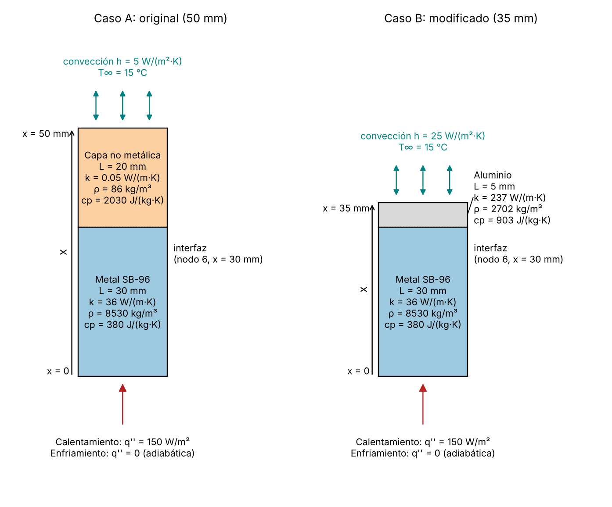
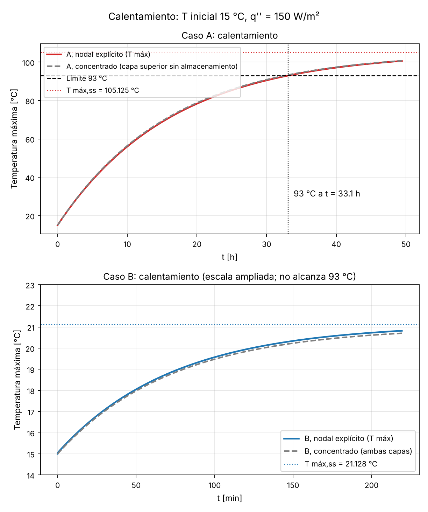
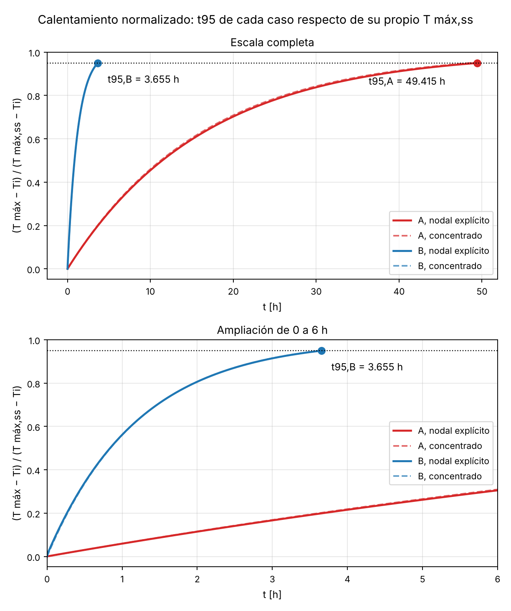
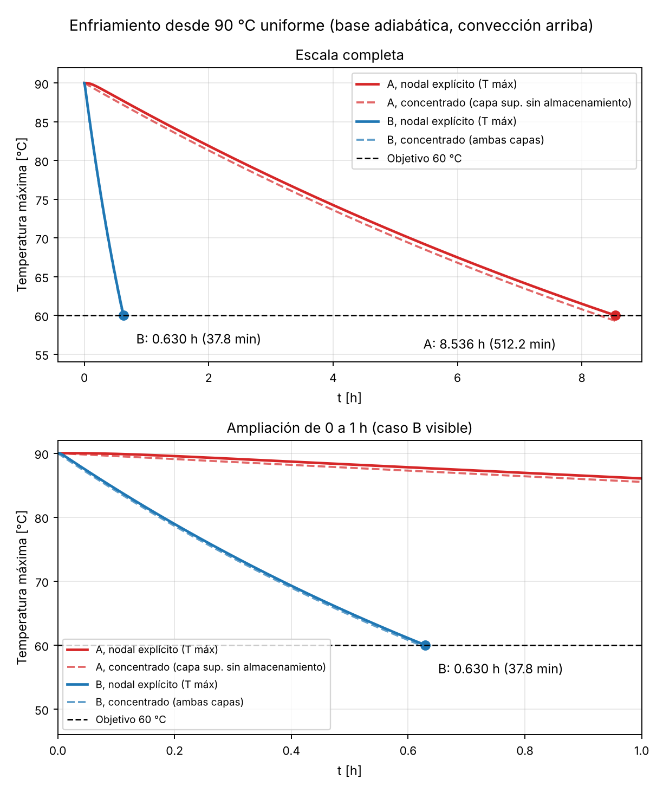

# Ejercicio modificado 5-34: análisis transitorio y mejora del enfriamiento

## 1. Portada

**Versión:** Versión 3 — preparada para revisión final de las estudiantes

**Estudiantes:**

1. Karina Hernández Cruz.
2. Claudia Román García.

**Curso:** Transferencia de Calor, proyecto de métodos numéricos.

**Fecha de generación del borrador:** 25 de octubre de 2026.

**Estado:** borrador de la versión 3, generado con asistencia de IA a partir de la versión 2 y de las observaciones de auditoría indicadas en el prompt de la versión 3 y en su aclaración de alcance, y completado con la comparación con el documento de cálculos manuales de las estudiantes (secciones 12.4 y 16). **No está aprobado ni firmado** y no certifica una verificación manual del 100 %. La revisión final y las firmas corresponden a las estudiantes (sección 19).

**Archivos de esta entrega:** reporte_modificado_v3.md, Reporte_modificado_v3.docx, Reporte_modificado_v3.pdf, ej_5_34_modificado_v3.py, esquema_casos_modificado_v3.png, calentamiento_modificado_v3.png, calentamiento_normalizado_modificado_v3.png, enfriamiento_modificado_v3.png, resultados_modificado_v3.csv, convergencia_modificado_v3.csv.

**Uso de IA y archivos para GitHub.** Este reporte y el código se produjeron con asistencia de IA a partir de la versión 2 y del prompt de la versión 3. El prompt, la respuesta y los archivos listados deben conservarse en el repositorio del grupo. Las estudiantes utilizaron una estructura propia de prompts, conforme a la alternativa autorizada por el profesor. El alcance de cada tipo de comprobación (desarrollo manual y Excel confirmados por las estudiantes, computacional y análisis adicional) se separa en las secciones 12 y 16.

**Denominación.** Esta es la versión 3 del ejercicio modificado. No es una versión nueva del ejercicio original y no modifica los reportes aprobados del ejercicio original.

**Documentos consultados y no consultados.**

| Documento | Estado en esta sesión |
|--------------------------|--------------------------------------------|
| Instrucciones y rúbrica del profesor (`092126 2.pdf`) | Abiertas y leídas. |
| Reporte, código, figuras y CSV de la versión 2 | Disponibles. La versión 3 parte de ellos. El código se volvió a ejecutar y reproduce los dos CSV de la versión 2 sin cambios (sección 12.1). |
| Reporte de la versión 2 con los comentarios de la auditoría (PDF auditado) | **No estaba adjunto.** Se aplicaron las observaciones enumeradas en el prompt de la versión 3 y en su aclaración de alcance; no se leyeron comentarios individuales del PDF auditado. |
| Apuntes del curso (`Libreta.pdf`, `Libreta Examen 2.pdf`, `Libreta Heat Transfer examen .pdf`) | Se buscó en su texto extraíble en la versión 2; no se localizaron los valores de $\rho$ y $c_p$ usados. No se citan páginas. |
| Cálculos manuales del ejercicio modificado 5-34 (`Calculos_manuales_Ejercicio_modificado_5_34.pdf`, 14 páginas, con las tablas de Excel impresas) | **Abierto y leído completo.** Se contrasta en las secciones 12.4 y 16 y es la evidencia de la verificación manual de las estudiantes. Contiene el problema modificado ("Problem 2"); **no contiene el ejercicio original estacionario ni los archivos `.xlsx`**. Se contrastaron los valores escritos a mano y los de las tablas impresas. |
| Propiedades de los materiales | Las propiedades se tomaron del documento de cálculos de las estudiantes, que identifica el libro de texto como fuente. Los valores utilizados en el reporte coinciden con los de ese documento. El libro de texto no se consultó directamente (ver referencias). |

**Confirmación de las estudiantes.** Karina Hernández Cruz y Claudia Román García confirmaron que completaron la verificación manual de los cálculos incluidos en su documento `Calculos_manuales_Ejercicio_modificado_5_34.pdf`, que contrastaron sus resultados con los de este reporte y que confirman la concordancia de los resultados principales, considerando las diferencias de redondeo y de aproximación identificadas. Su documento es la evidencia para comparar y verificar esta solución independiente: ningún resultado de este reporte se sustituyó por los de ellas ni se modificó para forzar coincidencias. Estado de los cálculos presentes en su documento: *Contrastado con los cálculos de las estudiantes; concordancia dentro de las diferencias indicadas* (sección 12.4 y grupo A de la sección 16). La confirmación se refiere a los cálculos de su documento; las pruebas adicionales del código que no están en él se identifican como «Comprobación computacional adicional; fuera del alcance del contraste manual» (grupos B y C de la sección 16).

## 2. Objetivo y relación con el ejercicio original

El ejercicio original 5-34 es una pared compuesta (placa metálica SB-96 y capa no metálica) en **estado estacionario** con flujo de calor impuesto en la cara inferior y convección en la superior. Su análisis, ya aprobado, se resolvió por diferencias finitas con $\Delta x = 5$ mm y 11 nodos. Aquí se conserva ese análisis: la solución estacionaria sigue siendo válida y el transitorio no la invalida. El estado estacionario da las temperaturas finales y permite verificar el límite térmico de 93 °C. El transitorio es necesario para obtener tiempos.

**Objetivo.** Adaptar el ejercicio cambiando el material, la geometría y la convección. Se conserva el análisis de calentamiento (desarrollo previo de las estudiantes) para estudiar la evolución hacia el estado estacionario y verificar el límite térmico. Como prueba adicional, se demuestra cuantitativamente un **enfriamiento significativamente más rápido** entre las mismas temperaturas inicial (90 °C) y objetivo (60 °C).

Estabilizarse antes hacia una temperatura final distinta **no demuestra por sí solo** un enfriamiento más rápido entre temperaturas comunes. Por eso la comparación de la mejora se hace con la prueba adicional de enfriamiento (prueba II, sección 11), con temperaturas inicial y objetivo comunes.

Este reporte no repite el desarrollo completo del ejercicio original. Solo se incluye lo necesario para entender y comparar la adaptación.

**Relación con el documento de las estudiantes.** Su documento (14 páginas) desarrolla el problema modificado con los mismos datos, modelo y condiciones que este reporte: la tabla de datos de su p. 2 coincide con la sección 5.1. No incluye el ejercicio original estacionario. La comparación completa está en la sección 12.4. No se encontró ninguna diferencia de datos ni de planteamiento. Las diferencias numéricas se conservan y se explican (por inferencia) por el redondeo de coeficientes, por definiciones distintas de algunas magnitudes y por la determinación de los tiempos.

## 3. Enunciado del ejercicio modificado

Se tiene una placa inferior de cobre-silicio SB-96 de 30 mm sobre la que se apoya una capa superior. Se estudian por unidad de área transversal dos configuraciones:

- **Caso A (sistema original):** capa superior no metálica de 20 mm, $h = 5$ W/(m²·K).
- **Caso B (sistema modificado):** capa superior de aluminio de 5 mm, $h = 25$ W/(m²·K).

Para cada configuración se pide:

1. **Prueba I, calentamiento:** con $T(x,0) = 15$ °C y un flujo constante de 150 W/m² en $x = 0$ desde $t = 0$, hallar la temperatura máxima estacionaria, si se alcanza 93 °C y cuándo, y el tiempo $t_{95}$.
2. **Prueba II, enfriamiento (se incorporó inicialmente como análisis adicional; según la confirmación de las estudiantes, ahora también forma parte de su desarrollo):** con $T(x,0) = 90$ °C uniforme, flujo impuesto igual a cero en $x = 0$ (cara adiabática) y convección hacia aire a 15 °C en la cara superior, hallar el tiempo hasta que la temperatura máxima de todo el sistema baja a 60 °C.
3. Comparar los tiempos de enfriamiento de A y B y sustentar cuantitativamente la reducción.

Las temperaturas de 90 °C y 60 °C son condiciones elegidas para una comparación común. No son datos del ejercicio original.

## 4. Configuraciones A y B

Son **dos configuraciones físicas** sometidas a **dos condiciones de operación** (prueba I y prueba II). No son cuatro diseños distintos.

Se define $x = 0$ en la superficie inferior de la placa SB-96 y $+x$ hacia la superficie superior expuesta al aire. La interfaz está en $x = 30$ mm en ambos casos.

**Los tres cambios combinados del caso B respecto de A:**

1. La capa no metálica se sustituye por aluminio.
2. El espesor de esa capa baja de 20 a 5 mm.
3. El coeficiente $h$ sube de 5 a 25 W/(m²·K).

La tabla siguiente separa el efecto de cada cambio sobre las magnitudes que importan. Es un análisis de las magnitudes del modelo, no un aislamiento numérico: solo se compararon A y B, y no se ejecutaron casos que cambien un solo parámetro.

| Magnitud | Cambio que la afecta | Caso A | Caso B | Efecto |
|--------------|----------------|--------|--------|--------------------------|
| $R''$ de la capa superior | Material y espesor | 0.400 m²·K/W | $2.110\times10^{-5}$ m²·K/W | Cae casi a cero: el aluminio casi no añade resistencia |
| $R''_{conv} = 1/h$ | $h$ | 0.200 m²·K/W | 0.040 m²·K/W | Baja 5 veces |
| $R''_{tot}$ | Los tres | 0.600833 m²·K/W | 0.040854 m²·K/W | Baja 14.7 veces |
| $C''$ de la capa superior | Material y espesor | 3491.6 J/(m²·K) | 12199.5 J/(m²·K) | **Aumenta** 3.49 veces |
| $C''$ total | Material y espesor | 100733.6 J/(m²·K) | 109441.5 J/(m²·K) | Aumenta 8.64 % respecto de A |
| $T_{m\acute{a}x,ss}$ | Resistencia total | 105.125 °C | 21.128 °C | Baja porque $T_{m\acute{a}x,ss} - T_\infty = q''R''_{tot}$ |
| Respuesta y enfriamiento | Resistencia externa y capacidad | $\tau_{conc}$ = 16.207 h | $\tau_{conc}$ = 1.216 h | Domina la caída de la resistencia externa, no la capacidad |

La capacidad térmica por unidad de área **no baja**: sube un poco, porque el aluminio almacena más energía por metro cuadrado que la capa no metálica. Por tanto, la mejora no viene de almacenar menos energía. Viene de que la resistencia entre el sistema y el aire baja mucho.

La modificación **combina material, espesor y convección**, y no se atribuye toda la mejora al aluminio. Con aritmética de resistencias (no es una simulación ni un aislamiento numérico del enfriamiento), cada cambio por separado daría:

| Cambio aplicado | $R''_{tot}$ resultante [m²·K/W] | Factor $R''_{tot,A}/R''_{tot}$ |
|-------------------------|-------------|-------------|
| Solo la capa de aluminio de 5 mm (con $h = 5$) | 0.201 | 2.99 |
| Solo $h = 25$ W/(m²·K) (con la capa no metálica) | 0.441 | 1.36 |
| Ambos cambios (caso B) | 0.040854 | 14.71 |

**Las reducciones absolutas se suman, y sus porcentajes también cuando comparten el denominador.** Las resistencias en serie se suman, y por eso sus reducciones absolutas: la reducción total de $R''_{tot}$ es la reducción de la resistencia de la capa superior más la de la resistencia convectiva. Si cada reducción se expresa como porcentaje de la **misma** resistencia inicial, $R''_{tot,A}$ = 0.600833 m²·K/W, los porcentajes también se suman.

| Contribución | Cálculo | Reducción [m²·K/W] | % de $R''_{tot,A}$ |
|----------------------|----------------------|-------------|-----------|
| Capa superior (material y espesor) | 0.400 − $2.110\times10^{-5}$ | 0.399979 | 66.6 |
| Convección | 0.200 − 0.040 | 0.160 | 26.6 |
| Total | 0.600833 − 0.040854 | 0.559979 | 93.2 |

Con esa base común, 66.6 % + 26.6 % = 93.2 %. Dicho de otro modo, entre ambas contribuciones la capa superior aporta 71.4 % de la reducción total y la convección 28.6 % (base: la reducción total). **No deben sumarse** porcentajes calculados con bases distintas: por ejemplo, la reducción de la capa respecto de su propia resistencia (100.0 %) y la de la convección respecto de su propia resistencia (80.0 %) no dan un porcentaje del total. Tampoco se suman ni se multiplican los factores individuales de la tabla anterior (2.99 y 1.36) para obtener el combinado (14.71): su suma es 4.35 y su producto 4.08, porque son cocientes de resistencias.

**La mejora del tiempo no se deduce de estas sumas.** Se obtiene del análisis transitorio (sección 11), que depende de la capacidad y de $R''_{ext}$ (sección 8.5). No se ejecutaron casos con un solo cambio, así que no se reparte la mejora del tiempo entre los tres cambios. Que la capa aporte una reducción absoluta mayor que la convección describe la resistencia, no el tiempo de enfriamiento. Tampoco se atribuye toda la mejora al aluminio: también cambian el espesor de la capa y la convección.

**Capacidades térmicas, con su denominador.** La capacidad del aluminio ($C''_a$ = 12199.5 J/(m²·K)) es 12.5 % de la del metal inferior ($C''_m$ = 97242.0 J/(m²·K)). La capacidad total de B (109441.5 J/(m²·K)) es 8.64 % mayor que la total de A (100733.6 J/(m²·K)), con A como denominador. La capa no metálica de A (3491.6 J/(m²·K)) es 3.5 % de la capacidad total de A.

$h_B = 25$ W/(m²·K) se presenta como **condición de diseño**. No se afirma que cualquier ventilador garantice ese valor ni se supone una velocidad de aire.

## 5. Datos, fuentes y supuestos

### 5.1 Tabla de datos

Se trabaja por unidad de área transversal. No se inventan dimensiones laterales.

| Símbolo | Descripción | Valor | Unidad | Clase |
|-------|------------------------|---------|---------|----------------|
| $L_m$ | Espesor del SB-96 | 0.030 | m | Original |
| $k_m$ | Conductividad del SB-96 | 36 | W/(m·K) | Original |
| $L_n$ | Espesor de la capa no metálica (A) | 0.020 | m | Original |
| $k_n$ | Conductividad de la capa no metálica (A) | 0.050 | W/(m·K) | Original |
| $h_A$ | Coeficiente de convección (A) | 5 | W/(m²·K) | Original |
| $T_\infty$ | Temperatura del aire | 15 | °C | Original |
| $q''$ | Flujo impuesto en $x = 0$ (prueba I) | 150 | W/m² | Original |
| — | Límite térmico del ejercicio | 93 | °C | Original |
| $\rho_m$ | Densidad del SB-96 | 8530 | kg/m³ | Adoptada para el transitorio |
| $c_{p,m}$ | Calor específico del SB-96 | 380 | J/(kg·K) | Adoptada para el transitorio |
| $\rho_n$ | Densidad de la capa no metálica (A) | 86 | kg/m³ | Adoptada para el transitorio |
| $c_{p,n}$ | Calor específico de la capa no metálica (A) | 2030 | J/(kg·K) | Adoptada para el transitorio |
| $L_a$ | Espesor del aluminio (B) | 0.005 | m | Modificada por diseño |
| $k_a$ | Conductividad del aluminio (B) | 237 | W/(m·K) | Modificada por diseño |
| $\rho_a$ | Densidad del aluminio (B) | 2702 | kg/m³ | Modificada por diseño |
| $c_{p,a}$ | Calor específico del aluminio (B) | 903 | J/(kg·K) | Modificada por diseño |
| $h_B$ | Coeficiente de convección (B) | 25 | W/(m²·K) | Modificada por diseño |
| $T_i$ (I) | Temperatura inicial, calentamiento | 15 | °C | Elegida para la comparación |
| $T_i$ (II) | Temperatura inicial, enfriamiento | 90 | °C | Elegida para la comparación |
| $T_{obj}$ | Temperatura máxima objetivo, enfriamiento | 60 | °C | Elegida para la comparación |
| $\Delta x$ | Espaciamiento de la malla base | 0.005 | m | Numérica |

Espesor total: 0.050 m (A) y 0.035 m (B).

### 5.2 Fuentes y estado de las propiedades

Los datos originales vienen del ejercicio y del prompt. Las propiedades $\rho$ y $c_p$ son valores adoptados para el transitorio. Las propiedades se tomaron del documento de cálculos de las estudiantes, que identifica el libro de texto como fuente. Los valores utilizados en el reporte coinciden con los de ese documento. Que coincidan con ese documento no elimina su carácter de supuesto cuando se aplican al SB-96 (ver abajo).

| Material | Valores adoptados | Fuente indicada en el documento de las estudiantes | Uso en este reporte |
|--------------|----------------------|---------------------------|----------------------------------|
| Aluminio (caso B) | $\rho$ = 2702 kg/m³, $c_p$ = 903 J/(kg·K), $k$ = 237 W/(m·K) | Libro de texto (Çengel, Apéndice 1), aluminio | Valores adoptados tal cual |
| Capa no metálica (caso A) | $\rho$ = 86 kg/m³, $c_p$ = 2030 J/(kg·K) | Libro de texto (Çengel, Apéndice 1), corcho ($k$ = 0.048 W/(m·K)) | Solo se adoptan del corcho las propiedades de almacenamiento. Se conserva $k_n$ = 0.050 W/(m·K), dato original |
| SB-96 (placa) | $\rho$ = 8530 kg/m³, $c_p$ = 380 J/(kg·K) | Documento de las estudiantes: los rotula como propiedades del SB-96; corresponden a las del latón tabulado | **Supuesto de trabajo.** Se conserva $k_m$ = 36 W/(m·K), dato original |

- **Capa no metálica.** No se afirma que el material original se haya identificado como corcho ni se sustituye su conductividad (0.050 contra 0.048 W/(m·K)).
- **SB-96.** El ejercicio lo identifica como cobre-silicio. Que sus valores de $\rho$ y $c_p$ coincidan con los del latón tabulado no justifica atribuirle las propiedades del latón: se mantienen como supuesto, salvo que una fuente específica del SB-96 lo respalde. Tampoco se cambió $k_m$ = 36 W/(m·K) por la conductividad del latón.
- **Temperatura de referencia.** El documento de las estudiantes no consigna una temperatura de referencia para las propiedades, y este reporte no asigna ninguna. En todo el modelo las propiedades se **mantienen constantes** (independientes de la temperatura), aunque el sistema recorre de 15 a 105 °C en el caso A. Es una simplificación de la hipótesis 2 de la sección 6.1.
- **Documento de las estudiantes.** Su p. 2 lista los mismos valores de $k$, $\rho$, $c_p$, $L$ y $h$, anota que provienen del Apéndice 1 del libro de Çengel y que la capa no metálica de A se aproxima como corcho. Rotula $\rho$ y $c_p$ del metal como propiedades del SB-96; este reporte los mantiene como **supuesto de trabajo** (valores del latón tabulado), porque la coincidencia con el documento no elimina ese carácter.
- **Estado frente a la versión 1.** La versión 1 declaró que no pudo confirmarse la fuente de estas propiedades. Esa declaración corresponde a esa versión y no se modifica. Desde la versión 3, la procedencia es la del documento de las estudiantes, contrastado con los valores de este reporte.

**Sensibilidad de los tiempos a $\rho_m c_{p,m}$ (estimación de primer orden).** Con el modelo concentrado (sección 8.5), $\tau = C''R''_{ext}$ y los tiempos concentrados son proporcionales a $\tau$ (con $T_i$ y $T_{ss}$ fijos). Si solo cambia $\rho_m c_{p,m}$ en ±10 % y los demás datos se mantienen constantes, el cambio relativo de $\tau$ es ±10 % por la fracción de $C''$ que aporta el metal:

| Variante concentrada | Fracción de $C''$ aportada por el metal | Cambio de $\tau$ y de los tiempos |
|--------------------------|-------------|-------------|
| A, almacenamiento solo en el metal (aproximación principal) | 100 % | ±10.0 % |
| A, variante que incluye la capacidad de la capa superior | 96.5 % | ±9.7 % |
| B, capacidad total (ambas capas) | 88.9 % | ±8.9 % |

Son estimaciones de primer orden con el modelo concentrado. **No son un estudio de sensibilidad con el modelo nodal**, que no se ejecutó. Un error de ±10 % en $k_n$ cambia $R''_{ext,A}$ aproximadamente ∓6.7 %, también como estimación de primer orden.

## 6. Modelo físico y condiciones de frontera

### 6.1 Supuestos

1. Conducción unidimensional en $x$.
2. Propiedades constantes dentro de cada material.
3. Sección transversal constante.
4. Contacto térmico perfecto entre capas.
5. Sin generación volumétrica de calor. El flujo aplicado en la frontera $x = 0$ **no** es generación volumétrica: es una condición de frontera.
6. Sin pérdidas laterales.
7. Radiación omitida en este modelo. $h$ representa solo convección.
8. Ambiente a temperatura constante.
9. Convección prescrita en la superficie superior.

### 6.2 Ecuaciones

En cada material ($i$ = metal, capa superior):

$$
\rho_i c_{p,i}\,\frac{\partial T}{\partial t} = k_i\,\frac{\partial^2 T}{\partial x^2}
\quad\Longleftrightarrow\quad
\frac{\partial T}{\partial t} = \alpha_i\,\frac{\partial^2 T}{\partial x^2},\qquad \alpha_i = \frac{k_i}{\rho_i c_{p,i}}
$$

Símbolos: $T$ es la temperatura [°C], $t$ el tiempo [s], $x$ la coordenada [m], $k$ la conductividad [W/(m·K)], $\rho$ la densidad [kg/m³], $c_p$ el calor específico [J/(kg·K)] y $\alpha$ la difusividad térmica [m²/s].

**Condiciones de frontera.**

- En $x = 0$: $-k_m\,\partial T/\partial x\big|_{x=0} = q''_{ap}(t)$, con $q''_{ap} = 150$ W/m² en la prueba I y $q''_{ap} = 0$ en la prueba II (cara adiabática, sin convección inferior).
- En $x = L_{tot}$: $-k_s\,\partial T/\partial x\big|_{x=L_{tot}} = h\,[T(L_{tot},t) - T_\infty]$, donde $k_s$ es la conductividad de la capa superior.
- En la interfaz ($x = L_m$), con contacto perfecto: $T_m = T_s$ (continuidad de temperatura) y $k_m\,\partial T_m/\partial x = k_s\,\partial T_s/\partial x$ (continuidad de flujo).

**Condiciones iniciales.**

- Prueba I: $T(x,0) = 15$ °C en ambas capas.
- Prueba II: $T(x,0) = 90$ °C uniformemente en ambas capas. Es una prueba independiente del arranque de calentamiento. **No** es el perfil estacionario previo del calentamiento: son condiciones iniciales distintas.

En la prueba II el sistema se encuentra con el calentamiento apagado, con la cara inferior adiabática y con la cara superior expuesta a aire a 15 °C. Cada configuración conserva sus materiales, espesores y $h$.

## 7. Selección de métodos

| Método | Para qué se usa aquí | Condiciones de validez y límites |
|--------------|---------------------|------------------------------|
| Resistencias térmicas (estacionario) | $T_{m\acute{a}x,ss}$ y verificación del límite de 93 °C | Solo estado estacionario con flujo unidimensional |
| Capacidad concentrada | Aproximación analítica de $\tau$, $t_{95}$ y tiempos de enfriamiento | Requiere un Biot efectivo pequeño; no representa el gradiente interno |
| Diferencias finitas, esquema explícito | **Resultado base** de tiempos (A: $\Delta t$ = 1 s, B: $\Delta t$ = 0.1 s) | Estabilidad condicionada (sección 9.4); error temporal de primer orden |
| Mismo sistema nodal, integración temporal exacta | Aislar el error espacial en el estudio de malla (sección 12) | Resuelve el sistema discretizado, no el problema continuo; no es una solución exacta |
| Heisler y soluciones de un término | **No se aplican** | Ver sección 8.4 |

Todos los métodos se contrastan entre sí. Ningún modelo se ajustó artificialmente para coincidir con otro.

## 8. Desarrollo analítico aproximado

### 8.1 Propiedades y resistencias por unidad de área

Difusividad $\alpha = k/(\rho c_p)$, resistencia de cada capa $R'' = L/k$ y de convección $R''_{conv} = 1/h$, y capacidad $C'' = \sum \rho c_p L$:

| Magnitud | Cálculo | Resultado |
|-------------|-----------------------------|------------------|
| $\rho_m c_{p,m}$ | $8530 \times 380$ | 3241400 J/(m³·K) |
| $\rho_n c_{p,n}$ | $86 \times 2030$ | 174580 J/(m³·K) |
| $\rho_a c_{p,a}$ | $2702 \times 903$ | 2439906 J/(m³·K) |
| $\alpha_m$ | $36 / 3241400$ | $1.111\times10^{-5}$ m²/s |
| $\alpha_n$ | $0.050 / 174580$ | $2.864\times10^{-7}$ m²/s |
| $\alpha_a$ | $237 / 2439906$ | $9.713\times10^{-5}$ m²/s |
| $R''_m$ | $0.030/36$ | $8.333\times10^{-4}$ m²·K/W |
| $R''_n$ | $0.020/0.050$ | 0.400 m²·K/W |
| $R''_a$ | $0.005/237$ | $2.110\times10^{-5}$ m²·K/W |
| $R''_{conv,A}$ | $1/5$ | 0.200 m²·K/W |
| $R''_{conv,B}$ | $1/25$ | 0.040 m²·K/W |
| $C''_m$ | $8530 \times 380 \times 0.030$ | 97242.0 J/(m²·K) |
| $C''_n$ | $86 \times 2030 \times 0.020$ | 3491.6 J/(m²·K) |
| $C''_a$ | $2702 \times 903 \times 0.005$ | 12199.5 J/(m²·K) |
| $C''_{tot,A}$ | $C''_m + C''_n$ | 100733.6 J/(m²·K) |
| $C''_{tot,B}$ | $C''_m + C''_a$ | 109441.5 J/(m²·K) |

### 8.2 Estado estacionario (resistencias) y distinción de resistencias

La **resistencia total** usada para la temperatura máxima estacionaria es la suma en serie hasta la cara inferior, donde está el máximo:

$$
R''_{tot} = R''_m + R''_{s} + R''_{conv},\qquad T_{m\acute{a}x,ss} = T_\infty + q''\,R''_{tot}
$$

- Caso A: $R''_{tot} = 8.333\times10^{-4} + 0.400 + 0.200 = 0.600833$ m²·K/W, y $T_{m\acute{a}x,ss,A} = 15 + 150 \times 0.600833 = 105.125$ °C.
- Caso B: $R''_{tot} = 8.333\times10^{-4} + 2.110\times10^{-5} + 0.040 = 0.040854$ m²·K/W, y $T_{m\acute{a}x,ss,B} = 15 + 150 \times 0.040854 = 21.128$ °C.
- Temperatura en la interfaz y en la superficie superior en el estacionario: A, 105.000 °C y 45.000 °C; B, 21.003 °C y 21.000 °C.

En cambio, la **resistencia externa equivalente** $R''_{ext}$ que se usa en la aproximación concentrada es la resistencia entre el cuerpo que se supone isotérmico y el aire. No incluye la resistencia interna del cuerpo:

- Caso A: el cuerpo es el metal, $R''_{ext,A} = L_n/k_n + 1/h_A = 0.600$ m²·K/W.
- Caso B: el cuerpo es el metal más el aluminio, $R''_{ext,B} = 1/h_B = 0.040$ m²·K/W.

Por eso la temperatura estacionaria concentrada (105.000 °C en A, 21.000 °C en B) difiere de $T_{m\acute{a}x,ss}$ (105.125 °C y 21.128 °C): la diferencia es la caída interna que la aproximación desprecia.

### 8.3 Biot y Fourier

**Longitud característica.** Las capas no están expuestas por ambas caras a un fluido, así que no se usa $L/2$. La capa superior tiene una cara convectiva y la otra en contacto con el metal. Se usa su espesor completo como longitud característica.

**Biot convencional** (se identifica como tal): $Bi = hL_c/k$ con $L_c$ el espesor de la capa expuesta.

- Capa no metálica del caso A: $Bi = 5 \times 0.020/0.050 = 2.0$. Es mayor que 0.1: **la capa no metálica no es isotérmica** y no debe declararse así.
- Aluminio del caso B: $Bi = 25 \times 0.005/237 = 5.27\times10^{-4}$, menor que 0.1.

**Biot efectivo** (estimación basada en una conductancia equivalente; **no** es una identidad universal para paredes compuestas): relación entre la resistencia interna del cuerpo supuesto isotérmico y la resistencia externa,

$$
Bi_{ef} = \frac{R''_{int}}{R''_{ext}}
$$

- Caso A (cuerpo = metal, $R''_{int} = R''_m$): $Bi_{ef} = 8.333\times10^{-4}/0.600 = 1.39\times10^{-3}$.
- Caso B (cuerpo = metal + aluminio, $R''_{int} = R''_m + R''_a$): $Bi_{ef} = (8.333\times10^{-4} + 2.110\times10^{-5})/0.040 = 0.0214$.

Ambos son menores que 0.1. Un Biot efectivo pequeño es una condición **necesaria** para tratar un cuerpo como isotérmico, no suficiente: no garantiza que la respuesta concentrada coincida con la nodal en todo instante. Eso se contrasta numéricamente (secciones 8.5, 8.6, 10 y 11). Un $Bi$ convencional mayor que 0.1 (la capa no metálica de A) solo indica que esa capa **no** debe suponerse a temperatura uniforme.

**Número de Fourier.** $Fo = \alpha t/L_c^2$ mide cuánto ha avanzado la difusión en una capa. Para el tiempo de enfriamiento de cada caso (resultado base, sección 11):

| Caso | $Fo$ del metal ($L_c$ = 0.030 m) | $Fo$ de la capa superior ($L_c$ = espesor) |
|------|-------------------|--------------------|
| A, $t$ = 30729.3 s | 379.210 | 22.0 |
| B, $t$ = 2266.2 s | 27.966 | 8805.15 |

No se usa $Fo$ como criterio de validez de ninguna solución de un término. **No** debe confundirse con el parámetro de malla $Fo_\Delta = \alpha\,\Delta t/\Delta x^2$ (sección 9), que gobierna la estabilidad del esquema explícito. La constante de tiempo de la aproximación concentrada se denota $\tau$ para no repetir el símbolo de Fourier.

### 8.4 Heisler y soluciones de un término

Las gráficas de Heisler y las soluciones de un término corresponden a un sólido **homogéneo** con condición inicial uniforme y convección a temperatura constante. Aquí hay una pared **compuesta** de dos materiales, un flujo impuesto en una cara (prueba I) o una cara adiabática (prueba II) y convección solo en la cara opuesta. No se aplican sin una justificación que no se ha construido, y no se usaron. Tampoco se afirma que $Fo > 0.2$ valide una solución de un término: ese criterio exige condiciones que este problema no cumple.

### 8.5 Capacidad concentrada: derivación

Se supone un cuerpo de capacidad $C''$ a temperatura uniforme $T(t)$, que recibe $q''_{ap}$ y cede calor al aire a través de $R''_{ext}$. El balance de energía por unidad de área es:

$$
C''\,\frac{dT}{dt} = q''_{ap} - \frac{T - T_\infty}{R''_{ext}}
$$

Se define la temperatura estacionaria $T_{ss,conc} = T_\infty + q''_{ap}R''_{ext}$, que anula el miembro derecho, y $\theta = T - T_{ss,conc}$. Como $T_{ss,conc}$ es constante, $d\theta/dt = -\theta/\tau$ con $\tau = C''R''_{ext}$. Separando variables e integrando desde $\theta_i$:

$$
T(t) = T_{ss,conc} + \left(T_i - T_{ss,conc}\right)e^{-t/\tau}
$$

De aquí salen los tiempos:

- Prueba I, tiempo hasta $T_{lim}$: $t = -\tau\,\ln\!\left[1 - \dfrac{T_{lim}-T_i}{T_{ss,conc}-T_i}\right]$.
- Prueba I, $t_{95}$: $t_{95} = -\tau\ln(0.05)$.
- Prueba II ($q''_{ap} = 0$, $T_{ss,conc} = T_\infty$): $t = \tau\,\ln\!\left[\dfrac{T_i - T_\infty}{T_{obj} - T_\infty}\right] = \tau\ln(75/45)$.

**Caso A, aproximación principal: la capa no metálica como resistencia sin almacenamiento.** $C'' = C''_m$ y $R''_{ext,A} = 0.6$ m²·K/W. Un $Bi$ mayor que 0.1 indica que la capa **no** puede tomarse como isotérmica; no justifica despreciar su almacenamiento. Lo que se supone es que la capa tiene una respuesta **aproximadamente cuasiestacionaria**: su tiempo de ajuste por difusión, $L_n^2/\alpha_n \approx$ 1397 s (23.3 min), es mucho menor que la constante de tiempo del conjunto ($\tau \approx$ 16.207 h), de modo que su perfil sigue al flujo que la atraviesa y el calor que sale es aproximadamente $(T_{metal} - T_\infty)/R''_{ext}$. Que su capacidad (3491.6 J/(m²·K)) sea 3.5 % de la total **no basta** para concluir que la aproximación vale en todo instante: se trata como aproximación y se contrasta con el modelo nodal (tabla siguiente).

**Caso A, variante con la capacidad de la capa superior.** Suma toda la capacidad de la capa superior a una sola temperatura (la del metal), con la misma $R''_{ext}$. Es una **aproximación adicional**: la capa tiene gradientes y su almacenamiento está distribuido, así que no lo representa exactamente. Los tiempos de esta variante, incluido el de ≈ 8.576 h de enfriamiento, deben leerse con esa limitación.

**Caso B, aproximación principal.** $C'' = C''_{tot,B}$ (ambas capas a la misma temperatura) y $R''_{ext,B} = 1/h_B$. Se apoya en $Bi_{ef}$ = 0.0214 y en el $Bi$ del aluminio ($5.27\times10^{-4}$). La comparación con la aproximación de las estudiantes, que incluye la resistencia del aluminio, se hace en la sección 8.6.

| Caso y variante | $C''$ [J/(m²·K)] | $R''_{ext}$ [m²·K/W] | $\tau$ [s] | $\tau$ [h] |
|---------|-------------|-------------|--------|-------|
| A, capa superior sin almacenamiento (principal) | 97242.0 | 0.600 | 58345.2 | 16.207 |
| A, variante con la capacidad de la capa superior | 100733.6 | 0.600 | 60440.2 | 16.789 |
| B, ambas capas isotérmicas (principal) | 109441.5 | 0.040 | 4377.7 | 1.216 |

**Resultados concentrados** (estos valores se mantienen separados de los nodales y de los estacionarios por resistencias, y no se ajustaron para coincidir):

| Magnitud | A (principal, sin almacenamiento) | A (variante, con almacenamiento) | B (principal) |
|--------------|----------|----------|----------|
| $T_{ss,conc}$ [°C] | 105.000 | 105.000 | 21.000 |
| Tiempo para 93 °C [h] | 32.656 | 33.828 | No alcanza |
| $t_{95}$ [h] | 48.552 | 50.295 | 3.643 |
| Enfriamiento 90→60 °C [h] | 8.279 | 8.576 | 0.621 |

**Contraste del caso A con el modelo nodal** (esquema explícito, malla de 5 mm; diferencia relativa = (concentrado − nodal)/nodal):

| Magnitud | Nodal [h] | A principal [h] | Dif. [%] | A variante [h] | Dif. [%] |
|--------------|--------|--------|--------|--------|--------|
| Tiempo para 93 °C | 33.085 | 32.656 | −1.3 | 33.828 | +2.2 |
| $t_{95}$ | 49.415 | 48.552 | −1.7 | 50.295 | +1.8 |
| Enfriamiento 90→60 °C | 8.536 | 8.279 | −3.0 | 8.576 | +0.5 |

La aproximación principal subestima los tres tiempos (la capa superior sí almacena algo de energía) y la variante los sobrestima. Que la variante quede muy cerca del nodal en el enfriamiento no la valida: se aleja más en el calentamiento, así que el acuerdo en una sola magnitud no demuestra la aproximación. Las diferencias persisten porque el modelo concentrado desprecia el gradiente interno: el máximo local (en $x = 0$) queda por encima de la temperatura concentrada, y en el estacionario el máximo local supera a la concentrada en 0.125 K (A) y 0.128 K (B).

**Estimación nodal de las estudiantes para A.** Su documento (p. 11) estima el tiempo de A hasta 93 °C por **interpolación lineal entre dos filas de su tabla de Excel**: 33 h ($T_0$ = 92.96 °C) y 48 h ($T_0$ = 100.23 °C), separadas 15 h, y obtiene 33.0825 h. El código obtiene 33.0850 h al interpolar entre pasos consecutivos de 1 s. Las dos cifras difieren −0.0025 h (−0.008 %), pero **no son resultados exactamente iguales** y su cercanía es en parte una compensación de dos efectos: (i) las tablas de Excel usan coeficientes redondeados y dan temperaturas algo mayores, de modo que el cruce exacto de ese esquema sería 33.0582 h (−0.027 h respecto del código); (ii) interpolar linealmente sobre 15 h retrasa el cruce +0.024 h respecto de ese cruce exacto, porque la curva es cóncava. Con los valores del propio código en las mismas filas (33 h y 48 h), la interpolación daría 33.129 h (+0.044 h respecto del cruce con pasos de 1 s). Tampoco debe confundirse el tiempo concentrado (32.656 h, modelo de un solo nodo) con el nodal (33.085 h): son modelos distintos y difieren 1.3 %; el documento (p. 11) informa una diferencia de 1.3 % entre ambos.

**Variante con la capacidad de la capa superior.** El documento (pp. 2, 3 y 5) desprecia el almacenamiento de la capa no metálica en A (3.6 % de la capacidad del metal) y no desarrolla esta variante; por eso no se clasifica como verificada manualmente (sección 16).

### 8.6 Caso B: aproximación principal y aproximación con la resistencia del aluminio

El documento de las estudiantes (pp. 3 y 6) plantea el concentrado de B con la capacidad total de ambas capas, $\sum\rho c_pL$ = 109 442 J/(m²·K), y con la resistencia del aluminio incluida, $R_{tot,B} = L_a/k_a + 1/h_B$ = 0.040021 m²·K/W ($U_B$ = 24.9868 W/(m²·K)). Obtiene $1/b_B$ = 4379.43 s = 1.22 h y $T_{ss}$ = 21.0024 °C. Aquí se calculó el mismo planteamiento con $C''_{tot,B}$ y $R''_{ext}$ = 0.040021 m²·K/W: $\tau$ = 4379.97 s = 1.2167 h y $T_{ss}$ = 21.0032 °C. La diferencia (+0.012 % en $\tau$) se debe a que el documento redondea $U_B$ a 24.99. El planteamiento es el mismo, así que ya no es una reconstrucción: está contrastado con el documento. La versión 1 y la aproximación principal de esta versión consideran ambas capas isotérmicas con $R''_{ext,B} = 1/h_B$ y dan 1.216 h; esa aproximación no está en el documento.

| Aproximación | Capacidad | Resistencia | Constante de tiempo | Hipótesis y limitaciones |
|----------------|--------------|--------------|--------------|------------------------------------|
| **Principal** (v1, v2 y v3): ambas capas isotérmicas | $C''_{tot,B}$ = 109441.5 J/(m²·K) | $R''_{ext} = 1/h_B$ = 0.040 m²·K/W | 4377.7 s = 1.216 h | Metal y aluminio a una sola temperatura. Desprecia las resistencias internas ($R''_m + R''_a$ = 0.000854 m²·K/W, $Bi_{ef}$ = 0.0214). $T_{ss,conc}$ = 21.000 °C |
| Con resistencia del aluminio (planteamiento del documento de las estudiantes, pp. 3 y 6) | $C''_{tot,B}$ = 109441.5 J/(m²·K) | $R''_{ext} = 1/h_B + L_a/k_a$ = 0.040021 m²·K/W | 4380.0 s = 1.2167 h | Incluye la caída en el aluminio, pero mantiene su capacidad en el mismo nodo que el metal. Sigue sin incluir la resistencia del metal. $T_{ss,conc}$ = 21.0032 °C |
| Modo más lento del sistema nodal (contraste, malla de 5 mm) | Capacidades nodales | Matriz de conductancias | $\tau_{lento}$ = 4403.6 s = 1.2232 h | Es la constante del modo más lento del sistema discretizado, no una aproximación de un nodo. No es idéntica a los tiempos $t_{95}$ ni de enfriamiento |

**Por qué la diferencia es de planteamiento y no solo de redondeo.** Las resistencias usadas difieren (0.040 contra 0.040021 m²·K/W, 0.053 %) con la misma capacidad, así que las constantes difieren en ese mismo porcentaje: 1.2160 contra 1.2167 h, que redondeadas a tres decimales dan 1.216 y 1.217 h. Un cambio de redondeo no modificaría la resistencia ni la diferencia de planteamiento.

**Limitación concreta de cada enfoque.** La aproximación principal no ve la resistencia del aluminio ni la del metal. La de las estudiantes ve la del aluminio pero no la del metal, y usa la capacidad total de ambas capas a una sola temperatura; por eso la caída que incluye no está ubicada del todo coherentemente con la capacidad. Ambas son estimaciones de primer orden de un cuerpo isotérmico. La diferencia entre ellas (0.053 %) es menor que la distancia de cualquiera al modo más lento del modelo nodal (0.59 % y 0.54 %), así que el modelo nodal no permite preferir una por su constante de tiempo.

**Se mantiene como aproximación principal** la de ambas capas isotérmicas con $R''_{ext} = 1/h_B$, porque es la hipótesis más simple y la misma de la versión 1; el modelo nodal es el contraste. No se forzó que las cifras coincidan. En el registro de la sección 16 la aproximación de las estudiantes y el modo nodal más lento figuran en filas separadas, con clasificaciones distintas.

**Contraste del caso B con el modelo nodal** (explícito, 5 mm):

| Magnitud | Nodal [h] | Principal [h] | Dif. [%] | Con $R''_a$ [h] | Dif. [%] |
|--------------|--------|--------|--------|--------|--------|
| $t_{95}$ | 3.6551 | 3.6429 | −0.34 | 3.6448 | −0.28 |
| Enfriamiento 90→60 °C | 0.6295 | 0.6212 | −1.32 | 0.6215 | −1.27 |

## 9. Desarrollo numérico

### 9.1 Malla y volúmenes de control

Malla base $\Delta x = 0.005$ m. Caso A: 11 nodos (0 a 10), interfaz en el nodo 6. Caso B: 8 nodos (0 a 7), interfaz en el nodo 6. Los nodos de superficie usan **medios volúmenes** de control. En la interfaz, el volumen de control es la mitad del metal y la mitad del material superior, así que su capacidad suma la de ambos materiales. No se asigna al nodo de interfaz las propiedades de un solo material. Como ese volumen almacena energía, los flujos por sus dos caras pueden diferir (sección 12.7).

Capacidades nodales $C_i$ [J/(m²·K)] (por unidad de área):

| Nodo | Descripción | A | B |
|-----|--------------|-------|-------|
| 0 | Superficie inferior (medio volumen de metal) | 8103.5 | 8103.5 |
| 1 a 5 | Interiores del metal | 16207 | 16207 |
| 6 | Interfaz (medio metal más medio material superior) | 8539.95 | 14203.265 |
| 7 a 9 | Interiores de la capa superior (solo A) | 872.9 | — |
| 10 (A) / 7 (B) | Superficie superior (medio volumen) | 436.45 | 6099.765 |

### 9.2 Ecuaciones nodales

Cada ecuación es un balance de energía de un volumen de control por unidad de área. Con $G_j = k_j/\Delta x$ la conductancia del intervalo entre los nodos $j$ y $j+1$ ($k_j$ la del material de ese intervalo) y $p$ el índice de tiempo:

**Superficie inferior (nodo 0).** Recibe el flujo aplicado e intercambia calor por conducción con el nodo 1. El signo de $T_1^p - T_0^p$ determina la dirección: durante el calentamiento $T_0 > T_1$, el término de conducción es negativo y el calor sale del nodo 0 hacia el nodo 1.

$$
C_0\,\frac{T_0^{p+1} - T_0^{p}}{\Delta t} = q''_{ap} + G_0\left(T_1^{p} - T_0^{p}\right)
$$

**Nodos interiores de cada material.**

$$
C_i\,\frac{T_i^{p+1} - T_i^{p}}{\Delta t} = G_{i-1}\left(T_{i-1}^{p} - T_i^{p}\right) + G_i\left(T_{i+1}^{p} - T_i^{p}\right)
$$

con $C_i = \rho c_p\,\Delta x$ del material correspondiente.

**Interfaz (nodo 6)**, con $G_5 = k_m/\Delta x$ y $G_6 = k_s/\Delta x$ y $C_6 = \tfrac12\left[(\rho c_p)_m + (\rho c_p)_s\right]\Delta x$:

$$
C_6\,\frac{T_6^{p+1} - T_6^{p}}{\Delta t} = G_5\left(T_5^{p} - T_6^{p}\right) + G_6\left(T_7^{p} - T_6^{p}\right)
$$

**Superficie superior (nodo $N$)**, con $C_N = \tfrac12 (\rho c_p)_s\,\Delta x$:

$$
C_N\,\frac{T_N^{p+1} - T_N^{p}}{\Delta t} = G_{N-1}\left(T_{N-1}^{p} - T_N^{p}\right) + h\left(T_\infty - T_N^{p}\right)
$$

Estas ecuaciones son la versión transitoria de las del ejercicio original (donde el miembro izquierdo es cero en el estacionario). En la **prueba II** el cambio es solo en el nodo 0: $q''_{ap} = 0$, y el balance inferior queda $C_0\,(T_0^{p+1}-T_0^p)/\Delta t = G_0(T_1^p - T_0^p)$, que representa una cara adiabática.

### 9.3 Esquema explícito y no negatividad de coeficientes

Despejando $T_i^{p+1}$, el coeficiente de $T_i^p$ es $1 - \Delta t\,\sum G/C_i$ y los de los vecinos son positivos. En los nodos sin fuente los coeficientes suman 1. Si todos son no negativos, $T_i^{p+1}$ es un promedio ponderado de valores del paso anterior (más términos fuente acotados) y los errores no crecen: es un criterio **suficiente** de estabilidad y de no negatividad de coeficientes.

### 9.4 Criterio de estabilidad por tipo de nodo

Con $Fo_\Delta = \alpha\,\Delta t/\Delta x^2$ y $Bi_\Delta = h\Delta x/k$:

| Tipo de nodo | Condición $1 - \Delta t\,\sum G/C_i \ge 0$ | $\Delta t$ máximo |
|--------------|-------------------------|-----------------|
| Superficie inferior (metal) | $Fo_\Delta \le 1/2$ | $\Delta x^2/(2\alpha_m)$ |
| Interior | $Fo_\Delta \le 1/2$ | $\Delta x^2/(2\alpha)$ |
| Interfaz | $\Delta t \le \dfrac{\Delta x^2\,[(\rho c_p)_m + (\rho c_p)_s]}{2\,(k_m + k_s)}$ | según la fórmula |
| Superficie superior | $Fo_\Delta\,(1 + Bi_\Delta) \le 1/2$ | $\Delta x^2(\rho c_p)_s/[2k_s(1 + Bi_\Delta)]$ |

Evaluado en la malla base (código, sección 2 de la salida):

| Nodo | A: $\Delta t_{máx}$ [s] | B: $\Delta t_{máx}$ [s] |
|-----|---------|---------|
| 0 a 5 (metal) | 1.1255 | 1.1255 |
| 6 (interfaz) | 1.1845 | 0.2601 |
| Interiores de la capa superior | 43.645 | — |
| Superficie superior | 29.097 | 0.1286 |
| **Límite del sistema** | **1.1255** (nodo 0) | **0.1286** (nodo 7) |
| $\Delta t$ base | 1 | 0.1 |
| $Fo_\Delta$ base en el metal | 0.4443 | 0.0444 |

En el caso A el nodo limitante es el metal (el nodo 0 empata con los interiores del metal); en el caso B lo limita la **superficie superior**, por el aluminio, de difusividad alta ($Fo_\Delta$ del aluminio con $\Delta t$ = 0.1 s es 0.3885). No se supone que un paso válido para A lo sea para B: con $\Delta t$ = 1 s el caso B sería inestable.

**Demostración numérica (código).** Con $\Delta t$ por encima del límite el esquema diverge: A con $\Delta t$ = 1.25 s da $\max|T|$ = $4.41\times10^{5}$ °C tras 200 pasos, y B con $\Delta t$ = 0.2 s da $9.92\times10^{17}$ °C. Esto muestra que el criterio no es una formalidad. La estabilidad no implica precisión: la sensibilidad al paso se estudia en la sección 12.

**Paso admisible al refinar la malla.** Al reducir $\Delta x$ el límite baja con $\Delta x^2$ y debe recalcularse:

| $\Delta x$ [mm] | A: nodos | A: $\Delta t_{máx}$ [s] | B: nodos | B: $\Delta t_{máx}$ [s] |
|--------|-----|----------|-----|----------|
| 5 | 11 | 1.12549 | 8 | 0.12862 |
| 2.5 | 21 | 0.28137 | 15 | 0.03216 |
| 1.25 | 41 | 0.07034 | 29 | 0.00804 |
| 0.625 | 81 | 0.01759 | 57 | 0.00201 |

### 9.5 Primeros pasos nodales de A y de B

Los pasos se calcularon con las propiedades **sin redondear** y se imprimen con 7 u 9 decimales solo al presentarlos; el código conserva toda la precisión interna. Las estudiantes desarrollaron los primeros pasos de ambos casos (pp. 11 y 12 de su documento) con coeficientes redondeados a 4–6 cifras (pp. 9 y 10). Esos coeficientes explican las diferencias pequeñas con los valores de aquí, que se cuantifican en la sección 12.4.3 (hasta $1.7\times10^{-5}$ °C en A y $5.5\times10^{-6}$ °C en B en los primeros 10 pasos). Con $\rho$ y $c_p$ de la sección 5.1, las capacidades $C_0$ y $C_1$ resultan exactas (8103.5 y 16207 J/(m²·K)); el redondeo está en los coeficientes de las ecuaciones, no en las capacidades.

**Caso A, calentamiento.** Datos: $\Delta t$ = 1 s, $T_i = 15$ °C en los 11 nodos, $q'' = 150$ W/m², $k_m/\Delta x = 7200$ W/(m²·K), $C_0 = 8103.5$ J/(m²·K) y $C_1 = 16207$ J/(m²·K).

**Paso 1** ($p = 0 \to 1$). Con todas las temperaturas iguales, solo el nodo 0 cambia, por el flujo aplicado:

$$
T_0^{1} = 15 + \frac{1}{8103.5}\left[150 + 7200\,(15 - 15)\right] = 15 + \frac{150}{8103.5} = 15.0185105\ \text{°C}
$$

Los nodos 1 a 10 siguen en 15 °C, porque sus vecinos están a 15 °C.

**Paso 2** ($p = 1 \to 2$). Ahora el nodo 0 y su vecino ya no están a la misma temperatura:

$$
T_0^{2} = 15.0185105 + \frac{1}{8103.5}\left[150 + 7200\,(15 - 15.0185105)\right] = 15.0205744\ \text{°C}
$$

$$
T_1^{2} = 15 + \frac{1}{16207}\left[7200\,(15.0185105 - 15) + 7200\,(15 - 15)\right] = 15.0082233\ \text{°C}
$$

Los nodos 2 a 10 siguen en 15 °C. Los valores coinciden con la ejecución del código (sección 3 de la salida).

**Caso B, calentamiento.** Datos: $\Delta t$ = 0.1 s, 8 nodos, $T_i = 15$ °C, $q'' = 150$ W/m², $k_m/\Delta x = 7200$ W/(m²·K), $k_a/\Delta x = 47400$ W/(m²·K), $C_0 = 8103.5$ J/(m²·K) y $C_1 = 16207$ J/(m²·K) (el metal es el mismo que en A).

$$
T_0^{1} = 15 + \frac{0.1}{8103.5}\left[150 + 7200\,(15 - 15)\right] = 15.0018511\ \text{°C}
$$

$$
T_0^{2} = 15.0018511 + \frac{0.1}{8103.5}\left[150 + 7200\,(15 - 15.0018511)\right] = 15.0035376\ \text{°C}
$$

$$
T_1^{2} = 15 + \frac{0.1}{16207}\left[7200\,(15.0018511 - 15) + 7200\,(15 - 15)\right] = 15.0000822\ \text{°C}
$$

Los demás nodos siguen en 15 °C. Se observa que $T_0^1$ es el mismo en A y en B por unidad de tiempo ($150/8103.5$ K/s): en $t = 0$ la tasa de calentamiento del nodo inferior no depende de la capa superior, porque ese nodo tiene el mismo medio volumen de metal.

**Cómo cambia el balance inferior al apagar el calentamiento (prueba II).** Se elimina el término $q''$ del nodo 0. Con la temperatura inicial uniforme de 90 °C, en el primer paso el nodo 0 no cambia (no hay flujo ni diferencia con su vecino) y el único nodo que cambia es el de la superficie superior, que pierde calor por convección. Caso A (nodo 10):

$$
T_{10}^{1} = 90 + \frac{1}{436.45}\left[\frac{0.05}{0.005}(90 - 90) + 5\,(15 - 90)\right] = 90 - \frac{375}{436.45} = 89.140795\ \text{°C}
$$

Para el caso B (nodo 7, $C_7$ = 6099.765 J/(m²·K), $\Delta t$ = 0.1 s) el mismo balance da:

$$
T_{7}^{1} = 90 + \frac{0.1}{6099.765}\left[47400\,(90 - 90) + 25\,(15 - 90)\right] = 90 - \frac{187.5}{6099.765} = 89.969261\ \text{°C}
$$

**Alcance.** Comprobar algunos pasos respalda esas operaciones; no equivale a calcular manualmente toda la evolución temporal. Además, que en estos pasos solo cambien los nodos vecinos es una propiedad del esquema explícito (cada paso usa únicamente los nodos adyacentes). **No** debe leerse como una velocidad física de un frente de calor: en la conducción por difusión del modelo continuo, el efecto de la fuente se siente en todo el medio desde el primer instante, aunque sea muy pequeño lejos de ella. La frase del documento de las estudiantes (pp. 11 y 12), "el frente de calor avanza un nodo a la vez", describe esta propiedad del esquema y conviene leerla así.

### 9.6 Métodos usados y determinación de los tiempos

Se usan dos procedimientos distintos para fijar un tiempo de cruce, y no deben confundirse:

- **Simulación explícita (resultado base): interpolación entre pasos.** Esquema explícito, malla de 5 mm, $\Delta t$ = 1 s (A) y 0.1 s (B). El instante en que la temperatura máxima cruza un nivel se obtiene por **interpolación lineal** entre los dos pasos consecutivos que lo encierran. Se ejecutaron pasos reales: por ejemplo, 177894 pasos para el calentamiento de A hasta $t_{95}$, 131584 para el de B y 30730 y 22663 para el enfriamiento de A y B (el último de cada corrida, parcial). Estos números salen de dividir el tiempo simulado entre $\Delta t$ y redondear hacia arriba.
- **Solución del sistema nodal con integración temporal exacta: búsqueda de raíz mediante Brent.** Para el estudio de malla se resolvió el **mismo sistema nodal** $C\,\dot T = -K\,T + f$ mediante su descomposición en valores y vectores propios, que da $T(t)$ en forma cerrada, sin pasos de tiempo. Sobre esa expresión, el tiempo en que la temperatura máxima cruza un nivel se busca con el **método de Brent**, un método numérico de búsqueda de raíces en un intervalo que la encierra (tolerancia de 10⁻⁹ s). Esto **no** es interpolación. Esta solución es exacta en el tiempo **para el sistema discretizado en el espacio**; conserva el error espacial de la malla y por eso **no** es una solución exacta del problema continuo.
- **Último paso parcial.** Cuando la corrida explícita termina en un cruce, el último paso se toma parcial. Como el esquema explícito es lineal en $\Delta t$, avanzar $\theta\,\Delta t$ desde $T^p$ equivale a $T^p + \theta\,(T^{p+1} - T^p)$, con $\theta$ la fracción del paso en que ocurre el cruce. El tiempo reportado se conserva (interpolación) y el calor saliente, la energía almacenada y el balance se evalúan en ese mismo instante.

## 10. Resultados de calentamiento (prueba I)

### 10.1 Temperatura frente al tiempo

Temperaturas en la superficie inferior ($x = 0$), la interfaz y la superficie superior, y ubicación del máximo, del esquema explícito en la malla base:

**Caso A**

| $t$ [h] | $T$ inferior [°C] | $T$ interfaz [°C] | $T$ superior [°C] | Nodo del máximo |
|-----|----------|----------|----------|------|
| 0.5 | 17.736 | 17.670 | 15.704 | 0 |
| 1 | 20.344 | 20.277 | 16.578 | 0 |
| 2 | 25.331 | 25.260 | 18.250 | 0 |
| 4 | 34.441 | 34.364 | 21.304 | 0 |
| 8 | 49.659 | 49.572 | 26.406 | 0 |
| 16 | 70.972 | 70.870 | 33.551 | 0 |
| 24 | 84.095 | 83.984 | 37.950 | 0 |
| 33 | 92.937 | 92.821 | 40.914 | 0 |
| 48 | 100.215 | 100.094 | 43.354 | 0 |

**Caso B**

| $t$ [min] | $T$ inferior [°C] | $T$ interfaz [°C] | $T$ superior [°C] | Nodo del máximo |
|-----|----------|----------|----------|------|
| 0.5 | 15.086 | 15.020 | 15.020 | 0 |
| 1 | 15.129 | 15.059 | 15.059 | 0 |
| 2 | 15.210 | 15.139 | 15.139 | 0 |
| 5 | 15.447 | 15.374 | 15.374 | 0 |
| 10 | 15.821 | 15.745 | 15.744 | 0 |
| 20 | 16.497 | 16.415 | 16.414 | 0 |
| 40 | 17.602 | 17.509 | 17.508 | 0 |
| 60 | 18.443 | 18.343 | 18.341 | 0 |

El máximo ocurre en el nodo 0, la superficie inferior, en todos los instantes registrados de ambos casos: el calor entra por ahí y la temperatura decrece con $x$.

### 10.2 Temperatura máxima estacionaria y recuperación del estacionario

Por resistencias (sección 8.2): A, 105.125 °C; B, 21.128 °C. El sistema nodal estacionario da los mismos valores (diferencia máxima entre ambos métodos en las tres temperaturas comparadas: A 0.0e+00, B 0.0e+00 °C). El transitorio tiende a ellos: la corrida explícita larga (A hasta 700000 s, B hasta 60000 s) termina a 6.86e-04 °C (A) y 7.36e-06 °C (B) del estacionario.

### 10.3 Límite de 93 °C

- **Caso A:** $T_{m\acute{a}x,ss} = 105.125$ °C > 93 °C. **Alcanza 93 °C** a $t$ = 119106.2 s = 33.085 h (esquema explícito, malla 5 mm).
- **Caso B:** $T_{m\acute{a}x,ss} = 21.128$ °C < 93 °C. **No alcanza 93 °C** bajo estas condiciones.

Sobre el umbral de convección del ejercicio original (geometría del caso A), $h^* = 1200/143 \approx 8.391608$ W/(m²·K): con $h = h^*$ resulta $T_{m\acute{a}x} = 93$ °C; con $h > h^*$, $T_{m\acute{a}x} < 93$ °C. No se usa $h = 8.39$ como garantía del límite estricto, porque es menor que $h^*$.

### 10.4 Tiempo $t_{95}$

Se define explícitamente

$$
\frac{T_{m\acute{a}x}(t_{95}) - T_i}{T_{m\acute{a}x,ss} - T_i} = 0.95
$$

con $T_i = 15$ °C y $T_{m\acute{a}x,ss}$ propio de cada caso. $t_{95}$ **no** es el tiempo para alcanzar exactamente el estado estacionario.

### 10.5 Tabla de resultados de calentamiento

| Magnitud | Caso A | Caso B |
|--------------------|-------------|-------------|
| $T_{m\acute{a}x,ss}$ nodal [°C] | 105.125 | 21.128 |
| Tiempo para 93 °C, explícito, 5 mm [h] | 33.085 | No alcanza |
| Tiempo para 93 °C, nodal exacto en el tiempo, 0.625 mm [h] | 33.080 | No alcanza |
| $t_{95}$, explícito, 5 mm [h] | 49.415 | 3.655 |
| $t_{95}$, nodal exacto en el tiempo, 0.625 mm [h] | 49.407 | 3.655 |
| $t_{95}$ concentrado [h] | 48.552 (sin almac.) | 3.643 |
| Razón $t_{95,A}/t_{95,B}$ (explícito, 5 mm) | 13.52 | |

**Contraste con la versión 1.** La versión 1 obtuvo $T_{m\acute{a}x,ss,A} \approx 105.125$ °C, $T_{m\acute{a}x,ss,B} \approx 21.128$ °C, A en 93 °C a $\approx 33.085$ h y B sin alcanzar 93 °C. Esta versión da 105.125 °C, 21.128 °C, 33.085 h y la no llegada de B: los valores se conservan. Se obtuvieron con el código de esta entrega.

**Qué mide $t_{95}$ y qué no.** A y B tienen temperaturas finales distintas (105.125 y 21.128 °C). Comparar $t_{95}$ entre ambos demuestra una diferencia en la estabilización **normalizada**, no necesariamente un calentamiento más rápido hacia una misma temperatura absoluta. Por eso la comparación de la mejora se hace con la prueba adicional de enfriamiento (sección 11).

### 10.6 Interpretación del calentamiento

El estado estacionario se alcanza asintóticamente: la temperatura se acerca a él sin llegar a igualarlo en un tiempo finito. Por eso el tiempo de aproximación se cuantifica con un criterio definido, $t_{95}$ (sección 10.4).

Un menor $t_{95}$ no significa que el sistema se caliente más rápido en términos absolutos. Tres hechos lo distinguen:

| Magnitud | Caso A | Caso B |
|--------------------|-------------|-------------|
| Cambio total hasta el estacionario, $T_{máx,ss} - T_i$ [K] | 90.125 | 6.128 |
| $t_{95}$ nodal, explícito, 5 mm [h] | 49.415 | 3.655 |
| Tasa inicial media, $q''/C''_{tot}$ [K/h] | 5.36 | 4.93 |
| Tasa inicial del nodo inferior, $q''/C_0$ [K/h] | 66.64 | 66.64 |

1. B se aproxima más rápidamente a **su propia** temperatura estacionaria, porque su constante de tiempo es mucho menor (sección 8.5).
2. Esa temperatura estacionaria es mucho menor (21.128 °C contra 105.125 °C): B tiene que recorrer solo 6.128 K, contra 90.125 K en A.
3. La tasa inicial media de aumento de la temperatura del conjunto, $q''/C''_{tot}$, es 8.0 % menor en B que en A, porque su capacidad total es mayor. La del nodo inferior es igual en ambos casos. El documento de las estudiantes (pp. 5 y 6) calcula la tasa inicial de A solo con la capacidad del metal (5.553 K/h) y la de B con ambas capas (4.93 K/h), y observa que es algo menor en B; con esa base de A la reducción es 11.1 %. Las dos lecturas son compatibles; solo cambia la capacidad usada para A.

Por eso $t_{95,A}/t_{95,B}$ = 13.52 mide diferencias en la estabilización **normalizada** hacia cada estado final. No se comparan tiempos para alcanzar 93 °C, que B no puede alcanzar con este calentamiento. La comparación entre temperaturas comunes es la del enfriamiento (sección 11).

## 11. Prueba adicional para demostrar la mejora del enfriamiento

**Naturaleza de esta prueba y estado de su verificación.**

- Se incorporó inicialmente como **análisis adicional**, después del desarrollo de calentamiento. **Ahora también forma parte del desarrollo de las estudiantes** (p. 13 de su documento): enfriamiento concentrado y nodal, con desarrollo manual y tablas de Excel.
- **No reemplaza ni corrige** el análisis de calentamiento de la sección 10, que se conserva.
- Compara los dos sistemas entre **temperaturas inicial y objetivo comunes**.
- Los valores de 90 °C y 60 °C se **eligieron** para esta comparación; no son datos del ejercicio original.
- La condición uniforme de 90 °C es **independiente** del perfil estacionario del calentamiento: no es el perfil estacionario previo.
- Los resultados de este reporte son del código (esquema explícito y estudio de malla) y se comparan con el documento en la sección 12.4.4. La comparación no se extiende a las pruebas adicionales de esta sección (energías en el cruce, sensibilidad a la malla), que no están en el documento.

Ambos casos se resuelven desde 90 °C uniforme hasta que la temperatura máxima de todo el sistema llega a 60 °C, con las condiciones de la sección 6 (base adiabática, convección en la cara superior a 15 °C).

**Detección del cruce.** En cada paso se calcula la temperatura máxima del sistema (en la prueba II está en el nodo 0, en todos los instantes registrados). El cruce de 60 °C se detecta cuando esa temperatura pasa de arriba hacia abajo de 60 °C y el tiempo se **interpola linealmente** entre los dos pasos consecutivos. La energía se evalúa en ese mismo instante con un último paso parcial (sección 9.6).

Temperaturas en la prueba II (esquema explícito, malla base):

**Caso A**

| $t$ [h] | $T$ inferior [°C] | $T$ interfaz [°C] | $T$ superior [°C] | Nodo del máximo |
|-----|----------|----------|----------|------|
| 0.5 | 88.240 | 88.190 | 39.583 | 0 |
| 1 | 86.054 | 86.006 | 38.820 | 0 |
| 2 | 81.875 | 81.830 | 37.419 | 0 |
| 4 | 74.240 | 74.200 | 34.860 | 0 |
| 6 | 67.477 | 67.441 | 32.592 | 0 |
| 8 | 61.486 | 61.454 | 30.584 | 0 |

**Caso B**

| $t$ [min] | $T$ inferior [°C] | $T$ interfaz [°C] | $T$ superior [°C] | Nodo del máximo |
|-----|----------|----------|----------|------|
| 1 | 89.266 | 88.586 | 88.549 | 0 |
| 2 | 88.262 | 87.589 | 87.553 | 0 |
| 5 | 85.328 | 84.682 | 84.647 | 0 |
| 10 | 80.696 | 80.093 | 80.060 | 0 |
| 20 | 72.328 | 71.801 | 71.773 | 0 |
| 30 | 65.026 | 64.566 | 64.541 | 0 |

### 11.1 Resultados

| Magnitud | Resultado base (explícito, 5 mm) | Nodal, 0.625 mm (exacto en el tiempo) |
|------------------|---------------|---------------|
| Tiempo de enfriamiento de A | 30729.3 s = 8.536 h = 512.2 min | 8.5372 h |
| Tiempo de enfriamiento de B | 2266.2 s = 0.6295 h = 37.8 min | 0.6295 h = 37.8 min |
| Diferencia $t_A - t_B$ | 28463.0 s = 7.906 h | 7.9077 h |
| Factor $t_A/t_B$ | 13.56 | 13.56 |
| Reducción $100\,(t_A - t_B)/t_A$ | 92.63 % | 92.63 % |

Resultado concentrado de contraste: A, 8.279 h (sin almacenamiento de la capa superior) o 8.576 h (con él); B, 0.621 h.

**Contraste con la revisión previa citada en el prompt de la versión 1** (malla de 0.625 mm; el documento de esa revisión no estuvo disponible): A $\approx 8.537$ h, B $\approx 0.629$ h ($\approx 37.8$ min) y reducción $\approx 92.6$ %. Los valores obtenidos aquí en la malla de 0.625 mm (8.5372 h, 0.6295 h y 92.63 %) son coherentes dentro de la precisión citada. Los valores se calcularon con el código propio y no se forzó ninguna coincidencia. La reducción con la malla base (5 mm) es 92.625 % y con la de 0.625 mm es 92.627 %; la diferencia es de 0.001 puntos porcentuales.

### 11.2 Qué se compara y qué se concluye

Se comparan sistemas con **capacidades térmicas distintas** bajo las **mismas temperaturas inicial y objetivo**. La métrica es el tiempo de enfriamiento, no la extracción de una cantidad idéntica de energía.

**Energía y flujo en el instante del cruce.** La energía extraída por convección hasta el instante de cruce reportado es $Q_{out,A}$ = 3075102 J/m² y $Q_{out,B}$ = 3302020 J/m² (energía por unidad de área, en J/m²). Se calculó con el último paso parcial, de modo que el calor saliente y la energía almacenada se evalúan en el mismo instante que el tiempo reportado. El flujo de calor medio (en W/m², energía entre tiempo) es 100.07 W/m² en A y 1457.06 W/m² en B. B extrae **más** energía y en mucho menos tiempo, porque cede calor al aire con un flujo mucho mayor.

**Cambio respecto de la versión 1.** La versión 1 interpolaba el tiempo de llegada a 60 °C, pero acumulaba la energía hasta el final del paso completo. Esta versión usa el instante del cruce. Los valores del paso completo se conservan aquí solo para documentar el cambio:

| Magnitud | Final del paso completo (v1) | Instante del cruce (v2 y v3) | Diferencia |
|--------------------|----------------|----------------|-------------|
| A: tiempo [s] | 30730.000 | 30729.255 | −0.745 |
| A: $Q_{out}$ [J/m²] | 3075157.92 | 3075101.69 | −56.23 (−0.0018 %) |
| A: flujo medio [W/m²] | 100.0702 | 100.07 | +0.0006 |
| B: tiempo [s] | 2266.300 | 2266.217 | −0.083 |
| B: $Q_{out}$ [J/m²] | 3302112.10 | 3302019.85 | −92.25 (−0.0028 %) |
| B: flujo medio [W/m²] | 1457.0499 | 1457.06 | +0.0125 |

Los tiempos de cruce, las temperaturas y la reducción del tiempo **no cambian**; solo cambian las energías y los flujos medios, en menos de 0.003 %.

**Conclusión de esta prueba.** Con las mismas temperaturas inicial y objetivo, el sistema modificado B tarda 37.8 min y el original A tarda 512.2 min (8.536 h): una reducción del 92.63 % en el modelo, con una razón $t_A/t_B$ de 13.56. Esta conclusión sale del tiempo de enfriamiento calculado con el modelo nodal, no solo del cambio de constante de tiempo ni de la temperatura estacionaria. Los resultados son del código; el enfriamiento forma parte también del desarrollo de las estudiantes (p. 13), que coincide con el código dentro del redondeo de sus coeficientes (secciones 11.3 y 12.4.4).

### 11.3 Tres fuentes del enfriamiento y conversión de unidades

Se mantienen separadas tres cosas: el enfriamiento por capacidad concentrada, el enfriamiento nodal de las estudiantes (en sus tablas) y el enfriamiento obtenido con el código de este reporte.

| Fuente | Caso A | Caso B | Alcance |
|------------------|-----------|-----------|---------------------------|
| Concentrado (este reporte: A sin almacenamiento de la capa; B ambas capas isotérmicas con $R''=1/h$) | 8.279 h | 0.621 h | Fórmula cerrada $t = \tau\ln(75/45)$ |
| Concentrado del documento (p. 13; B con la resistencia del aluminio) | 8.2772 h | 0.6215 h = 37.2901 min | Mismo planteamiento que la variante de B del reporte (37.29 min) |
| Nodal de las estudiantes (escrito en su documento, p. 13) | 8.53 h | 37.7 min | Tiempos escritos con 3 cifras |
| Reconstrucción computacional de Claude (esquema con los coeficientes redondeados del documento; no son valores del documento) | 8.5331 h | 37.746 min | Se calculó aparte para explorar el origen de las diferencias |
| Código de este reporte (explícito, 5 mm) | 30729.3 s = 8.536 h = 512.15 min | 2266.2 s = 0.6295 h = 37.770 min | Interpolación entre pasos de 1 s y 0.1 s |

Conversión: $t$[h] = $t$[s]/3600 y $t$[min] = $t$[s]/60. Con los tiempos **sin redondear**, el factor es $t_A/t_B$ = 13.5597 y la reducción es $100\,(1 - t_B/t_A)$ = 92.625 %. Los tiempos tabulados con menor precisión (en horas o minutos con pocos decimales) pueden dar un factor o una reducción que difieren en las últimas cifras: esa diferencia se debe al redondeo de los tiempos y no se fuerza a coincidir. Con las cifras tabuladas del documento, 8.53 h y 37.7 min, el factor es 13.58; con los tiempos sin redondear del código, 13.5597. Las diferencias entre el concentrado y el nodal son las de un modelo aproximado frente a uno distribuido (sección 8.5).

## 12. Comprobaciones y convergencia

Las comprobaciones se separan en cinco categorías según qué se evalúa y quién lo hizo: numéricas (12.1), revisión dimensional y conceptual (12.2), condiciones incorporadas al modelo (12.3), relación con el documento de las estudiantes (12.4) y confirmación de las estudiantes y alcance (12.5). Después se detallan el balance de energía (12.6), la interfaz (12.7), la malla (12.8), el paso temporal (12.9) y el efecto sobre la reducción (12.10).

### 12.1 Comprobaciones numéricas (ejecutadas por el código)

| Qué se evalúa | Procedimiento | Resultado | Alcance o limitación |
|--------------|--------------------|--------------------|--------------------------|
| Temperaturas estacionarias del sistema nodal | Resolver $K\,T = f$ y comparar con la fórmula de resistencias en los nodos 0, 6 y último | Diferencia máxima 0.0e+00 °C (A) y 0.0e+00 °C (B) | Compara dos soluciones del mismo modelo 1D: verifica la implementación, no las hipótesis físicas |
| Permanencia del estacionario | Usar el perfil estacionario como inicial y avanzar 2000 pasos con $q''$ y $h$ activos | Cambio máximo 1.4e-14 °C (A) y 1.4e-14 °C (B) | Muestra que el perfil es un punto fijo del esquema; no valida la dinámica |
| Recuperación del estacionario | Corrida explícita larga (A hasta 700000 s, B hasta 60000 s) contra el estacionario | Diferencia 6.86e-04 °C (A) y 7.36e-06 °C (B) | La diferencia restante es la cola exponencial finita, no un error del esquema |
| Balance global de energía | $\Delta E = Q_{in} - Q_{out}$ en el instante del cruce (12.6) | Residuos de 2.3e-07 a 1.2e-05 J/m² | Es una identidad del esquema (se cumple por construcción salvo redondeo): detecta errores de acumulación, no prueba que el modelo físico sea correcto |
| Estabilidad temporal | Criterio por nodo (9.4) y divergencia con $\Delta t$ excesivo | Pasos base estables; A con 1.25 s y B con 0.2 s divergen | Criterio suficiente de no negatividad de coeficientes; no garantiza precisión |
| Convergencia espacial | Mismo sistema nodal con integración temporal exacta en cuatro mallas (12.8) | Cambios relativos decrecientes | No se afirma independencia de malla |
| Convergencia temporal | Explícito con $\Delta t$ decreciente contra la solución exacta en el tiempo de la misma malla (12.9) | Diferencia máxima 0.0011 % | Aísla el error temporal; no es una solución del problema continuo |
| Contraste con la aproximación concentrada | Concentrado contra nodal (8.5 y 8.6) | Diferencias en las tablas de 8.5 y 8.6 | Contraste entre dos aproximaciones distintas: una coincidencia aproximada no equivale a verificar exactamente un tiempo nodal |
| Pasos seleccionados | Primeros dos pasos de A y de B, y primer paso de enfriamiento, evaluados con las fórmulas de 9.5 | Coinciden con el esquema (A: 15.0205744 y 15.0082233 °C; B: 15.0035376 y 15.0000822 °C) | Verifica pasos individuales con propiedades sin redondear. Se comparan con los pasos del documento de las estudiantes en 12.4.3 |
| Reproducción de la versión 2 | Nueva ejecución del código con los nombres de la versión 3 | Los dos CSV coinciden byte a byte con los de la versión 2 | Muestra que ningún resultado numérico de la versión 2 cambió; no valida el modelo |

### 12.2 Revisión dimensional y conceptual (no ejecutada por el código)

Esta revisión la hizo quien redactó el reporte, con asistencia de IA, leyendo cada fórmula. Los exponentes de unidades (kg, m, s, K) de las expresiones de la tabla se comprobaron además con un cálculo aparte, que no forma parte del código entregado. No sustituye la revisión de las estudiantes. Que el código use unidades del SI **no** equivale a una verificación dimensional, y que dos tiempos tengan el mismo orden de magnitud tampoco demuestra consistencia dimensional.

| Qué se evalúa | Procedimiento | Resultado | Alcance o limitación |
|--------------|--------------------|--------------------|--------------------------|
| Dimensiones de las magnitudes derivadas | Análisis dimensional de cada fórmula: $\alpha$ en m²/s, $R''$ en m²·K/W, $C''$ en J/(m²·K), $\tau = C''R''$ en J/W = s, $Bi$ y $Fo$ adimensionales | Consistentes | Revisa las expresiones, no los valores numéricos |
| Ecuaciones nodales | Cada término es potencia por unidad de área (W/m²): $C_i\,\Delta T/\Delta t$, $G\,\Delta T$, $h\,\Delta T$, $q''$ | Consistentes | Revisa la forma de las ecuaciones |
| Energía y flujo | Distinguir J/m² ($Q$, $\Delta E$) de W/m² ($q''$, flujos medios) | Distinguidos en 11.2 y 12.6 | Revisión de redacción y fórmulas |
| Direcciones del flujo de calor | Signo de las diferencias de temperatura en los nodos 0, 6 y último | Coherentes con 9.2 | Revisión conceptual |
| Coherencia hipótesis y modelo | 1D, contacto perfecto, sin generación, $q''$ como frontera | Coherentes con la sección 6 | No evalúa si las hipótesis describen un equipo real |

### 12.3 Condiciones incorporadas al modelo

Estas condiciones se **imponen** en el modelo; no son resultados.

| Condición | Cómo se incorpora | Comprobación asociada | Alcance o limitación |
|--------------|------------------------|--------------------------|--------------------------|
| Condición inicial (15 °C o 90 °C) | Vector inicial uniforme | Ninguna separada | Definida en el código |
| Frontera inferior ($q''$ o adiabática) | Término fuente $f_0$ en el nodo 0 | Permanencia del estacionario y balance de energía | La adiabaticidad se comprueba solo de forma indirecta, por el balance ($Q_{in} = 0$) |
| Convección superior | Término $h\,(T_N - T_\infty)$ en el nodo $N$ | Flujo convectivo estacionario: 150.000000 W/m² (A) y 150.000000 W/m² (B) | Verifica el balance, no el valor de $h$ |
| Interfaz (contacto perfecto) | Nodo común con $G_5$, $G_6$ y capacidad $C_6$ de ambos materiales | Flujos nodales a ambos lados en el estacionario: 150.000000 y 150.000000 W/m² (A); 150.000000 y 150.000000 W/m² (B) | Esta comparación solo es informativa en el estacionario, donde $C_6\,dT_6/dt = 0$ (12.7) |

**Prueba nula.** Con $T = T_\infty$ en todos los nodos y sin calentamiento, 2000 pasos no cambian la temperatura (cambio máximo 0.0e+00 °C en A y 1.8e-15 °C en B). Solo muestra que el esquema no crea ni pierde calor sin diferencias de temperatura ni fuente, y que el término convectivo se anula en $T_\infty$. **No** verifica el valor de $q''$, el de $h$, la frontera adiabática bajo gradientes ni la interfaz, así que no es una demostración suficiente de las condiciones de frontera. Esas se contrastan con la permanencia del estacionario, el balance y la solución por resistencias.

### 12.4 Comparación con el documento de las estudiantes

Se abrió y leyó completo `Calculos_manuales_Ejercicio_modificado_5_34.pdf` (14 páginas, escrito a mano, con tablas de Excel impresas). Contiene el problema modificado ("Problem 2"). **No contiene** el ejercicio original estacionario ni los archivos `.xlsx`; por eso se contrastaron los valores escritos y los de las tablas impresas, y las filas sobre el ejercicio original no se pueden contrastar con este documento. Los valores de las tablas se transcribieron de las imágenes del PDF y se compararon con el código mediante un cálculo aparte, que no forma parte de los archivos entregados.

**Procedencia de las cifras.** En esta sección hay tres tipos de cifras, siempre identificadas: (a) las **escritas o impresas en el documento** de las estudiantes (por ejemplo, 8.53 h, 37.7 min, 33.0825 h y los coeficientes de las pp. 9 y 10); (b) las **del código de este reporte**; y (c) las de la **Reconstrucción computacional de Claude**, calculadas aparte para explorar el origen de las diferencias: el esquema explícito se volvió a ejecutar con los coeficientes redondeados escritos en las pp. 9 y 10. En esa reconstrucción, el coeficiente del nodo superior de B, escrito 0.777 en el documento, se tomó como 0.77708; es una **decisión de la reconstrucción de Claude**, tomada porque con ese valor se conserva una temperatura uniforme con convección. **No** se afirma que 0.77708 sea el coeficiente usado internamente en el Excel de las estudiantes. Los resultados de la reconstrucción no son valores del documento ni se usan para sustituir los del código. Cuando una explicación de una diferencia se basa en la reconstrucción, es una **explicación inferida**.

| Páginas | Contenido |
|------|--------------------------------------------|
| 1 | Enunciado: casos A y B y mallas (11 y 8 nodos) |
| 2 | Supuestos, tabla de datos, $Bi$ y capacidad de la capa no metálica (A) |
| 3 | $Bi$, resistencia, $U_B$ y capacidades de B; porcentajes de capacidad |
| 4 | Derivación del modelo concentrado |
| 5 | Concentrado de A: $\tau$, $T_{ss}$, 93 °C, tasa inicial |
| 6 | Concentrado de B: $\tau$, $T_{ss}$, razón de constantes |
| 7 | Ecuaciones nodales explícitas (1) a (4) |
| 8 | Límites de estabilidad por nodo y pasos elegidos |
| 9–10 | Coeficientes numéricos de A y de B |
| 11 | Primeros pasos de A, tablas de Excel, interpolación de 93 °C |
| 12 | Primeros pasos de B y tablas de Excel |
| 13 | Enfriamiento: concentrado, nodal (tablas) y razones |
| 14 | Conclusión y gráficas |

#### 12.4.1 Datos y modelo concentrado (pp. 2 a 6)

| Magnitud | Este reporte | Documento | Diferencia | Observación |
|--------------|--------------|--------------|------------|--------------------------|
| Datos ($k$, $\rho$, $c_p$, $L$, $h$) | Sección 5.1 | p. 2 | Ninguna | Tabla idéntica |
| $Bi$ de la capa (A) | 2.0 | 2 | Ninguna | |
| $Bi$ del metal (A) | $1.39\times10^{-3}$ | 0.001389 | Ninguna | |
| $Bi$ del aluminio (B) | $5.27\times10^{-4}$ | 0.000527 | Ninguna | |
| $Bi_{m,B}$ con la definición del documento: $U_B L_m/k_m$ | 0.020822 (calculada aquí con esa fórmula) | 0.020822 | Ninguna | Resistencia del metal sobre la resistencia total con el aluminio (12.4.5) |
| $Bi_{m,B}$ con la definición del reporte: $(L_m/k_m + L_{al}/k_{al})/(1/h)$ | 0.0214 | No aparece en el documento | No comparable | Expresión distinta; no es un error ni un redondeo (12.4.5) |
| $C''$ [J/(m²·K)]: metal, capa A, aluminio, total B | 97242.0; 3491.6; 12199.5; 109441.5 | 97242; 3491.6; 12199.5; 109442 | Redondeo | |
| $R''_{ext,A}$ y $U_A$ | 0.6 m²·K/W; 1.6667 W/(m²·K) | 0.6; 1.667 | Redondeo | |
| $R''$ de B con el aluminio y $U_B$ | 0.040021; 24.9868 | 0.040021; 24.9868 | Ninguna | |
| $\tau$ concentrado de A | 16.207 h | 16.2067 h | +0.0019 % | Redondeo de $U_A$ |
| $T_{ss,conc}$ de A | 105.000 °C | 105 °C | Ninguna | |
| Tiempo concentrado para 93 °C (A) | 32.656 h | 32.6531 h | +0.007 % | Redondeo |
| $\tau$ concentrado de B (con $R''_a$) | 4379.97 s = 1.2167 h | 4379.43 s = 1.22 h | +0.012 % | $U_B$ redondeado a 24.99 |
| $T_{ss,conc}$ de B (con $R''_a$) | 21.0032 °C | 21.0024 °C | 0.0008 K | Mismo motivo |
| B no alcanza 93 °C | Sí | Sí (p. 6: el argumento del logaritmo es negativo) | Ninguna | |
| Razón de constantes de tiempo | 13.32 | 13.32 | Ninguna | |
| Tasa inicial media de B | 4.93 K/h | 4.93 °C/h | Ninguna | |
| Tasa inicial media de A | 5.36 K/h (capacidad total) | 5.553 °C/h (solo el metal) | Capacidad usada | 12.4.5 |

#### 12.4.2 Ecuaciones nodales, estabilidad y coeficientes (pp. 7 a 10)

Las ecuaciones (1) a (4) del documento son las de la sección 9.2: balances sobre volúmenes de control, con medios volúmenes en las superficies y con la capacidad de ambos materiales en la interfaz. Los límites de estabilidad coinciden:

| Límite de $\Delta t$ | Este reporte [s] | Documento [s] |
|------------------------|-----------|-----------|
| Metal (A y B) | 1.1255 | 1.125 |
| Interfaz de A | 1.1845 | 1.1845 |
| Interfaz de B | 0.2601 | 0.2601 |
| Capa no metálica, interior (A) | 43.645 | 43.65 |
| Superficie (A) | 29.097 | 29.097 |
| Superficie (B) | 0.1286 | 0.128 y 0.1286 |
| $\Delta t$ elegido (A y B) | 1 y 0.1 | 1 y 0.1 |

Los coeficientes de las ecuaciones explícitas, calculados con propiedades sin redondear, se comparan con los escritos en sus pp. 9 y 10:

| Caso | Coeficiente | Código | Documento | Diferencia |
|----|--------------------------|----------|----------|----------|
| A | Nodo 0: término de $q''$ | 0.018511 | 0.01852 | +0.000009 |
| A | Nodo 0: coeficiente de $T_1$ | 0.888505 | 0.8888 | +0.000295 |
| A | Nodo 0: coeficiente de $T_0$ | 0.111495 | 0.1112 | −0.000295 |
| A | Metal interior: vecino | 0.444252 | 0.4444 | +0.000148 |
| A | Metal interior: propio | 0.111495 | 0.1112 | −0.000295 |
| A | Interfaz: $T_5$ | 0.843096 | 0.843096 | −0.000000 |
| A | Interfaz: $T_7$ | 0.001171 | 0.001171 | +0.000000 |
| A | Interfaz: propio | 0.155733 | 0.155733 | +0.000000 |
| A | Capa no metálica interior: vecino | 0.011456 | 0.011456 | −0.000000 |
| A | Capa no metálica interior: propio | 0.977088 | 0.977088 | +0.000000 |
| A | Superficie (nodo 10): $T_9$ | 0.022912 | 0.022912 | −0.000000 |
| A | Superficie (nodo 10): propio | 0.965632 | 0.965632 | +0.000000 |
| A | Superficie (nodo 10): término de $T_\infty$ | 0.171841 | 0.17184 | −0.000001 |
| B | Nodo 0: término de $q''$ | 0.001851 | 0.001852 | +0.000001 |
| B | Nodo 0: coeficiente de $T_1$ | 0.088850 | 0.08888 | +0.000030 |
| B | Nodo 0: coeficiente de $T_0$ | 0.911150 | 0.91112 | −0.000030 |
| B | Metal interior: vecino | 0.044425 | 0.04444 | +0.000015 |
| B | Interfaz: $T_5$ | 0.050693 | 0.050692 | −0.000001 |
| B | Interfaz: $T_7$ | 0.333726 | 0.333726 | −0.000000 |
| B | Interfaz: propio | 0.615581 | 0.615582 | +0.000001 |
| B | Superficie (nodo 7): $T_6$ | 0.777079 | 0.777 | −0.000079 |
| B | Superficie (nodo 7): propio | 0.222511 | 0.22251 | −0.000001 |
| B | Superficie (nodo 7): término de $T_\infty$ | 0.006148 | 0.00615 | +0.000002 |

La diferencia absoluta máxima es $3.0\times10^{-4}$. Viene de que el documento usa $\alpha_m$ = 1.111×10⁻⁵ m²/s (el valor sin redondear es 1.1106×10⁻⁵) y redondea los coeficientes a 4–6 cifras; el valor del 0.777 del nodo superior de B está truncado a tres cifras en el documento.

#### 12.4.3 Primeros pasos y tablas de Excel de calentamiento (pp. 11 y 12)

Primeros pasos. El documento da los pasos 1 y 2 a mano y los 10 primeros en Excel:

| Paso | Código | Documento | Diferencia |
|--------------------|----------|----------|----------|
| A, paso 1 ($T_0$) | 15.01851052 | 15.01852000 | +0.00000948 |
| A, paso 2 ($T_0$) | 15.02057435 | 15.02057942 | +0.00000507 |
| A, paso 2 ($T_1$) | 15.00822334 | 15.00823029 | +0.00000695 |
| A, paso 10 ($T_0$) | 15.04938798 | 15.04940455 | +0.00001657 |
| B, paso 1 ($T_0$) | 15.00185105 | 15.00185200 | +0.00000095 |
| B, paso 2 ($T_0$) | 15.00353764 | 15.00353939 | +0.00000175 |
| B, paso 2 ($T_1$) | 15.00008223 | 15.00008230 | +0.00000007 |
| B, paso 10 ($T_0$) | 15.01316992 | 15.01317542 | +0.00000550 |

En los 10 pasos de las tablas de Excel, la diferencia máxima con el código es $1.7\times10^{-5}$ °C (A) y $5.5\times10^{-6}$ °C (B). Si se usan los coeficientes redondeados escritos en el documento (reconstrucción computacional de Claude), el esquema reproduce sus tablas con diferencia máxima $5.0\times10^{-9}$ °C (A) y $5.0\times10^{-9}$ °C (B). Esta cifra es de la reconstrucción computacional de Claude. Por inferencia, la diferencia viene del redondeo de los coeficientes y no de las ecuaciones ni de las sustituciones.

Tablas de tiempos largos. $T_0$ del Excel contra el código (la última columna es la diferencia máxima en todos los nodos):

**Caso A** (código con $\Delta t$ = 1 s)

| $t$ [h] | $T_0$ Excel [°C] | $T_0$ código [°C] | Dif. $T_0$ [K] | Dif. máx. [K] |
|-----|----------|----------|--------|--------|
| 1 | 20.35 | 20.344 | +0.006 | 0.006 |
| 4 | 34.45 | 34.441 | +0.009 | 0.011 |
| 8 | 49.67 | 49.659 | +0.011 | 0.019 |
| 16 | 70.99 | 70.972 | +0.018 | 0.021 |
| 24 | 84.12 | 84.095 | +0.025 | 0.026 |
| 33 | 92.96 | 92.937 | +0.023 | 0.023 |
| 48 | 100.23 | 100.215 | +0.015 | 0.019 |
| 72 | 103.99 | 103.979 | +0.011 | 0.017 |
| 120 | 105.08 | 105.063 | +0.017 | 0.019 |

**Caso B** (código con $\Delta t$ = 0.1 s)

| $t$ | $T_0$ Excel [°C] | $T_0$ código [°C] | Dif. $T_0$ [K] | Dif. máx. [K] |
|-----|----------|----------|--------|--------|
| 1 min | 15.129 | 15.1286 | +0.0004 | 0.0004 |
| 10 min | 15.821 | 15.8211 | −0.0001 | 0.0007 |
| 30 min | 17.088 | 17.0870 | +0.0010 | 0.0012 |
| 1 h | 18.444 | 18.4429 | +0.0011 | 0.0013 |
| 2 h | 19.943 | 19.9426 | +0.0004 | 0.0005 |
| 3 h | 20.605 | 20.6047 | +0.0003 | 0.0006 |
| 4 h | 20.896 | 20.8970 | −0.0010 | 0.0010 |
| 6 h | 21.082 | 21.0831 | −0.0011 | 0.0014 |
| 10 h | 21.125 | 21.1265 | −0.0015 | 0.0015 |

En A, el Excel da temperaturas mayores que el código en $T_0$ en los 9 instantes, hasta 0.025 °C (0.026 °C como máximo en los 11 nodos). Esa diferencia **no** es redondeo de la presentación a dos decimales: es mayor que 0.005 °C. Explicación inferida: los coeficientes redondeados del documento; con ellos, la reconstrucción computacional de Claude reproduce la tabla con diferencia máxima 0.0053 °C, compatible con el redondeo de presentación. En B la diferencia máxima es 0.0015 °C (0.0005 °C con sus coeficientes). La fila de estado estacionario coincide con la solución nodal dentro de 0.004 °C (A) y 0.0005 °C (B), redondeo de presentación.

Tiempo para 93 °C (A). El documento interpola entre las filas de 33 h (92.96 °C) y 48 h (100.23 °C) y obtiene 33.0825 h; el código, interpolando entre pasos de 1 s, 33.0850 h (diferencia −0.0025 h, −0.008 %). En la reconstrucción computacional de Claude con los coeficientes redondeados del documento, el cruce con pasos de 1 s sería 33.0582 h; la interpolación sobre 15 h lo desplaza +0.024 h. Con los valores del código en las mismas dos filas, la interpolación daría 33.129 h. La coincidencia entre 33.0825 y 33.0850 h es, por inferencia, en parte una compensación de dos efectos, no una igualdad exacta (sección 8.5).

#### 12.4.4 Enfriamiento (p. 13)

| Magnitud | Este reporte | Documento | Diferencia |
|----------------------|--------------|--------------|-----------|
| Concentrado, A | 8.2790 h | 8.2772 h | +0.021 % |
| Concentrado, B (con $R''_a$) | 37.29 min | 37.2901 min | Ninguna |
| Factor concentrado | 13.32 | 13.32 | Ninguna |
| Nodal, A (cruce) | 8.5359 h | 8.53 h | −0.07 % |
| Nodal, B (cruce) | 37.770 min | 37.7 min | −0.19 % |
| Reconstrucción computacional de Claude (coeficientes redondeados del documento) | 8.5331 h y 37.746 min | No aparecen en el documento | −0.03 % y −0.06 % respecto del código |
| Factor nodal | 13.5597 | 13.58 (escrito; con 8.53 y 37.7) | Tiempos con 3 cifras; con los cruces de la reconstrucción computacional de Claude, 13.56 |

Las filas de las tablas de enfriamiento (10 min a 8 h en A; 1 a 35 min en B) coinciden con el código con diferencia máxima 0.007 °C (A) y 0.019 °C (B); en la reconstrucción computacional de Claude con los coeficientes redondeados del documento, todas las filas, incluidas las de cruce, se reproducen con diferencia máxima 0.005 °C (A) y 0.005 °C (B), redondeo de presentación. Las filas rotuladas "8.53 h" y "37.7 min" del documento muestran 60.00 °C; evaluar el código en esos tiempos redondeados da 60.02 y 60.04 °C. Explicación inferida: corresponden a un cruce con el tiempo redondeado a tres cifras, como en la reconstrucción computacional de Claude. Los porcentajes de error escritos en el documento (2.964 %, 1.088 % y 1.915 %, p. 13) son coherentes con sus cifras (se recalcularon aquí) y usan sus tiempos nodales de tres cifras y el concentrado de B con la resistencia del aluminio; con las cifras sin redondear del reporte, el concentrado de A queda −3.0 % y el de B (con $R''_a$) −1.27 % respecto del nodal.

#### 12.4.5 Diferencias de definición y de redacción

- **$Bi$ del metal en B: dos expresiones con definiciones distintas.** El documento (p. 3) usa $Bi = U_B L_m/k_m$ = 0.020822 (0.020822 en el documento): la resistencia interna del metal comparada con la resistencia total del conjunto, aluminio incluido, a través de $U_B$. Este reporte usa $Bi = (L_m/k_m + L_{al}/k_{al})/(1/h)$ = 0.0214: la resistencia interna conductiva de metal y aluminio comparada con la resistencia convectiva $1/h$. Ambas son criterios válidos con denominadores distintos; la diferencia entre 0.0214 y 0.0208 es de definición, no un error de cálculo ni un redondeo. Las dos son menores que 0.1.
- **Porcentajes de capacidad.** El documento da 3.6 % para la capa de A (respecto del metal) y 12.5 % para el aluminio y para el aumento de B (respecto del metal de A, que es su capacidad de A). Este reporte da 3.5 % (capa respecto del total de A), 12.5 % (aluminio respecto del metal) y 8.64 % (B respecto del total de A, incluida la capa no metálica); respecto del metal solo, B es 12.55 % mayor. Son los mismos números con otro denominador.
- **Tasa inicial de A.** El documento (p. 5) usa solo la capacidad del metal: 5.553 K/h; la sección 10.6 usa la capacidad total (5.36 K/h).
- **Umbral de 5 %.** El documento adopta un umbral de 5 % de almacenamiento para decidir si la capa no metálica se desprecia (pp. 2 y 3). Este reporte no lo toma como criterio universal: contrasta la aproximación con el nodal (8.5).
- **"El frente de calor avanza un nodo a la vez"** (pp. 11 y 12): describe el esquema explícito, no una velocidad física (9.5).
- **Límite de 93 °C.** La conclusión (p. 14) lo atribuye a la ASME; este reporte limita la afirmación al criterio de 93 °C del ejercicio y no declara cumplimiento integral con la ASME.
- **Gráficas de la p. 14.** El documento anota que se generaron con ayuda de Claude con sus datos; no se compararon con las cuatro figuras de este reporte.

#### 12.4.6 Lo que esta comparación no cubre

- El ejercicio original estacionario (no está en el documento adjunto) y el umbral $h^*$.
- Lo que no está en el documento: la aproximación principal de B con $R''=1/h$, la variante de A con la capacidad de la capa superior, el modo nodal más lento, las energías en el cruce, la convergencia, la sensibilidad y la divergencia con pasos excesivos (grupos B y C de la sección 16).

No se identificó ninguna discrepancia que invalide la comparación. Las diferencias numéricas son reales y se conservan; su explicación (redondeo de los coeficientes escritos, interpolación entre filas, definiciones distintas) se apoya en la reconstrucción computacional de Claude y es, por tanto, inferida.

### 12.5 Confirmación de las estudiantes y alcance de la comparación

Karina Hernández Cruz y Claudia Román García confirmaron que completaron la verificación manual de los cálculos incluidos en su documento y que, al contrastarlos con los de este reporte, hallan concordancia en los resultados principales, considerando las diferencias de redondeo y de aproximación identificadas. La comparación de la sección 12.4 es consistente con esa confirmación para lo que el documento contiene: datos, ecuaciones nodales, límites de estabilidad, primeros pasos, tablas de calentamiento y enfriamiento y tiempos. Estado de esos cálculos: *Contrastado con los cálculos de las estudiantes; concordancia dentro de las diferencias indicadas*.

Este reporte distingue tres tipos de evidencia: (1) el **desarrollo y los cálculos manuales** de las estudiantes; (2) los **resultados de las tablas de Excel visibles en el PDF**; y (3) las **comprobaciones computacionales realizadas por Claude**, entre ellas la reconstrucción de la sección 12.4. Las pruebas del código que no están en el documento (convergencia, balances, sensibilidad, energías en el cruce, variantes) son «Comprobación computacional adicional; fuera del alcance del contraste manual»; no se presentan como cálculos que las estudiantes deban completar. La verificación no equivale a una garantía de ausencia de errores.

### 12.6 Balance de energía

En cada paso se acumula el calor saliente con las temperaturas $T_N^p$ del paso (el mismo esquema), el calor entrante $q''\,t$ y el cambio de energía almacenada $\sum C_i\,(T_i^{fin} - T_i^{0})$ con las capacidades de los volúmenes de control. Cuando la corrida termina en un cruce, todo se evalúa en el instante del cruce con el último paso parcial (9.6). Energías en J/m²:

| Prueba | Caso | $t$ [s] | $Q_{in}$ | $Q_{out}$ | $\Delta E$ | Residuo |
|--------|-----|---------|-----------|-----------|-----------|--------|
| Calentamiento ($t_{95}$) | A | 177893.010 | 26683951.47 | 18165211.88 | 8518739.58 | -6.25e-06 |
| Calentamiento ($t_{95}$) | B | 13158.400 | 1973759.95 | 1344112.07 | 629647.88 | -1.16e-05 |
| Enfriamiento (60 °C) | A | 30729.255 | 0.00 | 3075101.69 | -3075101.69 | -2.26e-07 |
| Enfriamiento (60 °C) | B | 2266.217 | 0.00 | 3302019.85 | -3302019.85 | -8.68e-06 |

Las energías son del orden de $10^6$ a $10^7$ J/m²; el residuo, de $10^{-7}$ a $10^{-5}$ J/m², es redondeo de punto flotante. Es una identidad del esquema y no prueba por sí solo que el modelo físico sea correcto.

### 12.7 Interfaz física y volumen de control del nodo 6

**Interfaz física.** Con contacto perfecto y sin almacenamiento superficial, en $x = L_m$ la temperatura y el flujo son continuos **en todo instante**, también en el transitorio (condiciones de la sección 6.2). La interfaz física no tiene capacidad propia.

**Volumen de control del nodo 6.** Contiene material a ambos lados de la interfaz (medio intervalo de cada uno) y tiene capacidad $C_6$. Sus dos caras están en posiciones distintas, $x = L_m - \Delta x/2$ y $x = L_m + \Delta x/2$, así que los flujos que cruzan cada una pueden diferir porque el volumen almacena energía:

$$
G_5\left(T_5 - T_6\right) - G_6\left(T_6 - T_7\right) = C_6\,\frac{dT_6}{dt}
$$

En el esquema explícito el miembro derecho es $C_6\,(T_6^{p+1} - T_6^{p})/\Delta t$. Esto no significa que la continuidad del flujo físico se cumpla solo en el estacionario: significa que los flujos *nodales* en las caras del volumen de control difieren en $C_6\,dT_6/dt$, que se anula en el estacionario, donde sí coinciden (verificado en 12.3).

### 12.8 Estudio de malla (separado del estudio temporal)

Se resolvió el sistema nodal con integración temporal exacta, para aislar el error espacial. Cada $\Delta x$ cambia el número de nodos (A: 11, 21, 41, 81; B: 8, 15, 29, 57).

| $\Delta x$ [mm] | A: 93 °C [h] | A: $t_{95}$ [h] | A: enfriamiento [h] | B: $t_{95}$ [h] | B: enfriamiento [h] |
|-----|--------|--------|--------|--------|--------|
| 5 | 33.08533 | 49.41514 | 8.53598 | 3.65515 | 0.62951 |
| 2.5 | 33.08135 | 49.40925 | 8.53692 | 3.65522 | 0.62949 |
| 1.25 | 33.08036 | 49.40777 | 8.53716 | 3.65524 | 0.62949 |
| 0.625 | 33.08011 | 49.40740 | 8.53722 | 3.65524 | 0.62949 |

Cambios relativos respecto de la malla anterior [%] (valor absoluto, nuevo menos anterior entre anterior):

| $\Delta x$ [mm] | A: 93 °C | A: $t_{95}$ | A: enfriamiento | B: $t_{95}$ | B: enfriamiento |
|-----|--------|--------|--------|--------|--------|
| 5 | — | — | — | — | — |
| 2.5 | 0.0120 | 0.0119 | 0.0111 | 0.0019 | 0.0027 |
| 1.25 | 0.0030 | 0.0030 | 0.0028 | 0.0005 | 0.0007 |
| 0.625 | 0.0008 | 0.0007 | 0.0007 | 0.0001 | 0.0002 |

Los cambios relativos son pequeños y **decrecen** al refinar. Eso respalda que el resultado con 5 mm está cerca de la tendencia, pero no se afirma independencia de malla ni se presenta la malla más fina (0.625 mm) como una solución exacta: solo se muestra evidencia de que la variación disminuye. $T_{m\acute{a}x,ss}$ no cambia con la malla (105.125 °C y 21.128 °C) porque, con propiedades constantes y flujo lineal por tramos, la solución estacionaria nodal ya es exacta.

### 12.9 Sensibilidad al paso temporal (malla base)

Se comparó el explícito con $\Delta t$ decreciente contra el sistema nodal con integración temporal exacta **en la misma malla de 5 mm**, para aislar el error temporal. Diferencia relativa respecto de esa referencia:

| Caso | $\Delta t$ [s] | 93 °C [s] | Dif. [%] | $t_{95}$ [s] | Dif. [%] | Enfriamiento [s] | Dif. [%] |
|----|-------|---------|--------|---------|--------|---------|--------|
| A | 1 | 119106.170 | -0.00084 | 177893.010 | -0.00084 | 30729.255 | -0.00084 |
| A | 0.5 | 119106.671 | -0.00042 | 177893.759 | -0.00042 | 30729.384 | -0.00042 |
| A | 0.25 | 119106.922 | -0.00021 | 177894.133 | -0.00021 | 30729.449 | -0.00021 |
| B | 0.1 | — | — | 13158.400 | -0.00114 | 2266.217 | -0.00114 |
| B | 0.05 | — | — | 13158.474 | -0.00057 | 2266.230 | -0.00057 |
| B | 0.025 | — | — | 13158.512 | -0.00028 | 2266.236 | -0.00028 |

Referencias de la misma malla (exacta en el tiempo): A, 93 °C a 119107.172 s, $t_{95}$ = 177894.507 s y enfriamiento 30729.513 s; B, $t_{95}$ = 13158.549 s y enfriamiento 2266.243 s. La diferencia máxima es de 0.0011 % y **disminuye** de forma aproximadamente proporcional a $\Delta t$, como corresponde a un esquema explícito de primer orden. Esto es sensibilidad al paso, distinta de la estabilidad.

### 12.10 Efecto sobre la reducción del enfriamiento

El factor $t_A/t_B$ y la reducción son prácticamente iguales en todas las variantes de malla y paso consideradas: 92.63 % (explícito, 5 mm) y 92.63 % (0.625 mm). Es evidencia de que la conclusión de la prueba adicional no depende de la malla ni del paso dentro de este estudio, sin afirmar independencia total.

## 13. Interpretación física y viabilidad

**Por qué disminuye la resistencia térmica.** La capa no metálica de 20 mm tenía $R'' = 0.400$ m²·K/W y la de aluminio de 5 mm tiene $R'' = 2.110\times10^{-5}$ m²·K/W. Además, $R''_{conv}$ baja de 0.200 a 0.040 m²·K/W. La resistencia total pasa de 0.600833 a 0.040854 m²·K/W.

**Cómo cambia la capacidad térmica.** Sube ligeramente (de 100733.6 a 109441.5 J/(m²·K)), porque el aluminio almacena más energía por metro cuadrado que la capa no metálica. La capacidad **no** es la causa de la mejora.

**Por qué esos cambios afectan el tiempo.** La constante de tiempo concentrada es $\tau = C''R''_{ext}$. Con $C''$ casi igual, el tiempo lo gobierna $R''_{ext}$, que pasa de 0.600 a 0.040 m²·K/W (menor en un factor de 15.0). El tiempo de enfriamiento baja en una proporción semejante: el factor $t_A/t_B$ es 13.56 en el modelo nodal, algo menor que 15.0 porque la capacidad total de B es 8.64 % mayor que la de A y porque el modelo nodal incluye la caída interna que el concentrado desprecia.

**Por qué B alcanza una temperatura estacionaria menor.** Porque $T_{m\acute{a}x,ss} - T_\infty = q''R''_{tot}$ y $R''_{tot}$ es mucho menor en B.

**Por qué ambos casos expulsan 150 W/m² en el estacionario.** Sin generación y con almacenamiento nulo en el estacionario, todo el calor que entra sale por convección: $h\,(T_{sup} - T_\infty) = 150$ W/m². En A: $5 \times (45 - 15) = 150$; en B: $25 \times (21 - 15) = 150$. Las temperaturas difieren porque $h$ difiere.

**Por qué en el transitorio entrante y saliente no tienen que ser iguales.** Porque $q''_{in} - q''_{out} = dE/dt$: la diferencia se acumula como energía almacenada. Solo cuando $dE/dt = 0$ coinciden.

**Límites de las conclusiones.**

- Son resultados de un modelo, no mediciones experimentales.
- La convección adoptada ($h_B = 25$ W/(m²·K)) tendría que conseguirse en una implementación real.
- El contacto térmico real puede añadir resistencia.
- La sustitución de la capa no metálica por aluminio debe preservar cualquier función eléctrica, mecánica o de protección que esa capa tuviera.
- La mejora térmica no demuestra por sí sola la viabilidad integral de fabricación.
- Las propiedades $\rho$ y $c_p$ son valores adoptados, con la procedencia indicada en la sección 5.2, y se suponen constantes. En el SB-96 son un supuesto.

**Límite térmico.** El caso B **cumple el límite térmico de 93 °C indicado en el ejercicio** (su temperatura máxima estacionaria es 21.128 °C). No se declara cumplimiento completo con ASME ni certificación de materiales.

## 14. Conclusiones

1. **Qué se modificó.** Se sustituyó la capa no metálica de 20 mm por aluminio de 5 mm y se aumentó $h$ de 5 a 25 W/(m²·K), conservando la placa SB-96.
2. **Cuánto se redujo el tiempo de enfriamiento.** De 512.2 min (8.536 h) en A a 37.8 min en B, bajando la temperatura máxima de 90 a 60 °C: reducción de 92.63 % y factor 13.56 (esquema explícito, 5 mm). Con la malla de 0.625 mm: 92.63 %. El documento de las estudiantes (p. 13) obtiene 8.53 h y 37.7 min, y un factor de 13.58 con esos tiempos redondeados.
3. **Qué evidencia respalda esa reducción.** El tiempo de la prueba adicional con el modelo nodal explícito; el contraste con el estudio de malla y de paso temporal (secciones 12.8 y 12.9); el balance global de energía, que es una identidad del esquema; y el contraste con la aproximación concentrada, que da tiempos del mismo orden con las limitaciones de la sección 8.5: A, 8.279 h (capa superior sin almacenamiento, aproximación principal) y ≈ 8.576 h (variante que suma toda la capacidad de la capa superior a una sola temperatura, aproximación adicional que no representa el almacenamiento distribuido); B, 0.621 h. Estos valores concentrados se contrastan con el nodal y no lo validan por sí solos.
4. **Qué supuestos limitan la conclusión.** Propiedades $\rho$ y $c_p$ adoptadas (procedencia en 5.2) y constantes con la temperatura (en el SB-96, un supuesto); contacto perfecto; $h_B$ como condición de diseño; conducción 1D sin pérdidas laterales ni radiación; base adiabática en la prueba II; y que es un modelo, no una medición.
5. **Alcance de la verificación.** El documento de las estudiantes (14 páginas) se comparó con el código (sección 12.4 y grupo A de la sección 16): coinciden los datos, las ecuaciones, los límites de estabilidad, los primeros pasos, los tiempos concentrados y las tablas de calentamiento y enfriamiento. Las diferencias numéricas son reales y se conservan (hasta 0.025 °C en las tablas de calentamiento de A); su explicación por el redondeo de los coeficientes escritos es inferida a partir de la reconstrucción computacional de Claude (cruces de 8.5331 h y 37.746 min, que no son valores del documento, el cual escribe 8.53 h y 37.7 min). Se compararon los valores escritos y las tablas impresas; el ejercicio original no está en el documento. Las pruebas del código que no están en el documento son «Comprobación computacional adicional; fuera del alcance del contraste manual» (grupos B y C). La verificación manual de los cálculos de su documento es de Karina Hernández Cruz y Claudia Román García, que confirmaron la concordancia de los resultados principales. El reporte no garantiza la ausencia de errores.

Además, en el calentamiento el caso A supera 93 °C tras 33.085 h y el caso B no lo alcanza (21.128 °C). La mejora proviene sobre todo de la reducción de la resistencia externa, no de almacenar menos energía.

## 15. Referencias

Consultadas directamente en esta sesión:

1. Instrucciones y rúbrica del profesor, `092126 2.pdf`.
2. Reporte, código, figuras y CSV de la versión 2 del ejercicio modificado (la versión 3 parte de ellos; el código se volvió a ejecutar).
3. `Calculos_manuales_Ejercicio_modificado_5_34.pdf` (14 páginas): cálculos manuales y tablas de Excel de Karina Hernández Cruz y Claudia Román García. Comparado en la sección 12.4.
4. Apuntes del curso: `Libreta.pdf`, `Libreta Examen 2.pdf` y `Libreta Heat Transfer examen .pdf`. Se buscó en su texto extraíble; no se localizaron los valores de $\rho$ y $c_p$ usados y no se citan páginas.
5. Prompts de las versiones 1, 2 y 3 del ejercicio modificado y la aclaración de alcance de la versión 3: fuente de los datos, de las propiedades adoptadas y de los valores de contraste.
6. Código de esta entrega: `ej_5_34_modificado_v3.py`, con salidas en `resultados_modificado_v3.csv` y `convergencia_modificado_v3.csv`.

Fuentes citadas, no consultadas directamente en esta sesión:

7. Libro de texto del curso (Çengel, Apéndice 1), identificado como fuente de las propiedades en el documento de las estudiantes (p. 2). **No se consultaron directamente las tablas del libro** en esta sesión; las propiedades se toman del documento de las estudiantes, con el que coinciden los valores de este reporte.
8. Auditoría de la versión 1 y de la versión 2 (incluido `Revision_y_ajustes_Ejercicio_modificado_5_34.pdf`): se conocen solo por lo que enumeran los prompts de las versiones 2 y 3.

Las estudiantes utilizaron una estructura propia de prompts, conforme a la alternativa autorizada por el profesor.

<!-- pagebreak -->

## 16. Registro de verificación y alcance de las comprobaciones

Este registro documenta qué se verificó, con qué procedimiento y con qué alcance. No es una lista de verificaciones pendientes. La comparación se realizó con los cálculos manuales y los resultados de Excel incluidos en el PDF de las estudiantes. La revisión abarcó los valores presentados, sin inspeccionar las fórmulas internas del archivo Excel. Para los cálculos presentes en el documento de las estudiantes (grupo A) el estado es: *Contrastado con los cálculos de las estudiantes; concordancia dentro de las diferencias indicadas*; cada fila indica la página. Los grupos B y C son «Comprobación computacional adicional; fuera del alcance del contraste manual», sin presentarlos como cálculos que las estudiantes deban completar.

**Clasificaciones usadas.**

- **Manual documentado:** desarrollo y cálculos manuales de las estudiantes, contrastados con este reporte en la página indicada.
- **Excel:** resultados de las tablas de Excel visibles en el PDF (valores impresos).
- **Computacional adicional:** Comprobación computacional adicional; fuera del alcance del contraste manual, realizada por Claude con el código y los CSV de la versión 3.
- **Reconstrucción computacional de Claude:** cálculo aparte con los coeficientes redondeados escritos en el documento, usado para explorar el origen de las diferencias; sus cifras (8.5331 h, 37.746 min, 33.058 h y similares) no son valores del documento y las explicaciones basadas en ella son inferidas. Se identifica en la columna de observaciones.
- **Discrepancia:** diferencia que invalida la comparación o requiere aclaración. Ninguna fila lleva esta clasificación; las diferencias numéricas reales se conservan y explican en cada fila y en 12.4.

Las páginas son las del documento de 14 páginas. "Código y CSV v3" designa `ej_5_34_modificado_v3.py` y los dos CSV de la versión 3. Los valores de las tablas de Excel se transcribieron de las imágenes del PDF.

### Grupo A: desarrollo manual y tablas de Excel de las estudiantes, contrastados con su documento

Estado de las filas de este grupo: Contrastado con los cálculos de las estudiantes; concordancia dentro de las diferencias indicadas.

| Magnitud o comprobación | Modelo y condiciones | Resultado del reporte | Resultado de las estudiantes | Página o evidencia | Tipo | Coincidencia, diferencia o limitación |
|------|------|------|------|------|------|------|
| Datos y propiedades ($k$, $\rho$, $c_p$, $L$, $h$) | Casos A y B | Tabla de la sección 5.1 | Tabla idéntica | p. 2 | Manual documentado | Coinciden todos los valores. El documento indica el libro de Çengel, Apéndice 1, como fuente de las propiedades; ρ y c_p del SB-96 siguen siendo un supuesto de trabajo (5.2). |
| Resistencias y capacidades | Por unidad de área | $R''_{ext,A}$ = 0.6; $R''$ de B con aluminio = 0.040021 m²·K/W; $C''$ = 97242.0, 3491.6, 12199.5 y 109441.5 J/(m²·K) | $R_{TA}$ = 0.6; $R_{tot,B}$ = 0.040021; 97242, 3491.6, 12199.5 y 109442 | pp. 2–3 | Manual documentado | Coinciden. $R''_{tot,A}$ del reporte (0.600833) incluye el metal; el documento usa 0.6, la $R''_{ext}$ del concentrado. |
| $Bi$ de la capa (A), del metal (A) y del aluminio (B) | Convección superior | 2.0; $1.39\times10^{-3}$; $5.27\times10^{-4}$ | 2; 0.001389; 0.000527 | pp. 2–3 | Manual documentado | Coinciden. El Bi del metal en B tiene dos definiciones distintas (no es error ni redondeo): 0.020822 en el documento (0.020822) y 0.0214 en el reporte; fórmulas en 12.4.5. |
| $T_{máx,ss}$ nodal | Estacionario, 150 W/m² | 105.125 y 21.128 °C | 105.125 y 21.128 °C (fila de estado estacionario de las tablas) | pp. 11–12 | Excel | Coinciden (diferencia máxima 0.004 °C en A y 0.0005 °C en B, redondeo de presentación). El ejercicio original estacionario no está en el documento. |
| $\tau$ concentrado de A (solo el metal) | $C''$ = 97242, $R''_{ext}$ = 0.6 | 16.207 h | 16.2067 h (58 344 s) | p. 5 | Manual documentado | Difiere +0.0019 %: el documento redondea $U_A$ a 1.667. |
| Tiempo concentrado para 93 °C (A) | Concentrado | 32.656 h | 32.6531 h | p. 5 | Manual documentado | Difiere +0.007 % por el mismo redondeo. Modelo concentrado, distinto del nodal (33.085 h). |
| Concentrado de B con la resistencia del aluminio | $C''$ = 109 442, $R''_{ext} = 1/h + L_a/k_a$ | $\tau$ = 4379.97 s = 1.2167 h; $T_{ss}$ = 21.0032 °C | $1/b_B$ = 4379.43 s = 1.22 h; $T_{ss}$ = 21.0024 °C; no alcanza 93 °C | pp. 3 y 6 | Manual documentado | Coinciden: difiere +0.012 % en $\tau$ y 0.0008 K en $T_{ss}$ porque el documento usa $U_B$ = 24.99 redondeado. Ambos: B no alcanza 93 °C. |
| Ecuaciones nodales (1) a (4) | Medios volúmenes en las superficies; interfaz con ambos materiales | Sección 9.2 | Mismas ecuaciones | p. 7 | Manual documentado | Coinciden. |
| Límites de estabilidad y pasos elegidos | Explícito, 5 mm | 1.1255, 1.1845, 0.2601, 43.645, 29.097 y 0.1286 s; $\Delta t$ = 1 s y 0.1 s | 1.125; 1.1845; 0.2601; 43.65; 29.097; 0.128 y 0.1286 s; $\Delta t$ = 1 s y 0.1 s | p. 8 | Manual documentado | Coinciden (el documento trunca 1.1255 a 1.125 y 0.1286 a 0.128 en una línea). |
| Coeficientes de las ecuaciones explícitas | Con $\Delta t$ = 1 s (A) y 0.1 s (B) | Calculados con propiedades sin redondear | Coeficientes redondeados a 4–6 cifras | pp. 9–10 | Manual documentado | Diferencia absoluta máxima $3.0\times10^{-4}$, por usar $\alpha_m$ = 1.111×10⁻⁵ (4 cifras). Detalle en 12.4.2. |
| Primeros pasos nodales de A | Calentamiento, $\Delta t$ = 1 s | $T_0^1$ = 15.0185105; $T_0^2$ = 15.0205744; $T_1^2$ = 15.0082233 °C | 15.01852; 15.02058; 15.008230 °C (manual); tabla de Excel en $i$ = 1 a 10 | p. 11 | Manual documentado y Excel | Diferencia máxima en los 10 pasos de Excel: $1.7\times10^{-5}$ °C; reconstrucción computacional de Claude con los coeficientes redondeados del documento, $5.0\times10^{-9}$ °C. |
| Primeros pasos nodales de B | Calentamiento, $\Delta t$ = 0.1 s | $T_0^1$ = 15.0018511; $T_0^2$ = 15.0035376; $T_1^2$ = 15.0000822 °C | 15.001852; 15.003539; 15.000082 °C (manual); Excel en $i$ = 1 a 10 | p. 12 | Manual documentado y Excel | Diferencia máxima en los 10 pasos de Excel: $5.5\times10^{-6}$ °C; reconstrucción computacional de Claude con los coeficientes del documento, $5.0\times10^{-9}$ °C. |
| Tabla de Excel de calentamiento de A | Nodal, 1 h a 120 h | Código, 1 s | Tabla impresa a 2 decimales | p. 11 | Excel | Excel mayor que el código en $T_0$ en los 9 instantes, hasta 0.025 °C (diferencia máxima en los 11 nodos 0.026 °C). Explicación inferida: con los coeficientes redondeados del documento, la reconstrucción computacional de Claude da ≤ 0.0053 °C (redondeo de presentación). |
| Tabla de Excel de calentamiento de B | Nodal, 1 min a 10 h | Código, 0.1 s | Tabla impresa a 3 decimales | p. 12 | Excel | Diferencia máxima 0.0015 °C; con los coeficientes redondeados del documento (reconstrucción computacional de Claude), 0.0005 °C. |
| Tiempo para 93 °C de A | Nodal | 33.0850 h (código, interpolación entre pasos de 1 s) | 33.0825 h (interpolación entre las filas de 33 h y 48 h) | p. 11 | Excel | Diferencia −0.0025 h (−0.008 %). No son resultados exactamente iguales: se compensan dos efectos (12.4.3). |
| Enfriamiento concentrado | 90→60 °C, $q''$ = 0 | A: 8.279 h; B: 37.29 min con la resistencia del aluminio (0.621 h con $R''=1/h$) | A: 8.2772 h (29 797.9 s); B: 37.2901 min = 0.6215 h; factor 13.32 | p. 13 | Manual documentado | A difiere +0.021 % (redondeo de $b$); B coincide con el planteamiento del documento. Factor 13.32 en ambos. |
| Enfriamiento nodal: tiempos y factor | 90→60 °C, nodal | A: 8.5359 h; B: 37.770 min; factor 13.5597 | A: 8.53 h; B: 37.7 min; factor 13.58 | p. 13 | Excel | Con 3 cifras, −0.07 % y −0.19 %. 8.53 h y 37.7 min son los tiempos escritos en el documento. Reconstrucción computacional de Claude (no son valores del documento): 8.5331 h y 37.746 min, −0.03 % y −0.06 % respecto del código; factor 13.56. |
| Enfriamiento nodal: tablas | $T_0$, interfaz y superficie | Código, 1 s y 0.1 s | Tablas impresas a 2 decimales | p. 13 | Excel | Diferencia máxima 0.007 °C (A) y 0.019 °C (B) en las filas con tiempo exacto; reconstrucción computacional de Claude con los coeficientes redondeados del documento, ≤ 0.005 °C. Las filas de 8.53 h y 37.7 min del documento muestran 60.00 °C (explicación inferida: cruce con tiempo redondeado). |
| Conclusiones de las estudiantes | — | Relación de constantes de tiempo 13.32; factor de enfriamiento 13.5597 | 13.3 veces y ~13.6 veces | p. 14 | Manual documentado | Coinciden. La conclusión se refiere al límite de la ASME; este reporte limita la afirmación al criterio de 93 °C del ejercicio (12.4.5). |

### Grupo B: comprobación computacional adicional; fuera del alcance del contraste manual

Evidencia: el código y los dos CSV de la versión 3.

| Magnitud o comprobación | Modelo y condiciones | Resultado del reporte | Resultado de las estudiantes | Página o evidencia | Tipo | Coincidencia, diferencia o limitación |
|------|------|------|------|------|------|------|
| $T_{máx,ss}$ nodal contra resistencias | Estacionario, 5 mm | Diferencia máxima 0.0e+00 °C (A) y 0.0e+00 °C (B) | No aplica | Código y CSV v3 (12.1) | Computacional adicional | Coinciden hasta la precisión de máquina. |
| Primeros pasos nodales de A y de B | Calentamiento y primer paso de enfriamiento | A: 15.0205744 y 15.0082233 °C; B: 15.0035376 y 15.0000822 °C | Ver grupo A | Sección 9.5 y salida del código | Computacional adicional | Las fórmulas de 9.5 reproducen el código con diferencia menor que 10⁻¹² °C. Respalda las operaciones, no la evolución completa. |
| Reproducción de la versión 2 | Nueva ejecución, nombres v3 | CSV idénticos byte a byte a los de la v2 | No aplica | Código y CSV v3 | Computacional adicional | Ningún resultado numérico cambió. |
| Tiempo para 93 °C de A | Nodal, 5 mm explícito; 0.625 mm exacto en el tiempo | 33.085 h y 33.080 h | 33.0825 h (ver grupo A) | Código y CSV v3 (12.8) | Computacional adicional | Diferencia entre mallas 0.015 %. |
| $t_{95}$ de A y de B | Nodal, 5 mm y 0.625 mm | A: 49.415 y 49.407 h; B: 3.655 y 3.655 h | No calculado en el documento | Código y CSV v3 (12.8) | Computacional adicional | Coinciden dentro de la variación de malla de 12.8. |
| Concentrado contra nodal | Principales y variantes | Principales: 0.3 % a 3.0 %; con las variantes, hasta 3.0 % | Documento: 1.3 % (93 °C de A), 2.964 % y 1.088 % (enfriamiento) | Tablas de 8.5 y 8.6 y p. 11 y 13 | Computacional adicional | Coincidencia aproximada; no equivale a verificar exactamente un tiempo nodal. Las bases de comparación difieren (12.4.4). |
| Balance global de energía | En el instante del cruce | Residuos de 2.3e-07 a 1.2e-05 J/m² | No aplica | Código y CSV v3 (12.6) | Computacional adicional | Identidad del esquema; no prueba el modelo físico. |
| Estabilidad del esquema explícito | Pasos base y pasos excesivos | Pasos base de 1 s (A) y 0.1 s (B), menores que 1.1255 y 0.1286 s; divergen 1.25 s (A) y 0.2 s (B) | Límites en el documento (grupo A) | Código y CSV v3 (9.4) | Computacional adicional | Criterio suficiente; no garantiza precisión. La divergencia con pasos excesivos no está en el documento. |
| Convergencia espacial | Nodal exacto en el tiempo, 4 mallas | Enfriamiento de A: 8.536 h (5 mm) y 8.5372 h (0.625 mm) | No incluida en el documento | Código y CSV v3 (12.8) | Computacional adicional | Cambios relativos decrecientes; no se afirma independencia de malla. |
| Sensibilidad temporal | Explícito con $\Delta t$ decreciente | Diferencia máxima 0.0011 % | No incluida en el documento | Código y CSV v3 (12.9) | Computacional adicional | Proporcional a $\Delta t$, como en un esquema explícito de primer orden. |
| Factor y reducción del enfriamiento | Explícito 5 mm y nodal 0.625 mm | Factor 13.5597; reducción 92.625 % (5 mm) y 92.627 % (0.625 mm) | Factor 13.58 con tiempos redondeados; reducción no calculada | Código y CSV v3 (11.1, 12.10) | Computacional adicional | Calculados con tiempos sin redondear; referencias previas ≈ 92.63 % conservadas. |
| Comparación con el documento de las estudiantes | Código contra tablas impresas y coeficientes | Secciones 12.4.1 a 12.4.5 | Documento de 14 páginas | Cálculo aparte, no incluido en los archivos entregados | Computacional adicional | Los valores de las tablas se transcribieron de las imágenes del PDF. |

### Grupo C: análisis adicional; fuera del alcance del contraste manual (sin contraste en el documento de las estudiantes)

| Magnitud o comprobación | Modelo y condiciones | Resultado del reporte | Resultado de las estudiantes | Página o evidencia | Tipo | Coincidencia, diferencia o limitación |
|------|------|------|------|------|------|------|
| Energía extraída y flujo medio hasta 60 °C | En el instante del cruce (último paso parcial) | A: 3075102 J/m² y 100.07 W/m²; B: 3302020 J/m² y 1457.06 W/m² | No está en el documento | Código y CSV v3 (11.2) | Computacional adicional | Cambiaron respecto de la v1 por el paso parcial; los tiempos no cambian. |
| Variante concentrada de A con la capacidad de la capa superior | Concentrado, capacidad a una temperatura | $\tau$ = 16.789 h; 93 °C en 33.828 h; enfriamiento 8.576 h | No está: el documento desprecia esa capacidad (3.6 % de la del metal) | Sección 8.5; pp. 2, 3 y 5 | Computacional adicional | No se clasifica como verificada manualmente. |
| Concentrado de B con $R''_{ext} = 1/h$ (aproximación principal) | Ambas capas isotérmicas | $\tau$ = 1.2160 h; $t_{95}$ = 3.643 h; enfriamiento 0.621 h | No está: el documento incluye la resistencia del aluminio | Sección 8.6 | Computacional adicional | La diferencia con el documento es de planteamiento (8.6), no de redondeo. |
| Modo nodal más lento | Sistema nodal, 5 mm | A: 16.498 h; B: 1.2232 h | No está en el documento | Sección 8.6 y CSV de convergencia | Computacional adicional | Distinto de la aproximación de B del documento (grupo A). |
| Reducciones absolutas de $R''$ y sus porcentajes | Resistencias en serie | Capa 0.399979 + convección 0.160 = 0.559979 m²·K/W (93.2 % de $R''_{tot,A}$) | No está en el documento | Sección 4 | Computacional adicional | Aritmética con el mismo denominador. |
| Sensibilidad de primer orden a $\rho_m c_{p,m}$ y a $k_n$ | Concentrado | ±10.0 % (A principal); ±9.7 % (A con capa); ±8.9 % (B) | No está en el documento | Sección 5.2 | Computacional adicional | Estimación con el modelo concentrado; no se ejecutó un estudio nodal. |
| Interpretación del calentamiento | Tasa inicial media y cambio total | Tasa inicial media 5.36 (A, capacidad total) y 4.93 (B) K/h | 5.553 (A, solo metal) y 4.93 K/h (B); nota de la p. 6 sobre la tasa inicial | Sección 10.6; pp. 5–6 | Computacional adicional | El valor de B coincide; el de A difiere por la capacidad usada (12.4.5). La nota del documento es compatible con 10.6. |

<!-- pagebreak -->

## 17. Cambios de la versión 1 a la versión 2 (registro conservado)

Tipos de cambio: **conceptual** (una explicación era incorrecta o incompleta), **aclaración**, **fuente** (actualización de fuentes), **numérico** (cambia un valor) y **presentación**. No todos son errores de cálculo: ningún tiempo ni temperatura de la versión 1 cambió.

| Observación de auditoría | Tipo | Corrección realizada | Sección afectada | ¿Modifica un resultado numérico? |
|--------------------|------|--------------------------|------|----------------|
| Se decía que "los efectos no se suman" | Conceptual | Las reducciones absolutas de las resistencias en serie sí se suman; no se suman los factores ni los porcentajes. Tabla de reducciones | 4 | No. Se añaden las reducciones absolutas (0.399979, 0.160 y 0.559979 m²·K/W) |
| El flujo en la interfaz solo coincidiría en el estacionario | Conceptual | Se distingue la interfaz física (continua siempre) del volumen de control del nodo 6 ($C_6\,dT_6/dt$) | 9.1, 12.7 | No |
| Sensibilidad: ±9.7 % se aplicaba a la variante principal de A | Conceptual | Para A con almacenamiento solo en el metal es ±10 %; ±9.7 % es de la variante con la capa superior; B, ±8.9 %. Se rotulan como estimaciones de primer orden | 5.2 | Sí: la estimación de primer orden para A principal pasa de ±9.7 % a ±10.0 %. Ningún tiempo cambia |
| "Se justifica con $Bi > 0.1$" | Conceptual | $Bi > 0.1$ solo indica que la capa no es isotérmica; se enuncia la hipótesis cuasiestacionaria y se contrasta con el nodal. La variante de 8.576 h se rotula como aproximación adicional, también en las conclusiones | 8.3, 8.5, 14 | No |
| Aproximación de B de las estudiantes (≈ 1.217 h) contra la de la versión 1 (1.216 h) | Aclaración | Tabla comparativa y explicación del planteamiento; se mantiene la principal | 8.6 | No cambia ningún valor de la versión 1. Se añade la variante 1.2167 h y $\tau_{lento}$ |
| Fuentes de las propiedades | Fuente | Procedencia indicada por el documento de las estudiantes; $k_n$ = 0.050 conservada; SB-96 como supuesto; propiedades constantes | 5.2, 15 | No |
| "Todas las comprobaciones las ejecutó el código" | Conceptual | Comprobaciones separadas por categoría, con qué se evalúa, procedimiento, resultado y alcance; alcance de la prueba nula | 12 | No |
| "Entra… el calor desde el nodo 1" | Aclaración | Intercambio por conducción con el nodo 1; el signo fija la dirección | 9.2 | No |
| Energía acumulada hasta el final del paso completo con el tiempo interpolado | Numérico | Último paso parcial; energía y balance en el instante del cruce; código actualizado | 9.6, 11.2, 12.6 | Sí: $Q_{out}$ de A pasa de 3075157.92 a 3075101.69 J/m² y la de B de 3302112.10 a 3302019.85 J/m²; los flujos medios cambian en menos de 0.02 W/m². Los tiempos no cambian |
| Prueba de enfriamiento presentada como "demostración principal" | Aclaración | Se titula "Prueba adicional para demostrar la mejora del enfriamiento" y se explica que se incorporó después y no está en el documento manual | 2, 3, 11 | No |
| Tabla de auditoría manual pendiente | Aclaración | Se sustituye por el "Registro de verificación y alcance de las comprobaciones", con la verificación manual confirmada por las estudiantes | 1, 12, 16 | No |
| Documento de cálculos manuales | Aclaración | Se identifica con ese nombre; se registra la confirmación y que no se pudo abrir | 1, 12.4, 12.5 | No |
| Tabla de convergencia | Aclaración | Se añade el modo nodal más lento $\tau_{lento}$ (también en el archivo de convergencia de la versión 2) | 12.8 | Añade valores; no cambia ninguno existente |
| Leyendas de figuras pequeñas | Presentación | Etiquetas y leyendas más grandes, paneles apilados y esquema rehecho | Figuras 1 a 4 | No |
| Páginas, firmas, Markdown | Presentación | Numeración de páginas, más espacio para firmas y fechas, Markdown sin atributos de ancho de imagen | 18 y formato | No |

## 18. Cambios de la versión 2 a la versión 3

Tipos de cambio: **conceptual**, **notación**, **fuente**, **comparación documental**, **numérico** y **presentación**. La columna "Origen" distingue un **error o imprecisión del reporte** de una **actualización por nueva evidencia de las estudiantes**. Los registros de versiones anteriores y lo que se declaró haber consultado en ellas no se modifican retrospectivamente.

| Observación | Origen | Tipo | Corrección o actualización | Sección | ¿Cambia un resultado? |
|--------------------|------|------|--------------------------|------|----------------|
| Se afirmaba en general que los porcentajes de mejora no se pueden sumar | Imprecisión del reporte | Conceptual | Las reducciones absolutas se suman; sus porcentajes también si tienen el mismo denominador ($R''_{tot,A}$); no se suman factores ni porcentajes de bases distintas; la mejora del tiempo viene del transitorio; no se atribuye todo al aluminio | 4 | No. Se añaden 66.6 %, 26.6 % y 93.2 % de $R''_{tot,A}$ |
| Fuentes y temperatura de referencia | Imprecisión del reporte | Fuente | Se distinguen propiedades tabuladas, supuestos de almacenamiento (latón para el metal, corcho para la capa) y $k_n$ original. Desde la versión 3 la procedencia es el documento de las estudiantes; no se asigna temperatura de referencia | 5.2, 15 | No |
| Interpolación y raíz de Brent presentadas sin separar | Imprecisión del reporte | Conceptual | Se separan la interpolación entre pasos (explícito) y la búsqueda de raíz de Brent (sistema nodal exacto en el tiempo); la solución exacta en el tiempo es del sistema discretizado, no del problema continuo | 9.6 | No |
| Primeros pasos nodales: solo A, y "no contrastados por las estudiantes" | Nueva evidencia (confirmación y documento de las estudiantes) | Comparación documental | Se añaden los pasos de B (calentamiento y enfriamiento) con propiedades sin redondear; se comparan los pasos de A y de B con las pp. 11 y 12 del documento (diferencias de hasta $1.7\times10^{-5}$ °C, por coeficientes redondeados); se aclara que el "avance" nodo a nodo no es la velocidad de un frente de calor | 9.5, 12.1, 12.4.3, 16 | No cambia ningún resultado. Se añaden valores de B |
| Enfriamiento "no incluido en el documento manual" | Nueva evidencia (confirmación de las estudiantes) | Comparación documental | Se conserva la historia (análisis adicional inicial) y se registra que ahora forma parte del desarrollo de las estudiantes; se separan concentrado, nodal de las estudiantes y código; se revisan las unidades y se calculan factor y reducción sin redondear | 3, 11, 11.3, 16 | No |
| Aproximación de B de las estudiantes descrita como "reconstrucción" | Nueva evidencia (documento de las estudiantes) | Comparación documental | Contrastada con las pp. 3 y 6: misma capacidad total y misma resistencia con el aluminio; $\tau$ = 4379.97 s contra 4379.43 s (+0.012 %, por $U_B$ redondeado); se separa del modo nodal más lento en el registro | 8.6, 12.4.1, 16 | No |
| Estimación nodal de A de las estudiantes por interpolación tabulada | Nueva evidencia (documento de las estudiantes) | Comparación documental | Se identifican los puntos (33 h y 48 h, separados 15 h) y el resultado (33.0825 h); se explica la diferencia con la interpolación entre pasos de 1 s (−0.0025 h) como compensación de coeficientes redondeados e interpolación gruesa | 8.5, 12.4.3 | No |
| Interpretación del calentamiento | Imprecisión del reporte | Conceptual | Nueva sección: aproximación asintótica, $t_{95}$ como criterio, B más rápido hacia su propio estado final pero con menor cambio total y menor tasa inicial media | 10.6 | No. Se añaden tasas y cambios totales |
| Porcentajes de capacidad sin denominador explícito | Imprecisión del reporte | Notación | Se enuncian: aluminio, 12.5 % de la capacidad del metal; B respecto de A, 8.64 % (la versión 2 daba 8.6 %) | 4, 13 | No: es el mismo valor con más cifras |
| Registro de verificación con marcadores "por completar" y "no visto" | Nueva evidencia (documento de las estudiantes) | Comparación documental | Tabla de 7 columnas, con cinco clasificaciones. Las filas del grupo A se completan con resultados, páginas y diferencias; "no visto", "sin contraste de valores" y "documento no inspeccionado" se conservan solo donde no hubo comparación (ejercicio original) | 1, 12.4, 12.5, 16 | No |
| Enfriamiento y 93 °C: tiempos tabulados del documento (8.53 h, 37.7 min, 33.0825 h) | Nueva evidencia (documento de las estudiantes) | Comparación documental | Comparados con los tiempos sin redondear del código; la reconstrucción computacional de Claude con los coeficientes redondeados del documento (8.5331 h y 37.746 min, que no son valores del documento) los reproduce como explicación inferida; factor 13.58 con tiempos de 3 cifras y 13.5597 sin redondear | 11.3, 12.4.4 | No |
| Diferencias de definición y de redacción con el documento ($Bi$ de B, denominadores de capacidad, tasa inicial de A, umbral de 5 %, "frente de calor", ASME) | Nueva evidencia (documento de las estudiantes) | Notación y comparación documental | Se documentan en 12.4.5 y se ajusta la redacción de 8.5, 9.5 y 10.6; el documento de las estudiantes no se altera | 8.5, 9.5, 10.6, 12.4.5 | No |
| Comentarios individuales del PDF auditado de la versión 2 | Limitación de esta sesión | Presentación | El PDF auditado no estaba adjunto; se aplicaron las observaciones enumeradas en los prompts | 1 | No |
| Estado de la verificación (secciones 1, 12.4, 12.5, 14 y 16) | Nueva evidencia (confirmación de las estudiantes de haber completado la verificación manual de su documento) | Comparación documental | Los cálculos presentes en su documento pasan a «Contrastado con los cálculos de las estudiantes; concordancia dentro de las diferencias indicadas»; se distinguen cálculos manuales, tablas de Excel visibles y comprobaciones computacionales; las pruebas ajenas al documento pasan a «Comprobación computacional adicional; fuera del alcance del contraste manual» | 1, 12.4, 12.5, 14, 16 | No |
| Procedencia de la reconstrucción (0.77708; 8.5331 h y 37.746 min) | Imprecisión de atribución | Fuente | 0.77708 se identifica como decisión de la reconstrucción computacional de Claude; 8.53 h y 37.7 min son los tiempos escritos en el documento y 8.5331 h y 37.746 min son de la reconstrucción; las explicaciones basadas en ella se marcan como inferidas | 3, 11.3, 12.4, 16 | No |
| $Bi$ del metal en B | Imprecisión de presentación | Notación | Se separan las dos definiciones, $U_BL_m/k_m$ (0.020822) y $(L_m/k_m+L_{al}/k_{al})/(1/h)$ (0.0214), sin presentarlas como error ni redondeo | 12.4.1, 12.4.5, 16 | No |
| Plantilla de prompts y procedencia de las propiedades | Actualización de presentación y referencias | Presentación | Se elimina la plantilla de GitHub como limitación (las estudiantes usaron una estructura propia de prompts, autorizada por el profesor); la procedencia de las propiedades se indica una vez (documento de las estudiantes) y la limitación sobre las tablas del libro queda solo en las referencias. No cambia ningún cálculo | 1, 5.2, 12.4, 14, 15, 16 | No |
| Nota sobre las tablas de Excel | Actualización de presentación | Presentación | Se sustituyen las menciones dispersas sobre las fórmulas internas de Excel por una sola nota en la sección 16. No cambia ningún cálculo ni las diferencias numéricas y sus explicaciones | 1, 12.4, 12.5, 14, 16 | No |
| Nombres, versión y firmas | Actualización | Presentación | Identificación "Versión 3 — preparada para revisión final de las estudiantes"; archivos `_v3`; firmas y fechas en blanco | Todas | No |

**Entrega de la versión 3.** Una primera entrega de la versión 3, preparada sin acceso al documento de cálculos manuales, se completó con la comparación de las secciones 12.4 y 16 y, en una última actualización de esta misma versión, con los ajustes de las filas siguientes. Se conservaron los mismos nombres de archivo, el código, las figuras y los CSV. Esta actualización no modificó ningún resultado numérico.

**Resultados de la versión 2 conservados.** Los dos CSV de la versión 3 coinciden byte a byte con los de la versión 2, y las cuatro figuras se regeneran con los mismos datos.

<!-- pagebreak -->

## 19. Página reservada para aprobación y firmas

Esta página queda reservada para las firmas manuscritas de ambas estudiantes y la fecha. **La versión 3 no está aprobada.** La página no contiene firmas, fechas de aprobación ni certificaciones de revisión ya realizada; las completan las estudiantes a mano.

| Estudiante | Firma manuscrita | Fecha |
|--------------------|------------------------|--------------|
| Karina Hernández Cruz |        |        |
| Claudia Román García |        |        |
